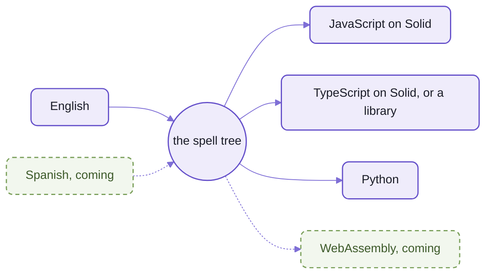
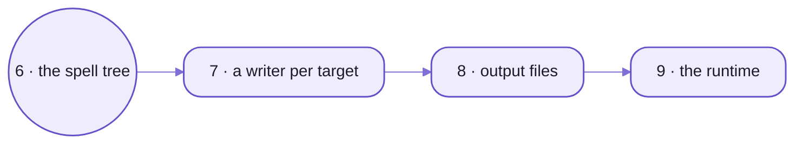

# spell-lang:  English you can run

Spell is English you can run.
Because the source IS English, the person who asked an AI for a program can read what it wrote,
change it, and learn from it:  the AI is a partner first, then a teacher.

What's built today:
- English spell compiles to JavaScript, TypeScript and Python, each written as a person would write it.
- The editor runs a program as you type it ([spell-app](../spell-app/README.md)).
- The parser underneath knows no language at all, so GitHub markdown runs on it too.

What isn't:
no AI feature ships in the editor yet, and English is the only language that parses.
Today an agent writes spell, and you read it.

**Underneath spell is a generic rule-based parser** that's worth a look on its own,
if you've ever fought a parser generator:
- A rule is a class with a syntax string, written in [Rulex](README-rulex.md),
  which reads like a regular expression over words and other rules.
- Scope lets earlier lines teach later ones:
  once a program says `a card is a thing`, the word "card" is a type for every line after it.
- No grammar file, no code generation step:  the rules are the program.
- A second language, GitHub-flavoured markdown, runs on it and passes all 670 of 670 spec examples
  ([README-markdown](README-markdown.md)).
- The parser itself:  [README-parser](README-parser.md).

## FizzBuzz

The whole program, one of the [frozen test projects](tests/spaces/@spell/test/fizzbuzz/FizzBuzz.spell):

```spell
## File FizzBuzz.spell
to play fizzbuzz
	for each number from 1 to 100
		if the number divided by 15 is an integer: print the number, "fizzbuzz"
		otherwise if the number divided by 3 is an integer: print the number, "fizz"
		otherwise if the number divided by 5 is an integer: print the number, "buzz"
		otherwise print the number

play fizzbuzz
```

What it compiles to, from the snapshots the tests check every target against:

<table>
<tr><th>JavaScript</th><th>Python</th></tr>
<tr>
<td>

```js
export function playFizzbuzz() {
  core.getRange(1, 100).forEach((number) => {
    if (core.isOfType(number / 15, "integer"))
      core.console.log(number, "fizzbuzz")
    else if (core.isOfType(number / 3, "integer"))
      core.console.log(number, "fizz")
    else if (core.isOfType(number / 5, "integer"))
      core.console.log(number, "buzz")
    else core.console.log(number)
  })
}

playFizzbuzz()
```

</td>
<td>

```py
def play_fizzbuzz() -> None:
    """File FizzBuzz.spell"""
    for number in range(1, 101):
        if (number / 15).is_integer():
            print(number, "fizzbuzz")
        elif (number / 3).is_integer():
            print(number, "fizz")
        elif (number / 5).is_integer():
            print(number, "buzz")
        else:
            print(number)


play_fizzbuzz()
```

</td>
</tr>
</table>

_One program, three languages out:  the TypeScript is the same as the JavaScript here._

- The JavaScript's long lines are folded here to fit;
  the [JavaScript snapshot](tests/spaces/@spell/test/fizzbuzz/fizzbuzz.snapshot.js) has them whole.
- The [Python snapshot](tests/spaces/@spell/test/fizzbuzz/fizzbuzz.snapshot.py) is checked by pyright, and it finds nothing.
- `core` is [the runtime](README-core.md) compiled JavaScript runs on;
  Python needs it only where it has no word of its own, so FizzBuzz needs none.

## Languages in, targets out

Spell's middle is ONE tree, the spell tree.
Each human language reads into it, and each target writes out of it:
so adding a language or a target is one piece of work, not one per pair.


_N languages plus M targets, never N × M._

<details>
<summary>As text</summary>



</details>

- English is the only language that parses today;  Spanish is a hand translation nothing reads yet (below, "Coming").
- The four targets are built and checked on every frozen test project:  [README-targets](README-targets.md).

## The pipeline

A program goes through the same steps whatever language it's in, or targets it's written to.
Reading:

```mermaid
%%{init: {"theme":"base","themeVariables":{"fontFamily":"-apple-system, BlinkMacSystemFont, Segoe UI, Helvetica, Arial, sans-serif","fontSize":"15px","primaryColor":"#EFECFB","primaryBorderColor":"#6550CA","primaryTextColor":"#1A1C27","secondaryColor":"#F4F1E9","tertiaryColor":"#F7F6FC","lineColor":"#7F6FD6","textColor":"#7F6FD6","clusterBkg":"#F7F6FC","clusterBorder":"#B9B0E8","titleColor":"#1A1C27","edgeLabelBackground":"#F7F6FC","actorBkg":"#EFECFB","actorBorder":"#6550CA","actorTextColor":"#1A1C27","actorLineColor":"#9C90DE","signalColor":"#7F6FD6","signalTextColor":"#7F6FD6","labelBoxBkgColor":"#EFECFB","labelBoxBorderColor":"#6550CA","labelTextColor":"#1A1C27","loopTextColor":"#7F6FD6","noteBkgColor":"#F1E7D4","noteBorderColor":"#C9B48A","noteTextColor":"#1A1C27","activationBkgColor":"#DCD6F7","activationBorderColor":"#6550CA","sequenceNumberColor":"#FFFFFF"},"flowchart":{"curve":"basis","padding":12,"nodeSpacing":40,"rankSpacing":44}}}%%
flowchart LR
  source[1 · source text] --> tokens[2 · tokens]
  tokens --> rules[3 · rules, in Rulex]
  rules --> matching[4 · matching]
  matching --> matches[5 · matches and scope]
  matches --> tree((6 · the spell tree))
  %% the Spell look:  yarn mermaid:pretty
  classDef default fill:#EFECFB,stroke:#6550CA,stroke-width:1.5px,color:#1A1C27,rx:8px,ry:8px
  classDef step fill:#EFECFB,stroke:#6550CA,stroke-width:1.5px,color:#1A1C27,rx:16px,ry:16px
  class source,tokens,rules,matching,matches,tree step
```



_Reading:  text becomes tokens, the rules match them, and each match builds part of the tree._

Writing:



_Writing:  one writer per target turns the same tree into its own language, which runs on its own runtime._

1. **Source text:**  `.spell` files in a project, listed by its project file ([README-spell](README-spell.md)).
2. **Tokens:**  words, numbers, symbols, text in double quotes;
   indentation makes blocks ([README-parser](README-parser.md#1-tokens)).
3. **Rules:**  each a class with a syntax string, compiled once when it's registered ([README-rulex](README-rulex.md)).
4. **Matching:**  every way a line could read is tried;
   the best match wins ([README-parser](README-parser.md#3-matches)).
5. **Matches and scope:**  each line records what it declares, so later lines know the new words
   ([README-parser](README-parser.md#how-earlier-lines-teach-later-ones)).
6. **The spell tree:**  83 kinds of node, saying what was meant, in no target's words
   ([README-parser](README-parser.md#4-the-spell-tree)).
7. **A writer:**  one per target, one method per kind of node ([README-targets](README-targets.md)).
8. **Output files:**  `<Project>.spell.js`, `.spell.tsx`, `.spell.py`, in a build folder never committed
   ([README-spell](README-spell.md#the-compiler)).
9. **The runtime:**  compiled JavaScript imports `@spell/core`, compiled Python `spell_core`
   ([README-core](README-core.md)).

## The pieces

ONE npm package, `spell-lang`, its code in six folders under [src/](src/).
A file's import name is the package's name, then its path under `src/`:
`spell-lang/parser` (a folder's barrel, its `index.ts`), `spell-lang/parser/rules/Rule`, `spell-lang/core/model`.

| Folder | Import | What it is | Its page |
| --- | --- | --- | --- |
| [parser/](src/parser/) | `spell-lang/parser` | the generic rule-based parser:  tokens, rules, matches, scope, the spell tree, the writers | [README-parser](README-parser.md) |
| [parser/rulex/](src/parser/rulex/) | `spell-lang/parser/rulex` | Rulex, the syntax rules are written in:  an opt-in import | [README-rulex](README-rulex.md) |
| [markdown/](src/markdown/) | `spell-lang/markdown` | GitHub-flavoured markdown on the parser, drawing HTML or `ui-*` tags | [README-markdown](README-markdown.md) |
| [spell/](src/spell/) | `spell-lang/spell` | the spell language:  its twenty rule modules, projects, the compiler | [README-spell](README-spell.md) |
| [core/](src/core/) | `spell-lang/core` | the runtime compiled JavaScript runs on | [README-core](README-core.md) |
| [py/](src/py/) | `spell-lang/py` | Python:  the writers that write it, and `spell_core`, what it runs on | [README-targets](README-targets.md) |
| [cli/](src/cli/) | `spell-lang/cli` | the language's `spell` commands:  their names, arguments and help, and the `language` hook's shape | below, [The language commands](#the-language-commands) |

- It stands only on [the kit](../README.md):  its shared helpers and its toolchain.
- How the folders depend on each other:
  - `markdown` and `py` stand on `parser`;  `core` on nothing here
  - `spell` stands on `parser` and `py`, and reads only `core`'s types
  - nothing here imports a repo above it
- The same name works everywhere, inside this repo too:  no aliases, no `../`.
  - [package.json](package.json)'s `exports` maps every name to its file.
- Outside `src/`, and never imported:  `tests/` (at the same paths as the code), `scripts/`, `docs/`, the configs.
- The rules for working in each folder:  its `AGENTS.md` ([the repo's](AGENTS.md) lists them).

### What's NOT here

spell-lang is the language alone.
The tools around it live in [spell-app](../spell-app/README.md), the repo above it:

| What | Where |
| --- | --- |
| the editor and the runner:  `<spell-app>`, `<spell-editor>`, the live loop | spell-app's [app/](../spell-app/app/), [README-app](../spell-app/README-app.md) |
| the language server, and the VS Code extension that runs it | spell-app's [src/lsp/](../spell-app/src/lsp/) and [vscode/](../spell-app/vscode/), [README-lsp](../spell-app/README-lsp.md) |
| projects on disk, their addresses, the editor's server | spell-app's [spaces/](../spell-app/spaces/), [README-spaces](../spell-app/README-spaces.md) |
| the example projects people edit | spell-app's [README-examples](../spell-app/README-examples.md) |
| the `spell` command line's base:  arguments, help, finding commands | the kit's [README-cli](../README-cli.md) |

The language's own commands are this repo's (below):  the command line finds them here.

## Try it in two minutes

You need the kit and its child repos installed, and `spell` on your `PATH`:
[README-cli](../README-cli.md#setting-it-up) says how, from zero.

How spell reads a line:  its match tree, then the JavaScript it compiles to.

```sh
spell parse "print 1 + 2 * 3"
```

```text
statement › print  print 1 + 2 * 3
  Keyword  print
  expressions: Repeat  1 + 2 * 3
    expression  1 + 2 * 3
      lhs: operand › number  1
      Repeat  + 2 * 3
        expression_suffix › plus  + 2
          operator › Symbol  +
          expression: operand › number  2
        expression_suffix › times  * 3
          operator › Symbol  *
          expression: operand › number  3

core.console.log(1 + 2 * 3)
```

What a word means to spell:  the rules it starts, with their syntax and an example.

```sh
spell explain print
```

```text
print  print (operator:info|warning|error|collapsed? group)? [expressions:{expression} ,]
e.g. print "Yo!"
```

Run a program.
Copy FizzBuzz out of the frozen test projects first, so you never edit them:

```sh
mkdir -p try
cp -R ~/www/spell/spell-lang/tests/spaces/@spell/test/fizzbuzz try/fizzbuzz
spell run try/fizzbuzz
```

```text
✓ Compiling @local/try/fizzbuzz
1
2
3 fizz
4
5 buzz
...
15 fizzbuzz
...
```

The same, run as Python (it needs Python 3.12 and uv:  [README-targets](README-targets.md#the-python-half)):

```sh
spell run try/fizzbuzz --target py
```

The output is the same, line for line.
See the Python itself with `spell compile try/fizzbuzz --stdout --target py`.

- A project outside the known groups is named for its folders:  `@local/try/fizzbuzz`.
- Copying keeps snapshot files you don't need:  harmless, or delete the `*snapshot*` files.
- Every command and its options:  [README-cli](../README-cli.md#commands-for-programs).

## The language commands

The `spell` command line takes its language commands from this repo's [cli/](src/cli/) folder:
the kit runs them, from the list in its `package.json`'s `"spell": { "commands" }`.

| Command | What it does |
| --- | --- |
| `spell compile [projects...]` | compiles each project to JavaScript in its build folder, plus its other targets, declarations and words;  `--target`, `--stdout`, `--stale` |
| `spell lint [projects...]` | lists every error as `path:line:col  message`, exiting 1 if there are any |
| `spell watch [projects...]` | recompiles on every save, showing a live list of errors |
| `spell format [projects...]` | tidies the whitespace of `.spell` files, as VS Code's Format Document does |
| `spell run [project]` | compiles a project and runs it under node;  one with a UI opens in your browser;  `--target ts \| py` |
| `spell test [projects...]` | runs each `to test ...` in a project, reporting ✓ or ✗ |
| `spell parse "<text>"` | how spell reads a line:  its match tree, then its JavaScript;  `--tree` for the spell tree |
| `spell repl [project]` | `spell parse` a line at a time:  what a line declares, later lines know |
| `spell explain <word>` | the rules a word names or starts, with their syntax and an example |
| `spell describe [project] [name] [member]` | what a file or project declares, as the editor's Type Explorer shows it |
| `spell speedtest [module]` | times the parser's rule tests;  `--against HEAD` compares with a commit |

- `spell help <command>` has each one's flags.
- Their names before repo-split P13:  `lint` was `spell check`, `speedtest` was `spell speed`;
  `spell explore` is gone (`spell describe` prints the same text).
- Their WORK is spell-app's for now:  each command asks for the `language` hook, which spell-app provides.
  - It loads projects the app's way:  by address (`@spell/examples/drawable-solitaire`), groups, `@here`,
    the "which project?" prompt, the build folder under spell-app's `build/`.
  - It asks the editor's language service, so the command line sees what an editor does.
  - Without spell-app, each command says to clone it, and exits 2.

<details>
<summary>The files in cli/</summary>

| Path | What |
| --- | --- |
| [cli/commands.ts](src/cli/commands.ts) | the list the kit's `spell` loads:  each command's name, arguments, flags and help |
| [cli/cli.types.ts](src/cli/cli.types.ts) | `LanguageCommands`, the `language` hook's shape;  each command's flags |
| [cli/index.ts](src/cli/index.ts) | `spell-lang/cli`:  the types, for spell-app |

</details>

<details>
<summary>Deferred:  moving each command's work down here</summary>

As the epic page's analysis of every command sorted them (repo-split P13, M1):
- What every project command needs first:
  - a loader that reads a project FOLDER by itself, as spell's tests already do (`parseSpellProject()`)
  - spell-app's hooks for what's the app's:  addresses and groups, the build folder, the editor pages after
    `compile` and `lint`, opening a UI project in a browser for `run`
- Then, command by command:
  - `parse`, `repl`:  the parser alone;  only a project argument (`--in`) needs the loader
  - `explain`:  the language service, from spell-app's `lsp`
  - `describe`:  the Type Explorer's builder (`ScopeExplorer`), from spell-app's `lsp`
  - `format`:  the language service's formatting;  its frozen-projects check names spell-lang's own `tests/spaces/`
  - `test`, `watch`:  the loader;  `watch`'s compile step as `compile`'s
  - `speedtest`:  finds spell by its package, not through spaces
  - `compile`, `lint`, `run`:  the loader, plus spell-app's hooks above
- And the progress lists and screens they draw (Ink, today spell-app's `cli/src/ui/`).

</details>

## How spell reads

A spell program is sentences, or an outline:  a heading, then bullets of what's true of it.
The two styles compile to the same code, and a file may mix them.

<table>
<tr><th>Sentences</th><th>An outline</th></tr>
<tr>
<td>

```spell
a card is a thing
cards have a suit as one of clubs, diamonds, hearts or spades
cards have a direction as either up or down
the color of a card is red if its suit is either diamonds or hearts otherwise it is black
a card "is face up" if its direction is up
a card "is a (suit)" for its suits
```

</td>
<td>

```spell
a card is a thing where:
	- it has a suit as one of clubs, diamonds, hearts or spades
	- its direction is up or down
	- its "color" is red if its suit is either diamonds or hearts otherwise it is black
	- it "is face up" if its direction is up
	- it "is a (suit)"
```

</td>
</tr>
</table>

_Both versions print the same for `print the color of the card`, `the card is face up` and `the card is a spade`._

- **Types and things:**  `a card is a thing` makes a type, a JavaScript class or a Python one.
  From then on, `card` is a word every later line knows.
- **Phrases become rules:**  `a card "is face up" if ...` teaches spell a new phrase.
  - `the card is face up` and `the card is not face up` both parse after it.
  - `"is a (suit)"` makes one phrase per suit:  `the card is a spade`, `the card is a heart`.
- **Properties and derived values:**  `cards have a suit as one of ...` is a stored property, with its choices;
  `the color of a card is ...` is worked out each time it's read.
- **Lists count from 1:**  `the first card of the deck`, `card 2 of the deck`, `the position of 30 in the cards`.
  The compiler turns positions into the target's own:
  `card 2 of the deck` becomes `deck.getItem(1)` ([README-core](README-core.md#positions-count-from-1)).
- **Precedence:**  `1 + 2 * 3` is 7, as in school;  `the count is greater than 2 + 1` adds first, then compares.
  `spell parse --tree "print 1 + 2 * 3"` shows the tree:

  ```text
  Print
    args: plus
      lhs: Number 1
      rhs: times
        lhs: Number 2
        rhs: Number 3
  ```

- **Ids and addresses:**  every thing has an `id`, built in, and can be saved as readable JSON by it.
  - `a person is saved in its own file` gives each one its own file;
    so does the bullet `- it is saved in its own file`.
  - A project and its files have addresses:  `@spell/examples/drawable-solitaire/Card.spell`.

Every rule and what each target writes for it:  [README-spell](README-spell.md).

## 🌱 Coming

### Spell in other human languages

The same programs, written in Spanish, then other languages, compiling to the same targets.
A hand translation of the card example works the words out, though nothing parses it yet:
[Card.spell-es](../spell-app/spaces/@spell/examples/outline-solitaire/Card.spell-es), beside the Solitaire example.

```spell
una carta es una cosa
las cartas tienen un palo como uno de tréboles, diamantes, corazones o espadas
el color de una carta es rojo si su palo es diamantes o corazones de lo contrario es negro
```

Where it stands:  the rule classes can already take a second language's syntax strings;  no Spanish rules are written.

### A WebAssembly target

`spell compile --target wasm`:  the part of spell that computes, without drawing, as WebAssembly, FizzBuzz first.

Where it stands:  planned, with its first decisions made ([README-targets](README-targets.md)).

### Mixins, and Spell UI written in spell

"A card is a drawable, sortable thing":  a type that takes its behaviour from several named sources.
Then Spell UI's simpler elements written in spell, compiled ahead to the TypeScript Spell UI ships.

Where it stands:  planned, not started.

### A program on a server, mirrored in the page

A JavaScript program running under node, its page kept in step by id:
the whole state when it opens, then a patch after each change.

Where it stands:  Python programs already work this way ([README-targets](README-targets.md));  JavaScript is next.

### The other direction:  any program, read as spell

An agent reads a program someone already has, in React or Python, and rewrites it as spell,
so the person can read what they have, and change it.

Where it stands:  an idea, not started.

## Working on it

spell-lang is a child repo of [the kit](../README.md):
it's cloned inside the kit, and the kit holds the one install for every repo.
How to set that up, and how the checks, tests and worktrees work across repos:
[README-development](../README-development.md).

At spell-lang's root, each check runs over the whole repo:

```sh
cd ~/www/spell/spell-lang
yarn ts               # the declarations (the kit's, then spell-lang's two programs), then the tests' tsc
yarn test             # Vitest, a project per folder, then py's pytest
yarn lint             # oxlint, then py's ruff;  lint:fix fixes what it can
yarn format           # oxfmt, then ruff format;  format:check only checks
yarn review           # the finishing pass:  ts, lint:fix, format, test
```

- TypeScript sees two programs:
  - [tsconfig.json](tsconfig.json):  the browser-safe code, `parser`, `markdown`, `core`, `py`'s writers and `spell`
  - [tsconfig.node.json](tsconfig.node.json):  what needs node:  the cli, spell's `node/`, the test helpers
- One folder's tests:  `yarn vp test run --project parser`.
- Tests live in `tests/<folder>/`, at the same paths as the code they test (`tests/parser/rules/Rule.test.ts`).
- The frozen test projects, [tests/spaces/@spell/test/](tests/spaces/@spell/test/), pin every target's output:
  [README-spell](README-spell.md#the-frozen-test-projects).
- The folders' own scripts, prefixed with the folder's name:

  | Script | What it does |
  | --- | --- |
  | `yarn spell:test:rules` | every rule module's tests;  `:bless` writes each test's output into its source |
  | `yarn spell:test:fixtures` | the frozen test projects against their snapshots;  `:bless` rewrites them |
  | `yarn spell:gen:syntax` | regenerates the spell syntax table, `spellSyntax.json` |
  | `yarn spell:test:ui`, `spell:test:coverage` | spell's tests in Vitest's UI, or with coverage |
  | `yarn core:gen:declarations` | regenerates the core's method list, `core.declarations.json5` |
  | `yarn markdown:spec:update` | refreshes the GFM spec examples markdown is tested on |

- The rules for working here, for people and agents:  [AGENTS.md](AGENTS.md).

<details>
<summary>The size of the grammar today</summary>

From the generated [spell syntax table](src/spell/spellSyntax.json), as of 2026-10-21:

| Counted | Number |
| --- | --- |
| rule modules | 20 (19 folders, plus the base rules:  block, line, statement) |
| rule classes | 241:  224 rules, 17 base classes no syntax names |
| registered syntaxes | 274 (a rule with several ways to be written is registered once per way) |

- Each syntax comes with an example from its tests, written by the JavaScript, TypeScript and Python writers.
- `yarn spell:gen:syntax` rewrites it, and a test fails until you do after changing a rule.

</details>

<details>
<summary>Where spell came from, in three lines</summary>

- Spell began in 2017 as a "non-programmer programming environment", from a Future of Programming talk:
  a layperson can read a program before they can write one.
- Its lineage is HyperCard ("programming for the rest of us"), SuperCard, Inform and literate programming;
  it aims to fix what HyperCard couldn't:  one platform, no network, a closed file format.
- The 2017 notes are in [spell/thoughts/](docs/spell/thoughts/):  history, not current plans.

</details>

<details>
<summary>Every target and the files it writes</summary>

| Target | What it is | Files it writes | Checked by |
| --- | --- | --- | --- |
| `js/solid` | JavaScript, drawing with Solid;  always compiled, what the editor and `spell run` run | `<Project>.spell.js` | the tests |
| `ts/solid` | TypeScript on the same runtime:  JSX, decorators, types | `<Project>.spell.tsx` | `tsc` |
| `py` | Python on `spell_core`, on asyncio | `<Project>.spell.py`;  a program that draws also `<Project>.elements.spell.js` and `<Project>.app.py` | pyright |
| `ts/lib` | a TypeScript library:  a project's classes alone, for other code to import | `<Project>.lib.ts` | `tsc` |

- Compiled code goes in a build folder, never committed;
  `.lib.ts`, `.app.py`, declarations and words go beside the source.
- More:  [README-targets](README-targets.md).

</details>

<details>
<summary>More in the docs site</summary>

These guides need a checkout with the content folder beside it, and the page server running.

| Guide | Served at |
| --- | --- |
| Spell Syntax:  every rule, drawn from the syntax table | `/guides/spell-syntax/spell-syntax.html` |
| Outline Spell | `/guides/outline-spell.html` |
| Compile Targets | `/guides/compile-targets/compile-targets.html` |
| spell Command Line | `/guides/cli.html` |

</details>

## License

MIT, as spell-lang's [package.json](package.json) says.

## See also

- The pages beside this one:
  [README-parser](README-parser.md), [README-rulex](README-rulex.md), [README-markdown](README-markdown.md),
  [README-spell](README-spell.md), [README-core](README-core.md), [README-targets](README-targets.md)
- The map of the parse pipeline, in detail:  [PARSING.md](src/spell/PARSING.md)
- The editor, spaces and the language server:  [spell-app](../spell-app/README.md)
- The command line:  [README-cli](../README-cli.md)
- The kit, and every repo:  [the kit's README](../README.md)
