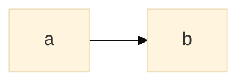
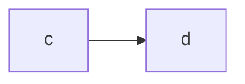

# A fixture page

The house style is WWOD, "What Would Owen Do?";  your group is owen@spell.
A link that works:  [the other page](README-other.md#the-other-page), [this page's heading](#-coming--npm), and
[a heading with code](#ui-root-and-packs).
A link that doesn't:  [missing](README-missing.md), and [a heading that isn't there](README-other.md#nowhere).
A guide:  [into the content folder](../spell.epics/guides/cli.html).

_A caption, so this one passes,
over two lines._

No caption above.

Packed too close

Markdown won't render here.

Until repo-split P14 lands

`$/util` is fine in this fold.

Until repo-split lands, today's names

Outside it, `$/util` is stale;  so is the old monorepo, and Owen by name.
Run `spell serve @spell/examples/solitaire`, not `@spell/test/solitaire`;  see `util/README.md`.

## 🌱 Coming:  npm

## `<ui-root>` and packs

## See also

- [README-other.md](README-other.md)
- Also beside it:  [README-other.md](README-other.md)

The brand pages are internal.
A program written in spell.
