# Spell UI's components

```html
<ui-form>
  <form method="dialog">
    <ui-field>
      <label for="form-first-name-1">First Name</label>
      <ui-input id="form-first-name-1" name="first-name" placeholder="First Name"></ui-input>
    </ui-field>
    <ui-field>
      <label for="form-last-name-2">Last Name</label>
      <ui-input id="form-last-name-2" name="last-name" placeholder="Last Name"></ui-input>
    </ui-field>
    <ui-field>
      <ui-checkbox name="terms">I agree to the Terms and Conditions</ui-checkbox>
    </ui-field>
    <ui-button type="submit">Submit</ui-button>
  </form>
</ui-form>
```


_The first example on Form's docs page, and the picture of it in the catalogue below._

That form is four families, not one:  Form, Input, Checkbox and Button.
Inside a `<ui-root>`, each loads the first time the page uses one of its tags.
Besides the loader and placeholders every root carries, the rest of the library is never fetched.
The form doesn't even import the controls it checks:  it validates whatever it holds, native ones included.

The catalogue below gives every family a line, and the line includes the names other libraries use.
So search this page for the name you already know.
"Datepicker" finds Calendar, "snackbar" finds Toast, and "skeleton" finds Placeholder.
"Drawer" finds two, Flyout and Sidebar, and that one is a real choice ([below](#when-two-families-look-alike)).

## A family is a folder, and a row

A FAMILY is one folder of [`src/components/`](src/components/), and its tags are defined together:
`ui-button/` holds `<ui-button>`, and the `<ui-buttons>` and `<ui-or>` that go with it.
Everything else counts in families.
The root imports one the first time the page uses any of its tags, the catalogue gives it one row,
and its docs page covers every tag in it.

- The root finds a tag's family in a catalog generated from the vocabularies, never guessed from the name:
  `<ui-header>` loads `ui-parts`.
  The whole load, step by step, is on [the front page](README.md#you-write-tags-and-the-root-does-the-importing).
- With no root, import the family yourself, and importing it defines its tags:
  its name, today and 🌱 on npm, is in [the front page's other ways to load](README.md#other-ways-to-load).
- A row works the same from plain HTML or any framework, because each tag is an element:
  [README-frameworks.md](README-frameworks.md) has the rules and the recipes.
- A tag the root can't find stays an unknown element, its text unstyled, but it doesn't fail quietly.
  Misspell one (`<ui-buton>`) and the root fires `ui-error` with the reason `unknown`,
  and the console says `<ui-buton> didn't load (unknown)`.

The groups are Fomantic UI's four, and they sort by what a piece is, not what it's for:
a Dropdown and a Modal are both Modules, because both have behaviour.
Then come the generic content parts, and the families Spell UI added.
- Looking by purpose instead?
  The docs site's nav files every tag under each of its topics:  Date & time, Dialogs, Overlays ...
- A family Spell UI added still files under the Fomantic group its topics name,
  so the last group isn't all of them:  Include sits in Modules, and Tree diagram in Views.
- Coming from Semantic UI or Fomantic UI, you know these groups already;
  [README-migrating.md](README-migrating.md) maps the rest.

What each column holds, and where it stops:
- **Picture:**  the first example on the family's docs page, shot headless and trimmed.
  A blank one means that example is only a button that opens something (Modal, Flyout, Toast, Popup ...)
  or grey placeholder bars (Segment, Grid, Rail ...):  the docs page shows the real thing.
- **Family:**  a link to its docs page, every example live with its markup a click away.
  - The page is plain HTML in [`docs/`](docs/), so on GitHub the link shows its source.
    Served by the page server, from a checkout of the kit, it shows the page
    ([setup from zero](https://github.com/spell-app/spell-kit/blob/main/README.md#setup-from-zero), then [README-site.md](README-site.md)).
  - *(In progress)* marks the two not done yet:  Property Editor and Section.
- **Tags:**  every tag of the family;  one with a docs page of its own is linked (`<ui-textarea>`, `<ui-radio>`).
- **What it is:**  the main tag's one-line description, from its vocabulary.
- **Also called:**  the first four names other libraries and everyday speech give the main tag (its `aka`).
  A vocabulary may hold more (Tree diagram's has nine, "org chart" and "AST" among them),
  and the docs site's search finds every one.

## When two families look alike

A few families are near-twins:  their one-line descriptions could swap rows, and nobody would notice.
Here's what actually separates them.

<details>
<summary>Select, Dropdown or Search:  the browser's own list, a list Spell UI draws, or a query box</summary>


_Their first examples:  a Select, a Dropdown made into a File menu, and a Search._

- **Select** is a native `<select>` in the shadow root:
  keyboard, type-ahead and screen readers get the browser's own behaviour.
  - Where the browser has the customizable select (`appearance: base-select`), Spell UI styles its picker and rich
    options;  elsewhere (Safari before 27, Firefox) it's the plain native picker, in the same closed box.
  - `multiple` makes it a native list box.
- **Dropdown** draws its own combobox and listbox, for what a native select can't do:
  - type to filter (`search`), and offer what was typed as a new option (`allow-additions`)
  - choose several, each shown as a label (`multiple`)
  - be a menu of actions:  its first example is a File menu
- **Search** is a text box with results under it, and its value is the text typed, not a choice from a list.
  - The results come from a `source` property, or from a server through a `url` with `{query}` in it.
  - `category` groups them.
- All three are form controls:  give one a `name`, and a `<form>` submits it.

</details>

<details>
<summary>Modal, Flyout, Sidebar or Dimmer:  mid-page, in from an edge, beside the content, or over one element</summary>

- **Modal** is a `<dialog>` shown with `showModal()`:  in the middle, over everything, the page behind it inert.
- **Flyout** is the same kind of dialog, sliding in from an edge:
  `position` picks left (the default), right, top or bottom.
- **Sidebar** runs along one edge of a `<ui-pushable>`, not the window,
  and moves or dims the `<ui-pusher>` beside it:  `transition` says how (over it, pushing it, from under it ...).
  - So it can live inside a segment, which a dialog in the top layer can't.
  - `persistent` makes it part of the page, an `<aside>`:  nothing dimmed, and focus stays where it was.
- **Dimmer** covers its parent and centres its content over it:
  a busy overlay, or a caption on hover (`show-on="hover"`).
  `page` makes it cover everything, as a modal.
- Escape and a click outside close the first three, a `persistent` sidebar aside;
  `closedby` changes that, as it does on a native `<dialog>`.

</details>

<details>
<summary>Message, Toast, Nag or Popup:  in the flow, for a few seconds, until dismissed, or at one element</summary>


_A Message and a Nag.  Toast and Popup have no picture:  their first examples are buttons that open one._

- **Message** sits in the page beside what it explains, tinted by `state` (`error`, `success` ...);
  `dismissible` adds a close button.
- **Toast** is a short notice that closes itself.
  - `UI.toast({ ... })`, from script, stacks one at the top right and closes it after 3000 ms.
  - A `<ui-toast>` written in the page is an ordinary block, where you put it, until its `display-time` runs out
    (`auto` is reading time, at 120 words a minute).
  - It never takes focus, and its countdown pauses while the pointer or focus is on it.
- **Nag** is a bar that stays until it's dismissed, and can remember that it was:
  `key` names the memory, kept in `localStorage` or a cookie for `expires` days, or in `sessionStorage`.
- **Popup** is anchored to one element (`for`, else the element just before it),
  and opens on hover, focus, click or only from script (`open-on`).
  On hover it stays open while the pointer is over it, so its text can be read and selected.

</details>

<details>
<summary>Segment, Card, Section, Panel or Accordion:  a box, a playing card, or three ways to fold</summary>

<br>


_A Section and a Panel, Spell UI's own:  Fomantic has neither._

- **Segment** groups anything in a box:  `raised`, `piled` or `stacked`;  or no box at all, with `basic`,
  or `vertical` for a band across the page.
- **Card** is a playing card:  an image on top, then content parts (a header, meta, a description),
  then an extra footer.  `href` makes the whole card a link.
- **Section** is a titled block with a real heading, `<h2>` unless it's nested or `level` says otherwise.
  `collapsible` folds it;  `sticky` keeps its title in view while you scroll through it.  It's still in progress.
- **Panel** is a Section dressed as an inspector:  a tinted box of fields under a header band, with sub-heads that
  fold.  It takes every Section attribute.
- **Accordion** is a stack of title and content pairs on the browser's own `<details>`:
  one open at a time unless `exclusive="no"`, and find-in-page opens a closed one.
- Accordion, Section and Panel can each fetch their content from a file the first time it opens (`source`).

</details>

<details>
<summary>Include, Code, Markdown or Embed:  a file from this site, shown three ways, or a frame from another</summary>

- **Include**, **Code** and **Markdown** show text from inside the element, or from a file on the same site
  (`source`).
  - `load` says when to fetch the file:  at once, when the browser is idle, or once it's scrolled into view.
  - Another site's URL is refused, and so is any page opened from disk (`file://`).
  - `save()` writes an edit back, once the page has registered somewhere to save it
    ([README-runtime.md](README-runtime.md)).
- **Include** puts part of another page into this one (`select`, a CSS selector), in a shadow root of its own;
  `page-styles` puts it in the light DOM instead, so the page's stylesheets reach it.
- **Code** colours source by language with highlight.js, and with any language the page registers
  (`UI.code.register()`).
- **Markdown** renders GitHub-flavoured markdown, and `editable` gives it Write and Preview tabs.
  It keeps raw HTML as written:  set `sanitized` for text you didn't write.
- **Embed** frames another site:  a YouTube or Vimeo video by its id, or any `http(s)` URL,
  behind a placeholder until someone clicks it.

</details>

## The catalogue

Every family, by group, A-Z inside each.

<!-- components:start -->

62 families, 104 tags;  2 families in progress.

### Elements

The basic pieces of a page.

| Picture | Family | Tags | What it is | Also called |
| --- | --- | --- | --- | --- |
|  | [Button](docs/ui-button.html) | `<ui-button>` `<ui-buttons>` `<ui-or>` | A button indicates a possible action. | btn, action, submit, link button |
|  | [Container](docs/ui-container.html) | `<ui-container>` | A container limits content to a maximum width. | wrapper, page width, content width |
|  | [Divider](docs/ui-divider.html) | `<ui-divider>` | A divider visually segments content into groups. | separator, hr, horizontal rule, rule |
|  | [Emoji](docs/ui-emoji.html) | `<ui-emoji>` | An emoji is a glyph used to represent something else. | emoticon, smiley, unicode emoji |
|  | [Flag](docs/ui-flag.html) | `<ui-flag>` | A flag is used to represent a political state. | country flag, country, locale flag |
|  | [Icon](docs/ui-icon.html) | `<ui-icon>` `<ui-icons>` | An icon is a glyph used to represent something else. | glyph, symbol, font awesome, svg icon |
|  | [Image](docs/ui-image.html) | `<ui-image>` `<ui-images>` | An image is a graphic representation of something. | picture, img, photo, avatar |
|  | [Input](docs/ui-input.html) | `<ui-input>` [`<ui-textarea>`](docs/ui-textarea.html) | An input is a field used to elicit a response from a person. | text field, text box, textbox, input field |
|  | [Label](docs/ui-label.html) | `<ui-label>` `<ui-labels>` | A label displays content classification. | badge, chip, tag, pill |
|  | [List](docs/ui-list.html) | `<ui-list>` | A list groups related content. | ul, ol, bullet list, list view |
|  | [Loader](docs/ui-loader.html) | `<ui-loader>` | A loader tells people to wait for an activity to complete. | spinner, loading indicator, busy, throbber |
|  | [Placeholder](docs/ui-placeholder.html) | `<ui-placeholder>` `<ui-placeholder-header>` `<ui-placeholder-image>` `<ui-placeholder-line>` `<ui-placeholder-paragraph>` | A placeholder is used to reserve space for content that soon will appear in a layout. | skeleton, shimmer, ghost, loading placeholder |
|  | [Rail](docs/ui-rail.html) | `<ui-rail>` | A rail is used to show accompanying content outside the boundaries of the main view of a site. | side rail, aside, gutter, margin column |
|  | [Reveal](docs/ui-reveal.html) | `<ui-reveal>` | A reveal displays additional content in place of previous content when activated. | hover reveal, flip, slide reveal, overlay image |
|  | [Segment](docs/ui-segment.html) | `<ui-segment>` `<ui-segments>` | A segment is used to create a grouping of related content. | panel, box, section, well |
|  | [Step](docs/ui-step.html) | `<ui-step>` `<ui-steps>` | One step of a set of steps. | wizard step, stage |
|  | [Text](docs/ui-text.html) | `<ui-text>` | A text is used to style some inline text with a simple color. | span, inline text, colored text, label text |

### Collections

Pieces made of several kinds of part.

| Picture | Family | Tags | What it is | Also called |
| --- | --- | --- | --- | --- |
|  | [Breadcrumb](docs/ui-breadcrumb.html) | `<ui-breadcrumb>` `<ui-breadcrumb-section>` | A breadcrumb is used to show hierarchy between content. | crumbs, path, trail, location |
|  | [Form](docs/ui-form.html) | `<ui-form>` `<ui-field>` `<ui-fields>` `<ui-repeat>` | A form displays a set of related input fields in a structured way. | form layout, fieldset, validation |
|  | [Grid](docs/ui-grid.html) | `<ui-grid>` `<ui-column>` `<ui-row>` | A grid is used to harmonize negative space in a layout. | columns, row, flex grid, layout grid |
|  | [Menu](docs/ui-menu.html) | `<ui-menu>` | A menu displays grouped navigation actions. | navbar, nav, tabs bar, toolbar |
|  | [Message](docs/ui-message.html) | `<ui-message>` | A message displays information that explains nearby content. | alert, callout, notice, banner |
|  | [Property Editor](docs/ui-property-editor.html) *(In progress)* | `<ui-property-editor>` `<ui-property>` `<ui-property-group>` | A property editor draws a form from a schema:  one field per property, in folding groups, for one thing or many. | inspector, property sheet, properties panel, settings form |
|  | [Table](docs/ui-table.html) | `<ui-table>` | A table displays a collection of data grouped into rows. | data table, data grid, grid, spreadsheet |

### Views

Ways to present a kind of content.

| Picture | Family | Tags | What it is | Also called |
| --- | --- | --- | --- | --- |
|  | [Advertisement](docs/ui-ad.html) | `<ui-ad>` | An ad displays third-party promotional content. | advertisement, banner ad, ad slot |
|  | [Card](docs/ui-card.html) | `<ui-card>` `<ui-cards>` | A card displays site content in a manner similar to a playing card. | tile, panel, profile card |
|  | [Comment](docs/ui-comment.html) | `<ui-comment>` `<ui-comments>` | One comment:  who wrote it, when, what, and the replies to it. | reply, post, message |
|  | [Feed](docs/ui-feed.html) | `<ui-feed>` `<ui-event>` | A feed presents people's activity chronologically. | activity feed, timeline, news feed, activity stream |
|  | [Item](docs/ui-item.html) | `<ui-item>` | An item of a dropdown, list, menu or Items view. | list item, media object, row |
|  | [Items](docs/ui-items.html) | `<ui-items>` | A group of items:  site content, each an image beside its header, meta, description and extra. | item list, media list, product list, results |
|  | [Statistic](docs/ui-statistic.html) | `<ui-statistic>` `<ui-statistics>` | A statistic emphasizes the current value of an attribute. | stat, kpi, metric, counter |
|  | [Tree diagram](docs/ui-tree-diagram.html) | `<ui-tree-diagram>` | A tree diagram draws a tree top-down:  a box for each node, a line to each of its children. | tree, tree chart, hierarchy, hierarchy diagram |

### Modules

Elements with behaviour:  they open, pick, move.

| Picture | Family | Tags | What it is | Also called |
| --- | --- | --- | --- | --- |
|  | [Accordion](docs/ui-accordion.html) | `<ui-accordion>` | An accordion lets people show and hide sections of content. | collapse, collapsible, disclosure, expander |
|  | [Calendar](docs/ui-calendar.html) | `<ui-calendar>` | A calendar lets a person pick a date, a time, or both. | date picker, datepicker, time picker, datetime |
|  | [Checkbox](docs/ui-checkbox.html) | `<ui-checkbox>` [`<ui-radio>`](docs/ui-radio.html) | A checkbox lets people choose a value from a small set of options, often on or off. | check box, toggle, switch, tick box |
|  | [Components](docs/ui-components.html) | `<ui-components>` | Components name a pack of another package's elements, which the root around them loads on demand, once per page. | component pack, plugin, extension, custom elements |
|  | [Dimmer](docs/ui-dimmer.html) | `<ui-dimmer>` | A dimmer hides distractions to focus attention on particular content. | overlay, backdrop, scrim, mask |
|  | [Dropdown](docs/ui-dropdown.html) | `<ui-dropdown>` | A dropdown lets people choose a value from a series of options. | select, combobox, picker, autocomplete |
|  | [Embed](docs/ui-embed.html) | `<ui-embed>` | An embed displays content from other websites, like YouTube videos, loaded only when asked for. | iframe, video, youtube, vimeo |
|  | [Flyout](docs/ui-flyout.html) | `<ui-flyout>` | A flyout is a modal that slides in from a side of the page. | drawer, sheet, side panel, off canvas |
|  | [Include](docs/ui-include.html) | `<ui-include>` | An include shows part of another page from this site in this one, loaded at once, when idle or when scrolled into view. | island, partial, fragment, server-side include |
|  | [Modal](docs/ui-modal.html) | `<ui-modal>` | A modal displays content that temporarily blocks interactions with the main view of a site. | dialog, popup window, lightbox, confirm |
|  | [Nag](docs/ui-nag.html) | `<ui-nag>` | A nag is a persistent message that stays until dismissed, and can remember the dismissal. | banner, cookie notice, announcement bar, sticky banner |
|  | [Popup](docs/ui-popup.html) | `<ui-popup>` | A popup displays additional information on top of a page. | tooltip, popover, hint, hover card |
|  | [Progress](docs/ui-progress.html) | `<ui-progress>` | A progress bar shows the progression of a task. | progress bar, meter, percent bar, upload progress |
|  | [Rating](docs/ui-rating.html) | `<ui-rating>` | A rating indicates people's interest in content. | stars, star rating, score, review stars |
|  | [Search](docs/ui-search.html) | `<ui-search>` | A search module lets people query for results from a selection of data. | autocomplete, typeahead, search box, combobox |
|  | [Select](docs/ui-select.html) | `<ui-select>` | A select lets people choose one or more values from a native list of options. | select box, native select, picker, option list |
|  | [Shape](docs/ui-shape.html) | `<ui-shape>` `<ui-side>` | A shape is a three dimensional object displayed on a two dimensional plane. | 3d flip, cube, flip card, carousel |
|  | [Sidebar](docs/ui-sidebar.html) | `<ui-sidebar>` `<ui-pushable>` `<ui-pusher>` | A sidebar hides additional content beside a page. | drawer, off canvas, side menu, nav drawer |
|  | [Slider](docs/ui-slider.html) | `<ui-slider>` | A slider lets people select values within a range. | range, range slider, volume, scrubber |
|  | [Sticky](docs/ui-sticky.html) | `<ui-sticky>` | Sticky content stays fixed to the viewport while its container is on screen. | affix, pinned, fixed header, sticky header |
|  | [Tab](docs/ui-tab.html) | `<ui-tab>` `<ui-tabs>` | A tab pane:  the content shown while its tab is selected. | tab panel, pane |
|  | [Toast](docs/ui-toast.html) | `<ui-toast>` | A toast gives people a short, non-blocking notification. | snackbar, notification, growl, flash message |
|  | [Transition](docs/ui-transition.html) | `<ui-transition>` | A transition is an animation used to show or hide content, or to draw attention to it. | animate, fade, slide, motion |
|  | [Visibility](docs/ui-visibility.html) | `<ui-visibility>` | Visibility provides a set of callbacks for when content appears in the viewport. | scroll spy, in view, intersection, lazy load |

### The generic content parts

One set of parts for every owner:  each styles itself by what it's in, a card, an item, a comment ...

| Picture | Family | Tags | What it is | Also called |
| --- | --- | --- | --- | --- |
|  | [Content parts](docs/ui-header.html) | `<ui-header>` [`<ui-actions>`](docs/ui-actions.html) [`<ui-author>`](docs/ui-author.html) [`<ui-avatar>`](docs/ui-avatar.html) [`<ui-content>`](docs/ui-content.html) [`<ui-date>`](docs/ui-date.html) [`<ui-description>`](docs/ui-description.html) [`<ui-detail>`](docs/ui-detail.html) [`<ui-extra>`](docs/ui-extra.html) [`<ui-meta>`](docs/ui-meta.html) [`<ui-summary>`](docs/ui-summary.html) [`<ui-title>`](docs/ui-title.html) [`<ui-value>`](docs/ui-value.html) | A header provides a short summary of content. | heading, title, h1, headline |

### Spell UI's own

Elements with no Fomantic counterpart.

| Picture | Family | Tags | What it is | Also called |
| --- | --- | --- | --- | --- |
|  | [Code](docs/ui-code.html) | `<ui-code>` | Code shows a block of source code coloured by its language, from the element's own text or a file on this site. | code block, syntax highlighting, highlighter, pre |
|  | [Markdown](docs/ui-markdown.html) | `<ui-markdown>` | Markdown renders GitHub-flavoured markdown -- tables, task lists, code blocks -- from the element's own text or a file on this site. | markdown, md, gfm, readme |
|  | [Panel](docs/ui-panel.html) | `<ui-panel>` | A panel is an inspector:  a tinted box of fields under a header band, with sub-head bands that fold.  It takes every `<ui-section>` attribute. | inspector, property panel, properties, settings panel |
|  | [Root](docs/ui-root.html) | `<ui-root>` | A root loads the components inside it on demand, sets their theme and size, and shows them once they're ready. | app shell, app root, provider, loader |
|  | [Section](docs/ui-section.html) *(In progress)* | `<ui-section>` `<ui-sections>` | A section is a titled block of content that can fold away and keep its title in view. | section, panel, collapsible, disclosure |

<details>
<summary>The docs site's own elements:  8 families, never in the library</summary>

| Family | Tags | What it is | Also called |
| --- | --- | --- | --- |
| Docs api | `<ui-docs-api>` | An API reference lists a tag's attributes, properties, events, slots, parts, states and texts as tables, from the site's generated data;  for a function component, its props and where it's drawn. | api reference, api table, props table, properties table |
| Docs example | `<ui-docs-example>` | An example shows its own markup live, under a header and description, with the same markup as code a button shows and hides. | example, demo, live example, code sample |
| Docs inspector | `<ui-docs-inspector>` | An inspector shows another element's attributes, properties and custom states, live:  click the element, and watch them change. | inspector, element inspector, devtools, live properties |
| Docs nav | `<ui-docs-nav>` | A docs nav is a panel listing the site's pages and every component, A-Z or by topic, in folding groups, with search and favourites;  the current page is highlighted and scrolled into view. | sidebar, table of contents, toc, site nav |
| Docs search | `<ui-docs-search>` | A docs search is a field that finds sections of the page shown, components, attributes and every page's sections as you type, and jumps to the one you pick;  `/` or Cmd / Ctrl+K focuses it from anywhere. | site search, docs search, quick find, jump to |
| Docs table of contents | `<ui-docs-toc>` | A table of contents lists the page's sections and examples as links, opens the one in view and follows the scroll. | table of contents, on this page, page index, scrollspy |
| Docs themes | `<ui-docs-themes>` | Theme controls switch the page between light and dark, and pick its theme, and remember both for the next page. | theme picker, theme switcher, dark mode toggle, colour scheme |
| Docs tokens | `<ui-docs-tokens>` | A token table lists the CSS custom properties of a component family, or of the whole foundation, with their defaults and a live swatch for each colour;  a playground adds inputs that restyle a live preview. | css variables, custom properties, design tokens, theme tokens |

</details>
<!-- components:end -->

## How a family is laid out

Every family folder holds the same files, each named for its component:
read one family, and you can find your way around all of them.

| File | What it is |
| --- | --- |
| `UI<Name>.tsx` | the component:  one class per tag (`UIButton.tsx`, `UIButtons.tsx`, `UIOr.tsx`), its state and its `render()` into the shadow root;  a family's own DOM element class, `DOM<Name>Element`, sits above it in the same file |
| `index.ts` | the family's barrel:  defines every tag (a side effect) and re-exports the classes;  also the family's entry, `spell-ui/ui-<name>` (`spell-ui/components/ui-<name>` inside the repos) |
| `UI<Name>.css` | its sheet, a port of Fomantic's `.less` and `.variables`, in layers |
| `UI<Name>.en.ts` | the VOCABULARY, one per tag:  every name the tag uses (attributes and their values, events, slots, parts, states, texts), plus `topics`, `aka` and `skeleton` |
| `UI<Name>.types.ts` | constants and types several of its files share |
| `UI<Name>.fallback.ts` | the plain-DOM stand-in shown if the render throws:  form controls only, nine families today |
| `examples/*.html` | Fomantic's examples in class grammar (`<div class="ui primary button">`), for the CSS tests and the site |
| `examples/elements/*.html` | the same examples as `ui-*` markup:  what the demo (`yarn dev`), the visual tests, the accessibility checks and the kitchen sink run |
| tests | at the same path under [`tests/components/`](tests/components/):  the component (axe passes on every element example), its sheet, its fallback, its static render;  speed, for Button and Dropdown |

### Adding a family, step by step

Seven steps, run from `spell-ui/`;  four of them have a test that fails until they're done.

1. Make the folder, `ui-<name>/` in [the components folder](src/components/), laid out like `ui-button/` (above).
2. Write one vocabulary per tag, `UI<Name>.en.ts`, with the two fields this page reads:
   - `topics`:  two or more ids from `ValueSets.topics`, how a newcomer looks for it.
     The Fomantic group among them (`elements`, `collections`, `views`, `modules`) is the group it files under here.
   - `aka`:  other libraries' and everyday names (`<ui-modal>` is also "dialog" and "lightbox"):
     the Also called column.
   - [The component definitions test](tests/components/ComponentDefinitions.test.ts) fails on a tag without them.
3. Make it a library entry:
   - `COMPONENTS` in [vite.config.ts](vite.config.ts)
   - in [package.json](package.json):  its barrel's own key in `exports` (`"./components/ui-<name>"`;
     [the package exports test](tests/tools/PackageExports.test.ts) fails without it), its short published name in
     `publishConfig.exports` (`"./ui-<name>"`), and its `dist/` file in `sideEffects`
   - re-export it from [the package's entry](src/index.ts)
4. `yarn gen:root`:  the root's catalog of tag → family.
   [Its test](tests/components/ui-root/UIRoot.catalog.test.ts) fails while it's stale.
5. `yarn site:data`:  the docs site's data.
   [Its test](tests/tools/SiteDataBuilder.test.ts) fails while it's stale.
   - Add the family's facts to [the pages data](docs/__data/pages.json5).
6. `yarn site:new <tag>`:  its docs page, from the template
   ([README-site.md](README-site.md#writing-a-page--start-from-the-model-write-it-flat) has today's catch).
   Then `yarn site:build`, and `yarn site:check <tag>`.
7. `yarn readme:components`:  its row in the catalogue (below).

<details>
<summary>How an element is written, in more depth</summary>

- The two objects behind every tag (the DOM element and the component), the decorators and the lifecycle:
  the kit's element framework, [README-element.md](https://github.com/spell-app/spell-kit/blob/main/README-element.md).
- What's under every element (the shared runtime, vocabularies, icons, styles):  [README-runtime.md](README-runtime.md).
- The rules for writing one (house style, imports, the lint guard):
  [AGENTS.md](AGENTS.md), "A family's files" and "Solid authoring".

</details>

## Written from the data

Nobody types these tables.
`yarn readme:components` writes them from the same data the docs site reads, between this page's markers,
and leaves the rest of the page alone.

```mermaid
%%{init: {"theme":"base","themeVariables":{"fontFamily":"-apple-system, BlinkMacSystemFont, Segoe UI, Helvetica, Arial, sans-serif","fontSize":"15px","primaryColor":"#EFECFB","primaryBorderColor":"#6550CA","primaryTextColor":"#1A1C27","secondaryColor":"#F4F1E9","tertiaryColor":"#F7F6FC","lineColor":"#7F6FD6","textColor":"#7F6FD6","clusterBkg":"#F7F6FC","clusterBorder":"#B9B0E8","titleColor":"#1A1C27","edgeLabelBackground":"#F7F6FC","actorBkg":"#EFECFB","actorBorder":"#6550CA","actorTextColor":"#1A1C27","actorLineColor":"#9C90DE","signalColor":"#7F6FD6","signalTextColor":"#7F6FD6","labelBoxBkgColor":"#EFECFB","labelBoxBorderColor":"#6550CA","labelTextColor":"#1A1C27","loopTextColor":"#7F6FD6","noteBkgColor":"#F1E7D4","noteBorderColor":"#C9B48A","noteTextColor":"#1A1C27","activationBkgColor":"#DCD6F7","activationBorderColor":"#6550CA","sequenceNumberColor":"#FFFFFF"},"flowchart":{"curve":"basis","padding":12,"nodeSpacing":40,"rankSpacing":44}}}%%
flowchart LR
  vocab["every tag's vocabulary"] -->|yarn site:data| data["the site's data"]
  facts["the hand-kept page facts"] -->|yarn site:data| data
  data --> site["the docs site"]
  data -->|yarn readme:components| catalogue["this page"]
  site -->|shot headless| pictures["the pictures"]
  pictures --> catalogue
  %% the Spell look:  yarn mermaid:pretty
  classDef default fill:#EFECFB,stroke:#6550CA,stroke-width:1.5px,color:#1A1C27,rx:8px,ry:8px
  classDef data fill:#F1E7D4,stroke:#C9B48A,stroke-width:1.5px,color:#1A1C27,rx:2px,ry:2px
  class data data
```



_The pictures come from the site itself, so a row shows what its docs page draws._

The data is two files:  [`components.json5`](docs/__data/components.json5), which `yarn site:data` writes
from every vocabulary, and the hand-kept [`pages.json5`](docs/__data/pages.json5) beside it, with titles and status.
So rerun `yarn readme:components` after `yarn site:data`.
Nothing runs it for you:  `yarn readme:components --check` fails while this page is stale,
but no test or CI step calls it, so a new family's row waits for the recipe's last step.

The pictures are PNGs in [the components' images folder](docs/images/components/), one per family that has one.
- `yarn readme:components --shoot <docs site address> [family ...]` retakes them headless from the docs site:
  each family page's first example, trimmed.
  No family named:  every family that has a picture already.
- Delete a picture to drop it from the table;  name a family to add one.

<details>
<summary>Taking the pictures:  the command, as run for this page</summary>

The docs site must be served first, since the command doesn't start the page server
([README-site.md](README-site.md), "Viewing it").

```sh
cd ~/www/spell/spell-ui
yarn readme:components --shoot http://localhost:4747/components/ui/
```

- One line per family, `thumbnail:  ui-button`;
  a family whose first example draws nothing says why and keeps its old picture.
- The pictures are light scheme, at the browser's normal size, in Playwright's Chromium.

</details>

## See also

- [README.md](README.md):  Spell UI's front page, with `<ui-root>`, how a page loads these families, and installing
- [README-frameworks.md](README-frameworks.md):  using any of these from React, Vue, Solid or plain JavaScript
- [README-site.md](README-site.md):  serving the docs site every Family link opens, and the tools that build it
- [README-runtime.md](README-runtime.md):  the vocabularies behind every row, and the runtime every element shares
- [README-themes.md](README-themes.md):  restyling a family through its tokens, or every family with a theme
