# Spell UI's components

Every component family, by group, one line each:  its tags, what it is, the names other libraries give it,
and a picture of its first example where a picture says more than the line.
Each family links to its page on the docs site, where every example is live.

- A FAMILY is one folder of `components/` (`ui-button/`):
  its main tag (`<ui-button>`) and the tags that go with it (`<ui-buttons>`, `<ui-or>`).
  - Each family is its own entry, `spell-ui/ui-button`:
    [`<ui-root>`](README.md#ui-root) loads it the first time one of its tags appears.
- The groups are Fomantic UI's four, as the docs site's kitchen sink files them, then the generic content parts,
  then the elements Spell UI added.
- The pages are plain HTML in [`docs/`](docs/):
  on GitHub a link shows the page's source;  served ([README-site.md](README-site.md)), it shows the page.

```mermaid
%%{init: {"theme":"base","themeVariables":{"fontFamily":"-apple-system, BlinkMacSystemFont, Segoe UI, Helvetica, Arial, sans-serif","fontSize":"15px","primaryColor":"#EFECFB","primaryBorderColor":"#6550CA","primaryTextColor":"#1A1C27","secondaryColor":"#F4F1E9","tertiaryColor":"#F7F6FC","lineColor":"#7F6FD6","textColor":"#7F6FD6","clusterBkg":"#F7F6FC","clusterBorder":"#B9B0E8","titleColor":"#1A1C27","edgeLabelBackground":"#F7F6FC","actorBkg":"#EFECFB","actorBorder":"#6550CA","actorTextColor":"#1A1C27","actorLineColor":"#9C90DE","signalColor":"#7F6FD6","signalTextColor":"#7F6FD6","labelBoxBkgColor":"#EFECFB","labelBoxBorderColor":"#6550CA","labelTextColor":"#1A1C27","loopTextColor":"#7F6FD6","noteBkgColor":"#F1E7D4","noteBorderColor":"#C9B48A","noteTextColor":"#1A1C27","activationBkgColor":"#DCD6F7","activationBorderColor":"#6550CA","sequenceNumberColor":"#FFFFFF"},"flowchart":{"curve":"basis","padding":12,"nodeSpacing":40,"rankSpacing":44}}}%%
flowchart LR
  vocab["each tag's vocabulary"] --> data["the site's data"]
  data --> site["the docs site"]
  data --> catalogue["this page"]
  site --> pictures["thumbnails"]
  pictures --> catalogue
  %% the Spell look:  yarn mermaid:pretty
  classDef default fill:#EFECFB,stroke:#6550CA,stroke-width:1.5px,color:#1A1C27,rx:8px,ry:8px
  classDef data fill:#F1E7D4,stroke:#C9B48A,stroke-width:1.5px,color:#1A1C27,rx:2px,ry:2px
  class data data
```

_This page is generated:  from the same data as the docs site, with pictures taken from the site itself._

## The catalogue

<!-- components:start -->

62 families, 104 tags;  2 families in progress.

### Elements

The basic pieces of a page.

| Picture | Family | Tags | What it is | Also called |
| --- | --- | --- | --- | --- |
| 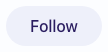 | [Button](docs/ui-button.html) | `<ui-button>` `<ui-buttons>` `<ui-or>` | A button indicates a possible action. | btn, action, submit, link button |
|  | [Container](docs/ui-container.html) | `<ui-container>` | A container limits content to a maximum width. | wrapper, page width, content width |
|  | [Divider](docs/ui-divider.html) | `<ui-divider>` | A divider visually segments content into groups. | separator, hr, horizontal rule, rule |
| 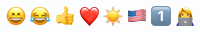 | [Emoji](docs/ui-emoji.html) | `<ui-emoji>` | An emoji is a glyph used to represent something else. | emoticon, smiley, unicode emoji |
| 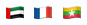 | [Flag](docs/ui-flag.html) | `<ui-flag>` | A flag is used to represent a political state. | country flag, country, locale flag |
| 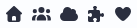 | [Icon](docs/ui-icon.html) | `<ui-icon>` `<ui-icons>` | An icon is a glyph used to represent something else. | glyph, symbol, font awesome, svg icon |
|  | [Image](docs/ui-image.html) | `<ui-image>` `<ui-images>` | An image is a graphic representation of something. | picture, img, photo, avatar |
| 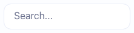 | [Input](docs/ui-input.html) | `<ui-input>` [`<ui-textarea>`](docs/ui-textarea.html) | An input is a field used to elicit a response from a person. | text field, text box, textbox, input field |
| 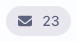 | [Label](docs/ui-label.html) | `<ui-label>` `<ui-labels>` | A label displays content classification. | badge, chip, tag, pill |
| 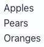 | [List](docs/ui-list.html) | `<ui-list>` | A list groups related content. | ul, ol, bullet list, list view |
| 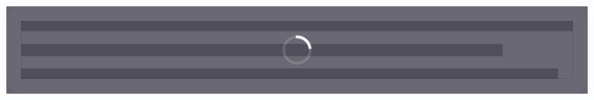 | [Loader](docs/ui-loader.html) | `<ui-loader>` | A loader tells people to wait for an activity to complete. | spinner, loading indicator, busy, throbber |
| 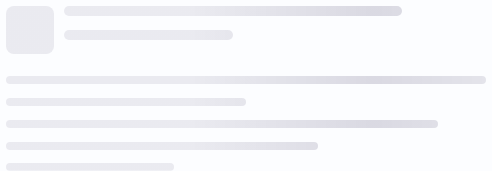 | [Placeholder](docs/ui-placeholder.html) | `<ui-placeholder>` `<ui-placeholder-header>` `<ui-placeholder-image>` `<ui-placeholder-line>` `<ui-placeholder-paragraph>` | A placeholder is used to reserve space for content that soon will appear in a layout. | skeleton, shimmer, ghost, loading placeholder |
|  | [Rail](docs/ui-rail.html) | `<ui-rail>` | A rail is used to show accompanying content outside the boundaries of the main view of a site. | side rail, aside, gutter, margin column |
|  | [Reveal](docs/ui-reveal.html) | `<ui-reveal>` | A reveal displays additional content in place of previous content when activated. | hover reveal, flip, slide reveal, overlay image |
|  | [Segment](docs/ui-segment.html) | `<ui-segment>` `<ui-segments>` | A segment is used to create a grouping of related content. | panel, box, section, well |
| 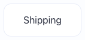 | [Step](docs/ui-step.html) | `<ui-step>` `<ui-steps>` | One step of a set of steps. | wizard step, stage |
| 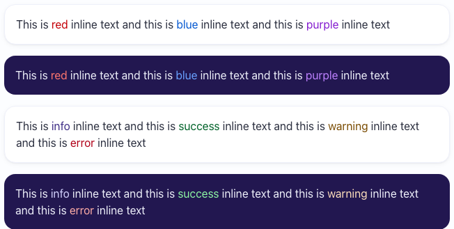 | [Text](docs/ui-text.html) | `<ui-text>` | A text is used to style some inline text with a simple color. | span, inline text, colored text, label text |

### Collections

Pieces made of several kinds of part.

| Picture | Family | Tags | What it is | Also called |
| --- | --- | --- | --- | --- |
| 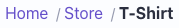 | [Breadcrumb](docs/ui-breadcrumb.html) | `<ui-breadcrumb>` `<ui-breadcrumb-section>` | A breadcrumb is used to show hierarchy between content. | crumbs, path, trail, location |
| 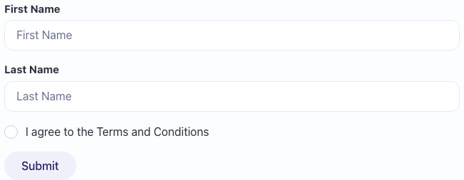 | [Form](docs/ui-form.html) | `<ui-form>` `<ui-field>` `<ui-fields>` `<ui-repeat>` | A form displays a set of related input fields in a structured way. | form layout, fieldset, validation |
|  | [Grid](docs/ui-grid.html) | `<ui-grid>` `<ui-column>` `<ui-row>` | A grid is used to harmonize negative space in a layout. | columns, row, flex grid, layout grid |
| 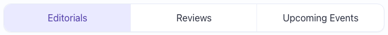 | [Menu](docs/ui-menu.html) | `<ui-menu>` | A menu displays grouped navigation actions. | navbar, nav, tabs bar, toolbar |
| 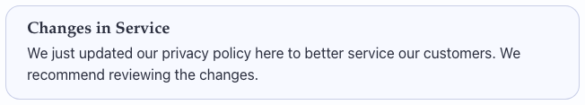 | [Message](docs/ui-message.html) | `<ui-message>` | A message displays information that explains nearby content. | alert, callout, notice, banner |
| 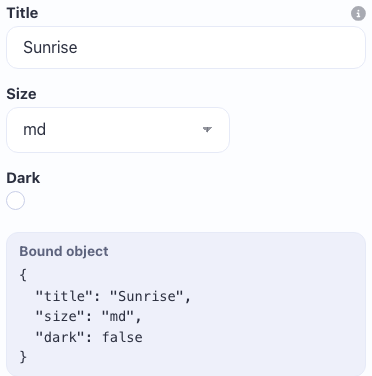 | [Property Editor](docs/ui-property-editor.html) *(In progress)* | `<ui-property-editor>` `<ui-property>` `<ui-property-group>` | A property editor draws a form from a schema:  one field per property, in folding groups, for one thing or many. | inspector, property sheet, properties panel, settings form |
| 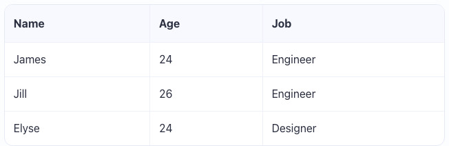 | [Table](docs/ui-table.html) | `<ui-table>` | A table displays a collection of data grouped into rows. | data table, data grid, grid, spreadsheet |

### Views

Ways to present a kind of content.

| Picture | Family | Tags | What it is | Also called |
| --- | --- | --- | --- | --- |
|  | [Advertisement](docs/ui-ad.html) | `<ui-ad>` | An ad displays third-party promotional content. | advertisement, banner ad, ad slot |
| 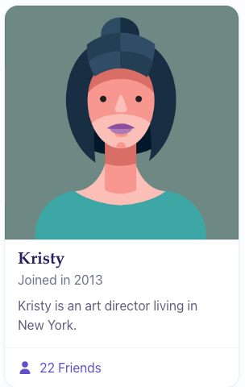 | [Card](docs/ui-card.html) | `<ui-card>` `<ui-cards>` | A card displays site content in a manner similar to a playing card. | tile, panel, profile card |
| 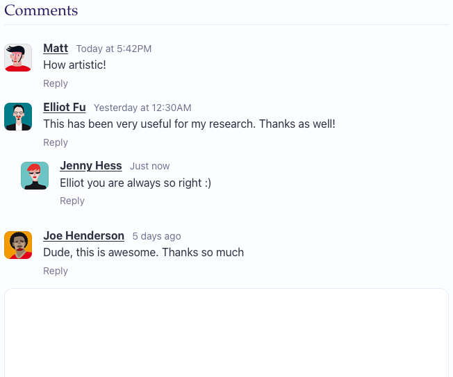 | [Comment](docs/ui-comment.html) | `<ui-comment>` `<ui-comments>` | One comment:  who wrote it, when, what, and the replies to it. | reply, post, message |
| 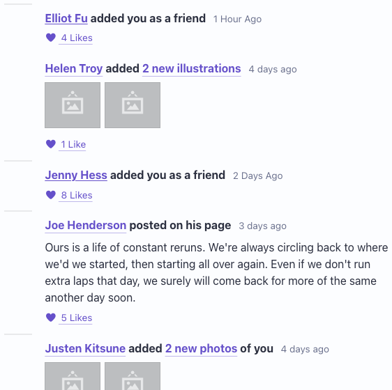 | [Feed](docs/ui-feed.html) | `<ui-feed>` `<ui-event>` | A feed presents people's activity chronologically. | activity feed, timeline, news feed, activity stream |
|  | [Item](docs/ui-item.html) | `<ui-item>` | An item of a dropdown, list, menu or Items view. | list item, media object, row |
| 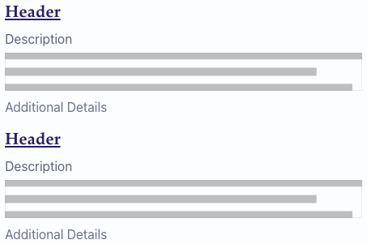 | [Items](docs/ui-items.html) | `<ui-items>` | A group of items:  site content, each an image beside its header, meta, description and extra. | item list, media list, product list, results |
| 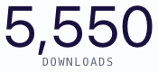 | [Statistic](docs/ui-statistic.html) | `<ui-statistic>` `<ui-statistics>` | A statistic emphasizes the current value of an attribute. | stat, kpi, metric, counter |
| 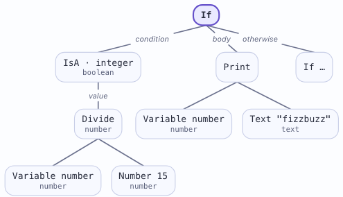 | [Tree diagram](docs/ui-tree-diagram.html) | `<ui-tree-diagram>` | A tree diagram draws a tree top-down:  a box for each node, a line to each of its children. | tree, tree chart, hierarchy, hierarchy diagram |

### Modules

Elements with behaviour:  they open, pick, move.

| Picture | Family | Tags | What it is | Also called |
| --- | --- | --- | --- | --- |
| 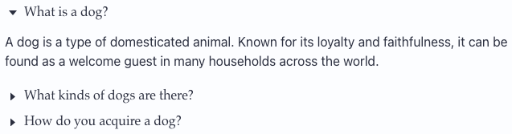 | [Accordion](docs/ui-accordion.html) | `<ui-accordion>` | An accordion lets people show and hide sections of content. | collapse, collapsible, disclosure, expander |
|  | [Calendar](docs/ui-calendar.html) | `<ui-calendar>` | A calendar lets a person pick a date, a time, or both. | date picker, datepicker, time picker, datetime |
| 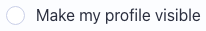 | [Checkbox](docs/ui-checkbox.html) | `<ui-checkbox>` [`<ui-radio>`](docs/ui-radio.html) | A checkbox lets people choose a value from a small set of options, often on or off. | check box, toggle, switch, tick box |
|  | [Components](docs/ui-components.html) | `<ui-components>` | Components name a pack of another package's elements, which the root around them loads on demand, once per page. | component pack, plugin, extension, custom elements |
|  | [Dimmer](docs/ui-dimmer.html) | `<ui-dimmer>` | A dimmer hides distractions to focus attention on particular content. | overlay, backdrop, scrim, mask |
| 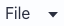 | [Dropdown](docs/ui-dropdown.html) | `<ui-dropdown>` | A dropdown lets people choose a value from a series of options. | select, combobox, picker, autocomplete |
| 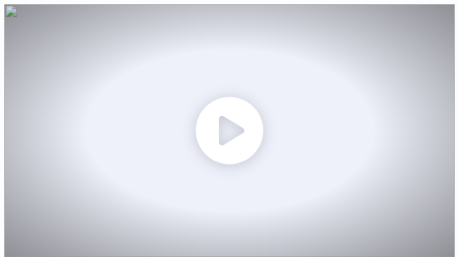 | [Embed](docs/ui-embed.html) | `<ui-embed>` | An embed displays content from other websites, like YouTube videos, loaded only when asked for. | iframe, video, youtube, vimeo |
|  | [Flyout](docs/ui-flyout.html) | `<ui-flyout>` | A flyout is a modal that slides in from a side of the page. | drawer, sheet, side panel, off canvas |
| 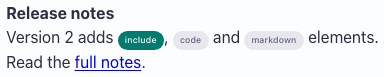 | [Include](docs/ui-include.html) | `<ui-include>` | An include shows part of another page from this site in this one, loaded at once, when idle or when scrolled into view. | island, partial, fragment, server-side include |
|  | [Modal](docs/ui-modal.html) | `<ui-modal>` | A modal displays content that temporarily blocks interactions with the main view of a site. | dialog, popup window, lightbox, confirm |
| 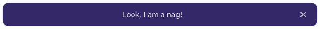 | [Nag](docs/ui-nag.html) | `<ui-nag>` | A nag is a persistent message that stays until dismissed, and can remember the dismissal. | banner, cookie notice, announcement bar, sticky banner |
|  | [Popup](docs/ui-popup.html) | `<ui-popup>` | A popup displays additional information on top of a page. | tooltip, popover, hint, hover card |
| 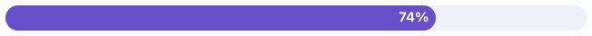 | [Progress](docs/ui-progress.html) | `<ui-progress>` | A progress bar shows the progression of a task. | progress bar, meter, percent bar, upload progress |
|  | [Rating](docs/ui-rating.html) | `<ui-rating>` | A rating indicates people's interest in content. | stars, star rating, score, review stars |
| 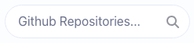 | [Search](docs/ui-search.html) | `<ui-search>` | A search module lets people query for results from a selection of data. | autocomplete, typeahead, search box, combobox |
| 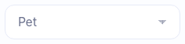 | [Select](docs/ui-select.html) | `<ui-select>` | A select lets people choose one or more values from a native list of options. | select box, native select, picker, option list |
| 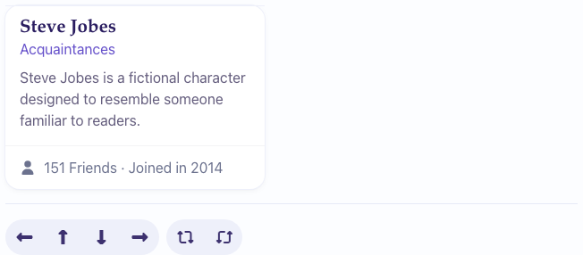 | [Shape](docs/ui-shape.html) | `<ui-shape>` `<ui-side>` | A shape is a three dimensional object displayed on a two dimensional plane. | 3d flip, cube, flip card, carousel |
|  | [Sidebar](docs/ui-sidebar.html) | `<ui-sidebar>` `<ui-pushable>` `<ui-pusher>` | A sidebar hides additional content beside a page. | drawer, off canvas, side menu, nav drawer |
|  | [Slider](docs/ui-slider.html) | `<ui-slider>` | A slider lets people select values within a range. | range, range slider, volume, scrubber |
|  | [Sticky](docs/ui-sticky.html) | `<ui-sticky>` | Sticky content stays fixed to the viewport while its container is on screen. | affix, pinned, fixed header, sticky header |
|  | [Tab](docs/ui-tab.html) | `<ui-tab>` `<ui-tabs>` | A tab pane:  the content shown while its tab is selected. | tab panel, pane |
|  | [Toast](docs/ui-toast.html) | `<ui-toast>` | A toast gives people a short, non-blocking notification. | snackbar, notification, growl, flash message |
| 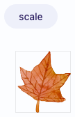 | [Transition](docs/ui-transition.html) | `<ui-transition>` | A transition is an animation used to show or hide content, or to draw attention to it. | animate, fade, slide, motion |
|  | [Visibility](docs/ui-visibility.html) | `<ui-visibility>` | Visibility provides a set of callbacks for when content appears in the viewport. | scroll spy, in view, intersection, lazy load |

### The generic content parts

One set of parts for every owner:  each styles itself by what it's in, a card, an item, a comment ...

| Picture | Family | Tags | What it is | Also called |
| --- | --- | --- | --- | --- |
| 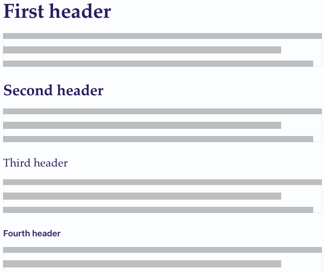 | [Content parts](docs/ui-header.html) | `<ui-header>` [`<ui-actions>`](docs/ui-actions.html) [`<ui-author>`](docs/ui-author.html) [`<ui-avatar>`](docs/ui-avatar.html) [`<ui-content>`](docs/ui-content.html) [`<ui-date>`](docs/ui-date.html) [`<ui-description>`](docs/ui-description.html) [`<ui-detail>`](docs/ui-detail.html) [`<ui-extra>`](docs/ui-extra.html) [`<ui-meta>`](docs/ui-meta.html) [`<ui-summary>`](docs/ui-summary.html) [`<ui-title>`](docs/ui-title.html) [`<ui-value>`](docs/ui-value.html) | A header provides a short summary of content. | heading, title, h1, headline |

### Spell UI's own

Elements with no Fomantic counterpart.

| Picture | Family | Tags | What it is | Also called |
| --- | --- | --- | --- | --- |
| 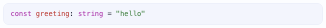 | [Code](docs/ui-code.html) | `<ui-code>` | Code shows a block of source code coloured by its language, from the element's own text or a file on this site. | code block, syntax highlighting, highlighter, pre |
| 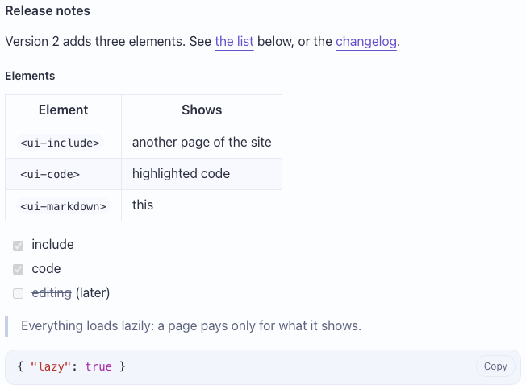 | [Markdown](docs/ui-markdown.html) | `<ui-markdown>` | Markdown renders GitHub-flavoured markdown -- tables, task lists, code blocks -- from the element's own text or a file on this site. | markdown, md, gfm, readme |
| 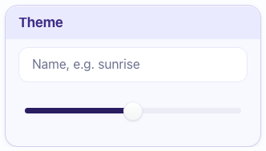 | [Panel](docs/ui-panel.html) | `<ui-panel>` | A panel is an inspector:  a tinted box of fields under a header band, with sub-head bands that fold.  It takes every `<ui-section>` attribute. | inspector, property panel, properties, settings panel |
| 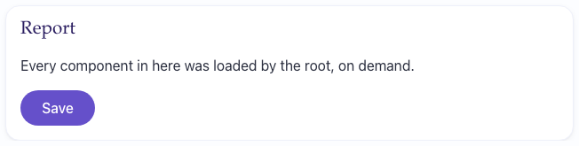 | [Root](docs/ui-root.html) | `<ui-root>` | A root loads the components inside it on demand, sets their theme and size, and shows them once they're ready. | app shell, app root, provider, loader |
| 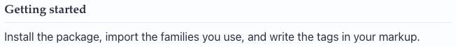 | [Section](docs/ui-section.html) *(In progress)* | `<ui-section>` `<ui-sections>` | A section is a titled block of content that can fold away and keep its title in view. | section, panel, collapsible, disclosure |

<details>
<summary>The docs site's own elements:  8 families, never in the library</summary>

| Family | Tags | What it is | Also called |
| --- | --- | --- | --- |
| Docs api | `<ui-docs-api>` | An API reference lists a tag's attributes, properties, events, slots, parts, states and texts as tables, from the site's generated data;  for a function component, its props and where it's drawn. | api reference, api table, props table, properties table |
| Docs example | `<ui-docs-example>` | An example shows its own markup live, under a header and description, with the same markup as code a button shows and hides. | example, demo, live example, code sample |
| Docs inspector | `<ui-docs-inspector>` | An inspector shows another element's attributes, properties and custom states, live:  click the element, and watch them change. | inspector, element inspector, devtools, live properties |
| Docs nav | `<ui-docs-nav>` | A docs nav is a panel listing the site's pages and every component, A-Z or by topic, in folding groups, with search and favourites;  the current page is highlighted and scrolled into view. | sidebar, table of contents, toc, site nav |
| Docs search | `<ui-docs-search>` | A docs search is a field that finds sections of the page shown, components, attributes and every page's sections as you type, and jumps to the one you pick;  `/` or Cmd / Ctrl+K focuses it from anywhere. | site search, docs search, quick find, jump to |
| Docs table of contents | `<ui-docs-toc>` | A table of contents lists the page's sections and examples as links, opens the one in view and follows the scroll. | table of contents, on this page, page index, scrollspy |
| Docs themes | `<ui-docs-themes>` | Theme controls switch the page between light and dark, and pick its theme, and remember both for the next page. | theme picker, theme switcher, dark mode toggle, colour scheme |
| Docs tokens | `<ui-docs-tokens>` | A token table lists the CSS custom properties of a component family, or of the whole foundation, with their defaults and a live swatch for each colour;  a playground adds inputs that restyle a live preview. | css variables, custom properties, design tokens, theme tokens |

</details>
<!-- components:end -->

## How a family is laid out

Every family folder holds the same files, each named for its component.
A new tag fills them all;  the tests fail on one that's missing a piece.

| File | What it is |
| --- | --- |
| `UI<Name>.tsx` | the component:  one class per tag, its state and its `render()` into the shadow root;  a family's own DOM element class, `DOM<Name>Element`, sits above it in the same file |
| `index.ts` | the family's barrel:  defines every tag (a side effect), re-exports the classes;  also the family's entry, `spell-ui/ui-<name>` |
| `UI<Name>.css` | its sheet, a port of Fomantic's `.less` and `.variables`, in layers |
| `UI<Name>.en.ts` | the VOCABULARY, one per tag:  every name the tag uses (attributes and their values, events, slots, parts, states, texts), plus `topics`, `aka` and `skeleton` |
| `UI<Name>.types.ts` | constants and types several of its files share |
| `UI<Name>.fallback.ts` | the plain-DOM stand-in shown if the render throws:  form controls only |
| `examples/*.html` | Fomantic's examples in class grammar (`<div class="ui primary button">`), for the CSS tests and the site |
| `examples/elements/*.html` | the same examples as `ui-*` markup:  the visual tests, the demo, the docs pages and these thumbnails start here |
| tests | at the same path under [`tests/components/`](tests/components/):  the component, its sheet, its fallback, its static render, accessibility, speed |

- A NEW TAG must fill two fields of its vocabulary:
  - `topics`:  two or more of the site's topics, how a newcomer looks for it
  - `aka`:  other libraries' and everyday names (`<ui-modal>` is also "dialog", "lightbox")
  - The component definitions test fails on a tag without them.
- Then `yarn gen:root` (the root's catalog of which family defines a tag) and `yarn site:data` (the docs site's data):
  each one's test fails while it's stale.
- The full recipe, "Adding a new family":  the front page's [Working on it](README.md#working-on-it).

<details>
<summary>How an element is written, in more depth</summary>

- The two objects behind every tag (the DOM element and the component), the decorators and the lifecycle:
  the kit's element framework, [README-element.md](../README-element.md).
- What's under every element (the shared runtime, vocabularies, icons, styles):  [README-runtime.md](README-runtime.md).
- The rules for writing one (house style, imports, the lint guard):
  [AGENTS.md](AGENTS.md), "A family's files" and "Solid authoring".

</details>

## Written from the data

The tables above are written by a script, never by hand:
`yarn readme:components` reads the site's data and puts a fresh catalogue between this page's markers.

- The data:
  - [`components.json5`](docs/__data/components.json5), written by `yarn site:data` from every vocabulary
  - the hand-kept [`pages.json5`](docs/__data/pages.json5) beside it:  titles, status
- Rerun it after `yarn site:data`;  `yarn readme:components --check` fails while this page is stale.
- The pictures are PNGs in [the components' images folder](docs/images/components/), one per family that has one.
  - `yarn readme:components --shoot <docs site address> [family ...]` retakes them headless from the docs site:
    each family page's first example, trimmed.
    No family named:  every family that has a picture already.
  - Delete a picture to drop it from the table;  name a family to add one.

<details>
<summary>Taking the pictures:  the command, as run for this page</summary>

The docs site must be served first (the page server, [README-site.md](README-site.md)).

```sh
cd spell-ui
yarn readme:components --shoot http://localhost:4747/components/ui/
```

- One line per family, `thumbnail:  ui-button`;
  a family whose first example draws nothing says why and keeps its old picture.
- The pictures are light scheme, at the browser's normal size.
- Families left without one on purpose, those whose first example is only:
  - a button that opens something (modal, flyout, toast, popup ...)
  - or grey placeholder bars (segment, grid, rail ...)

</details>

## See also

- [README.md](README.md):  Spell UI's front page
- [README-runtime.md](README-runtime.md):  what's under the elements
- [README-themes.md](README-themes.md):  theming
- [README-frameworks.md](README-frameworks.md):  using the elements from React, Vue, Svelte, Solid and plain JavaScript
- [README-migrating.md](README-migrating.md):  coming from Semantic UI or Fomantic UI
- [README-site.md](README-site.md):  the docs site and the tools
- [The kit's front page](../README.md)
