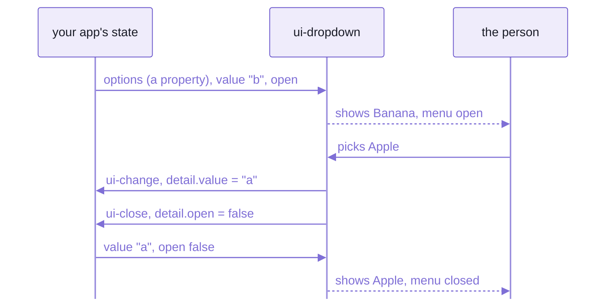

# Spell UI from plain JavaScript, React, Svelte, Solid and Vue

```text
PASS /src/tools/frameworks/vanilla.html (vanilla)
PASS /src/tools/frameworks/react.html (react 19.3.1)
PASS /src/tools/frameworks/vue.html (vue 3.5.44)
PASS /src/tools/frameworks/solid.html (solid 2.0.0-rc.17 (app) + identity hook)
```

That's `yarn smoke`, on four pages that each hold one `<ui-dropdown>`:
one in plain JavaScript, one in React, one in Vue, one in Solid.
In headless Chromium, a script picks Apple on each one,
then checks the pick reached the app's state and came back.
Not one of them has a wrapper component.

There's nothing to wrap.
A React component library ships React components:  functions React calls, which the page never holds.
`<ui-dropdown>` is a node the page holds, like `<select>`, with a component behind it drawing into its shadow root.
Your framework sets its attributes and properties and listens to its events, as it would on a `<video>`.

Find your row, then your section:

| Framework | Pass `options` | Hear `ui-change` | Checked by |
| --- | --- | --- | --- |
| [plain JavaScript](#plain-javascript--nothing-to-configure) | `dropdown.options = OPTIONS` | `addEventListener("ui-change", fn)` | ✓ [`vanilla.html`](src/tools/frameworks/vanilla.html) |
| [React 19](#react-19--define-the-tags-before-react-renders) | `options={OPTIONS}` | `onui-change={fn}` | ✓ [`react.html`](src/tools/frameworks/react.html) |
| [Vue 3](#vue-3--tell-the-compiler-the-tags-arent-vues) | `:options="options"` | `@ui-change="fn"` | ✓ [`vue.html`](src/tools/frameworks/vue.html) |
| [Solid 2](#solid-2--one-solid-on-the-page-and-plain-props) | `options={options}` | `on-ui-change={fn}` | ✓ [`solid.html`](src/tools/frameworks/solid.html) |
| [Svelte, Angular, Preact](#svelte-angular-and-preact--should-work-standard-contract) | -- | -- | no page yet |

Every page passes the same three fruit, `OPTIONS` from [`check.js`](src/tools/frameworks/check.js):
`{ value: "a", text: "Apple" }`, then `"b"` Banana and `"c"` Cherry.

## The contract:  four rules every element keeps

Every Spell UI element keeps the same four rules.
The first three are the DOM's own, so a framework that can drive a `<video>` already knows them.

1. **Primitives are attributes,** reflected both ways:  `<ui-dropdown placeholder="Fruit" open>`.
   - `el.open = true` and `el.setAttribute("open", "")` are the same fact, and either one opens it;
     `placeholder="Fruit"` reads back as `el.placeholder`.
   - Booleans read as HTML reads them, with three words for no:
     a present attribute is true (`open`, `open=""`, `open="true"`, `open="yes"`),
     unless its value is `"false"`, `"no"` or `"0"`, in any case.
   - Written back, `open` is only ever `open=""` or gone, never `open="false"`:
     to CSS's `[open]`, and to other libraries, a present attribute means true.
2. **Rich data is a property,** a real accessor on the element:  a dropdown's `options`, a table's `rows`.
   - That's what a framework checks to choose a property over an attribute:  `"options" in el`.
   - First paint never needs one:  a server render drops them.
3. **Events are `ui-*` `CustomEvent`s** (`ui-change`, `ui-open`, `ui-close`), and they bubble out of the shadow root.
   - `detail` holds the new state, `{ value }` or `{ open }`, and the `originalEvent` that caused it.
   - A plain click is the native `click`.
     A listener outside sees `event.target` as the `<ui-dropdown>` itself, never a node inside it.
4. **`ready`, and custom states.**
   `await dropdown.ready` resolves once the element has drawn with its styles.
   Its states are styleable from outside:  `ui-dropdown:state(open)`.
   - `ready` resolves when an element fails, too.
     It then has `:state(errored)` and has sent a cancelable `ui-error`, and the rest of the page carries on.

Define the elements BEFORE the framework renders them:
`import "spell/ui"` for every family, or `import "spell/ui/ui-dropdown"` for one.
As a backstop, a property set before the tag is defined is kept, and applied once it is.



_The round trip every recipe below runs:  your state drives the element, and its events drive your state._

### Who decides the value:  the element, unless you overrule it

A controlled `<input>` in React snaps back unless your state changes.
A Spell UI element doesn't wait for you:  it sends `ui-change`, then applies the pick itself.
So what you do while the event runs is what decides:

- Cancel one that can be cancelled (`ui-open`, `ui-close`) with `event.preventDefault()`:
  nothing changes, and the menu stays as it was.
- Set the property while you handle one that can't (`ui-change`), and your write wins:
  `event.target.value = "b"` there, and it shows Banana again.
- Ignore the event, and the element keeps what the person picked, whether your state followed or not.

The dropdown's own tests check each of these ([UIDropdown.test.tsx](tests/components/ui-dropdown/UIDropdown.test.tsx));
the smoke pages check only the round trip.

## Plain JavaScript:  nothing to configure

✓ Checked by [`vanilla.html`](src/tools/frameworks/vanilla.html),
which sets the property and the listener before the element is defined, to prove the backstop.

```html
<ui-dropdown selection placeholder="Fruit" value="b" open></ui-dropdown>
<p>Page state: <output id="value">b</output></p>
<button id="open" type="button">open</button>

<script type="module">
  const dropdown = document.querySelector("ui-dropdown")
  const output = document.querySelector("#value")
  dropdown.options = OPTIONS // a property, before the tag is even defined
  dropdown.addEventListener("ui-change", (event) => (output.textContent = event.detail.value))
  document.querySelector("#open").addEventListener("click", () => (dropdown.open = true))
  await import("spell/ui") // defined last, on purpose:  the element keeps `options`
</script>
```

That's all of it:  no configuration, no build step, nothing beyond the four rules.
Every recipe below ends up making these same calls, through its framework.

## React 19:  define the tags before React renders

✓ Checked by [`react.html`](src/tools/frameworks/react.html), on React 19.3.1 from esm.sh.
React 19 passes a prop as a PROPERTY when the element has one (`key in el`),
and listens to a custom event through `on<event-name>`:  `onui-change`.

```jsx
import "spell/ui"

function App() {
  const [value, setValue] = useState("b")
  const [open, setOpen] = useState(true)
  return (
    <ui-dropdown
      selection
      placeholder="Fruit"
      options={OPTIONS}
      value={value}
      open={open}
      onui-change={(event) => setValue(event.detail.value)}
      onui-open={() => setOpen(true)}
      onui-close={() => setOpen(false)}
    />
  )
}
```

- The smoke page writes the same with `React.createElement`, so it runs with no build step:
  `h("ui-dropdown", { options: OPTIONS, value, open, "onui-change": ... })`.
- **The catch:**  React decides property or attribute by looking at the element as it renders it.
  A tag that isn't defined yet has no `options` property, so React writes an attribute,
  and an array doesn't survive being a string.
  - Import the families up front:  `import "spell/ui"`, or `import "spell/ui/ui-dropdown"`.
  - Don't leave them to `<ui-root>`'s loading on demand:  it defines a tag after the page first shows one,
    and by then React has written its props.
- React 18 and older pass every prop as an attribute, and don't listen to custom events:
  set rich data and add the `ui-*` listeners through a `ref`.
  No page checks that;  it's React 18's rule, not ours.

## Vue 3:  tell the compiler the tags aren't Vue's

✓ Checked by [`vue.html`](src/tools/frameworks/vue.html), on Vue 3.5.44 from unpkg.
Vue binds `:options` as a property when the element has one, and `@ui-change` listens as on any element.

```js
import "spell/ui"
import { createApp } from "vue"

const app = createApp(App)
app.config.compilerOptions.isCustomElement = (tag) => tag.startsWith("ui-")
app.mount("#root")
```

```vue
<ui-dropdown
  selection
  placeholder="Fruit"
  :options="options"
  :value="value"
  :open="open"
  @ui-change="value = $event.detail.value"
  @ui-open="open = true"
  @ui-close="open = false"
></ui-dropdown>
```

- `isCustomElement` tells Vue's compiler that `ui-*` tags are elements, not Vue components.
  - The smoke page compiles its template in the browser, where `app.config.compilerOptions` applies.
    An app whose build compiles its templates sets the same option in its Vue plugin, `template.compilerOptions`:
    Vue's rule, which no page here runs.
- `.options="options"` forces a property, where Vue can't tell.
- **One quirk, already handled:**  where Vue can't find a property, it may write the attribute `open="false"`.
  Spell UI reads `"false"` as false, so it does the right thing anyway.

## Solid 2:  one Solid on the page, and plain props

✓ Checked by [`solid.html`](src/tools/frameworks/solid.html), a compiled Solid 2 app,
[`app.tsx`](src/tools/frameworks/solid/app.tsx), on Solid 2.0.0-rc.17:  the components' own copy.
Every prop is a plain one, the same name as in HTML:
- an event is `on-` and the event's own name, `on-ui-change={fn}`
- data is the property's name, `options={options}`, and arrives as the array itself, not as text

```tsx
import { createSignal } from "solid-js"
import { render } from "@solidjs/web"
import "spell/ui" // solid.html imports it before it mounts the app

const [value, setValue] = createSignal("b")
const [open, setOpen] = createSignal(true)

render(
  () => (
    <ui-root appContext={APP_CONTEXT_VALUE}>
      <ui-dropdown
        selection
        placeholder="Fruit"
        options={options}
        value={value()}
        open={open()}
        on-ui-change={(event) => setValue(String(event.detail.value))}
        on-ui-open={() => setOpen(true)}
        on-ui-close={() => setOpen(false)}
      />
    </ui-root>
  ),
  root
)
```

- **How:**  Solid 2 sets a prop it doesn't know with `setAttribute(name, value)`, the value as it is.
  Spell UI's elements take that over:  a function or object goes to a listener or a property.
  - An element whose component hasn't loaded yet keeps them until it does:
    a patch on the browser's `setAttribute()` holds them,
    and acts only for a dashed tag not defined yet, given a function or object.
  - `<ui-root pure>` turns the patch off.
    Spell UI's own tags still keep them:  the root defines every tag it knows before its component loads.
    A tag it doesn't know (another library's), given a function or object before it's defined, gets text, as in
    plain Solid.
  - Text for an attribute stays an attribute, as ever.
- Not `onUIChange`:  Solid lowercases a camelCase handler's name, so it would listen for `uichange`.
- Neither namespace:  Solid 2 has no `on:` (a compile error since rc.17), and `prop:` is no longer needed.
- **The catch:**  your app must run the SAME Solid as Spell UI, `solid-js` and `@solidjs/web` 2.0.0-rc.17.
  Two copies of Solid on one page break silently:
  two registries, two owners ([the element framework](https://github.com/spell-app/spell/blob/main/README-element.md)).
  - In Vite, that's `resolve.dedupe`:  `["solid-js", "@solidjs/web"]`, as every Spell build sets it.
- Solid's context stops at the element:  each element draws in a Solid root of its own,
  so your providers don't reach inside.
  - Hand app data to the root instead, as an object:  `<ui-root appContext={value}>`, as above.
  - How every component inside reads it, and when to set it:
    [the front page's `<ui-root>`](README.md#ui-root-the-top-of-every-page).

<details>
<summary>How the smoke page proves there's one Solid</summary>

[`identity.js`](src/tools/frameworks/solid/identity.js) is the ONLY place that proves
the host app and the components share one Solid.

- It hands the app the components' own `createSignal` and `render`;
  the app checks they're the very functions it imported.
- It also checks that the app's `appContext` value reaches the component inside `<ui-root>`,
  and that unmounting the dropdown releases its entry in [the runtime's](README-runtime.md) overlay stack.
- It binds names, never `import * as` a package, so the vendored Solid stays tree-shaken.
- It must load before the app mounts:  `solid.html` imports it first.

</details>

<details>
<summary>A Solid 1.9 app, with the components on Solid 2</summary>

[`compat-solid-1.9.html`](src/tools/smoke/compat-solid-1.9.html) runs a Solid 1.9.9 app, from esm.sh,
beside the components' vendored Solid 2:  two runtimes on one page.
It passes, as compatibility, not as the recommended setup.

- Solid 1.9 still has `on:`, so it listens with `on:ui-change`.
  It passes data with `prop:options`.
- Its context can't reach the components:  a 1.9 context can't be provided to Solid 2 components,
  and the check reports `null (as expected)`.

</details>

## Svelte, Angular and Preact:  should work, standard contract

No smoke page runs any of them yet, so this page gives them no recipe.
The contract above asks nothing of a framework but setting properties and listening for events,
which is why they should work;  until a page checks one, treat it as untested.
The docs site's [getting-started page](docs/getting-started.html) has a one-line binding for each, unchecked too.

## Types:  your editor knows every tag, and Solid's JSX does too

Spell UI ships what an editor reads, four files describing all 104 tags:

- [`custom-elements.json`](docs/__data/custom-elements.json), a Custom Elements Manifest (schema 2.1.0),
  named by `package.json`'s `"customElements"`:
  every tag's attributes, properties, events, slots, parts, custom states and CSS custom properties
- [`html-custom-data.json`](docs/__data/html-custom-data.json), VS Code's HTML data:
  autocomplete and hover docs for `<ui-*>` in HTML files
- [`css-custom-data.json`](docs/__data/css-custom-data.json), VS Code's CSS data:
  every `--ui-*` custom property, part (`::part(icon)`) and custom state (`:state(open)`) in CSS files,
  with hover docs
- [`spell/ui/jsx`](src/jsx.ts), the JSX types for Solid 2:
  autocomplete, hover docs and checks for `<ui-*>` in `.tsx` files
- `yarn site:data` writes all four, from the same vocabularies as everything else.

For Solid's JSX, import the types once, in any file of your program:

```ts
import type {} from "spell/ui/jsx"
```

- Then every `<ui-*>` tag is checked:
  a misspelt attribute (`sise="large"`), or a value its set doesn't hold (`size="enormous"`), is an error.
- HTML's global attributes (`class`, `id`, `slot`, `onClick`, `aria-*` ...) stay allowed.
- A name with a dash in it (`data-*`) is never checked:  TypeScript lets any through.
- Flags:  `fluid`, `fluid={true}` or `fluid=""`;  `fluid={false}` removes it.
- Rich data is a plain prop:  `options={[...]}`.
  It reaches the element whole, as its property (Solid's "How", above).
- So are the few properties no attribute stands for:
  - `appContext` on `<ui-root>`:  your app's value, which every component inside reads
  - `content` on the elements that show a file (`<ui-code>`, `<ui-markdown>`, `<ui-include>`):  the text shown
- Each attribute and property is typed as `prop:<name>` too, struck through in your editor (`@deprecated`):
  only compiled Spell still writes `prop:`.  Write the plain name.
- It augments `@solidjs/web/types/jsx.js`, not `@solidjs/web`, which only re-exports `JSX`.
- Other frameworks' JSX (React's, Preact's):  no types yet;  declare the tags in your own program.

### Events:  `event.detail` typed, in JSX and in plain DOM code

Every event a tag sends is typed, its `detail` too, from the same vocabularies:

```tsx
<ui-input on-ui-change={(event) => setName(event.detail.value)} />

const button = document.querySelector("ui-button")!
button.addEventListener("ui-toggle", (event) => setActive(event.detail.active))
```

- In JSX:  `on-` plus the event's name, `on-ui-change`, one per event the tag sends.
  - Solid hands your function to the element, which listens for that event (Solid's "How", above).
  - A misspelt `on-ui-chnage` isn't an error (it has a dash);  the app's VS Code extension warns on it.
- In plain DOM code:  `querySelector("ui-button")` gives a `<ui-button>` that knows its own events,
  and so does a JSX `ref`'s element.
  - Its `addEventListener()` types each one's `event.detail`.
  - Only its events:  for its other members (`value`, `open()` ...), cast to its class.
- On any other element, or the document, every `ui-*` name completes, but its `detail` is `unknown`.
  - The same name is many tags' (`ui-change` is 18 of Spell UI's, and other sets' too), each with its own `detail`.
  - Narrow it yourself, or listen on the tag.
- Each tag's own events, by name:  `UIInputEventMap` ..., exported by `spell/ui/jsx`.

## Loading it:  npm, or a build and an import map

A framework app with a bundler installs it, with Solid 2 as a peer, and imports what it uses:

```sh
npm install spell-ui@next solid-js@2.0.0-rc.17 @solidjs/web@2.0.0-rc.17
```

```js
import "spell-ui" // every family;  or one, "spell-ui/ui-dropdown"
```

- `@next` until Spell's first release (planned for December 1, 2026);  from then on, plain `spell-ui`.
- The same app can map the names from a CDN instead, with no install:
  [the front page's thirty seconds](README.md#thirty-seconds-three-ways) has the map.

The smoke pages use the build in a checkout of the kit instead:
`yarn build` for the library, `yarn vendor` for ONE copy of Solid.
A page maps the names onto those folders:

```html
<script type="importmap">
  {
    "imports": {
      "solid-js": "/vendor/solid-js.js",
      "@solidjs/web": "/vendor/@solidjs/web.js",
      "spell-ui": "/dist/index.js",
      "spell-ui/ui-dropdown": "/dist/ui-dropdown.js"
    }
  }
</script>
```

- `spell-ui` is every family, `spell-ui/ui-<family>` one.
  - `spell-ui/core`, `spell-ui/forms` and `spell-ui/api` are the shared entries.
- `yarn vendor` writes the two Solid lines to `vendor/importmap.json`,
  after compiling the Solid smoke app when it's out of date.
- `yarn serve` serves `dist/`, `vendor/` and `src/` with the whole map injected into every page,
  and prints each smoke page's address, on port 5199;  Ctrl-C stops it.

## What the smoke pages prove, and what they don't

Four PASS lines at the top of a page are a big claim, so here is exactly what stands behind them.
`yarn smoke` builds the library, checks its type declarations, then loads every page in headless Chromium,
from one static server, with an import map onto `dist/` and the vendored Solid.
Run `yarn vendor` once first.

Where the proof stops:
- Chromium only:  no page runs in Firefox or Safari.
- React comes from esm.sh and Vue from unpkg, as `react@19` and `vue@3`:
  those two pages need the network, and run whichever 19 and 3 those serve that day.
- Any other request off the machine is blocked, and fails its page;  so does an uncaught error.
- Not run at all:  Svelte, Angular, Preact, React 18.

<details>
<summary>The last run, page by page</summary>

```text
declarations:  ok
PASS /src/tools/frameworks/vanilla.html (vanilla)
PASS /src/tools/frameworks/react.html (react 19.3.1)
PASS /src/tools/frameworks/vue.html (vue 3.5.44)
PASS /src/tools/frameworks/solid.html (solid 2.0.0-rc.17 (app) + identity hook)
PASS /src/tools/frameworks/perf.html (perf (production))
PASS /src/tools/smoke/compat-solid-1.9.html (solid 1.9.9 (esm.sh) + vendored Solid 2)
PASS /src/tools/smoke/translate.html (es (<ui-root> in Spanish))
PASS /src/tools/demo/fallback.html (every form control, working + failed)
```

- `declarations:  ok`:  every `.d.ts` in `dist/` resolves for an app that installs it, with nothing outside `dist/`.
- Every framework page runs the same round trip ([`check.js`](src/tools/frameworks/check.js)):
  - the dropdown shows the app's value (`Banana`), and starts open
  - `options` arrived as a property, never an attribute
  - a pick (`Apple`) reaches the app's state, and back
  - the menu closes after the pick
  - the app setting `value` (`Cherry`) reaches the element
  - and so does the app setting `open`
- The other four:
  - `perf.html`:  a 1000-option search dropdown, on the production build.
    On the last run, opening it put all 1000 rows on the page in 22 ms of script and DOM work,
    and each keystroke of `united sta` took 5 ms or less of the same.
  - `compat-solid-1.9.html`:  the Solid 1.9 app, [above](#solid-2--one-solid-on-the-page-and-plain-props).
  - `translate.html`:  a page in Spanish (`<html lang="es">`).
    Its root loads the Spanish names, then each tag's family as it meets it (`<es-boton>`, `<es-tarjeta>`).
    - Spanish attributes and values, and the dropdown's own event, `es-cambio`
    - the texts in Spanish too:  "Cerrar"
  - `fallback.html`:  every form control, working and deliberately broken;
    each broken one logs one error and shows its plain-HTML fallback, which still submits.
- A page publishes `window.smokeResult = { ok, label, checks }`;
  the whole run lands in `results/smoke-results.json`, and `yarn report` lists the Solid 1.9 page as COMPATIBILITY.

</details>

## See also

- [README.md](README.md):  Spell UI's front page:  `<ui-root>`, and the other ways to load the families
- [README-components.md](README-components.md):  every family, for the attributes, properties and events
  your next snippet needs
- [The kit's element framework](https://github.com/spell-app/spell/blob/main/README-element.md):  why each tag is two objects,
  and why each one is its own error boundary
- [README-site.md](README-site.md):  `yarn smoke` beside the other tools, and the order to run them in
