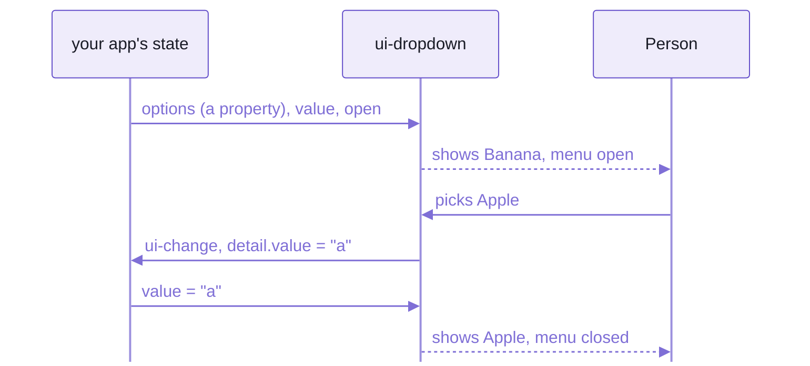

# Spell UI from plain JavaScript, React, Svelte, Solid and Vue

Spell UI's elements are plain custom elements, so any framework that renders HTML can use them.
Every element keeps the same contract, and that contract is all a framework needs to know:

- primitives (strings, numbers, booleans) are ATTRIBUTES, reflected both ways:
  `<ui-dropdown placeholder="Fruit" open>`
  - booleans follow HTML:  present, `""`, `"true"` or `"yes"` is true;  `"false"` or `"no"` is false
- rich data (`options`, `rows`) is a PROPERTY, a real accessor on the element.
  A framework finds it with `"options" in el`
  - first paint never needs one:  a server render drops them
- events are `CustomEvent`s named `ui-*` (`ui-change`, `ui-open`, `ui-close`), bubbling out of the shadow root.
  Each carries the new state in `detail` (`{ value }`, `{ open }`), and the `originalEvent`
- every element has a `ready` promise, resolved once it has drawn with its styles, and custom states you can style:
  `ui-dropdown:state(open)`

Define the elements BEFORE the framework renders them:  `import "spell-ui"`, or the families you use.
As a backstop, a property set on an element before its tag was defined is kept, and applied once it is.



_The same round trip in every framework:  your state drives the element, its events drive your state._

Each recipe below does that round trip on a controlled `<ui-dropdown>`.
Four of them are pages that run in a headless browser on every `yarn smoke`;  Svelte's isn't checked yet.

| Framework | Pass data | Hear `ui-change` | Checked |
| --- | --- | --- | --- |
| plain JavaScript | `dropdown.options = OPTIONS` | `addEventListener("ui-change", fn)` | ✓ [`vanilla.html`](src/tools/frameworks/vanilla.html) |
| React 19 | `options={OPTIONS}` | `onui-change={fn}` | ✓ [`react.html`](src/tools/frameworks/react.html) |
| Svelte 5 | `{options}` | `onui-change={fn}` | not yet:  standard contract |
| Solid 2 | `prop:options={options}` | a `ref` that adds the listener | ✓ [`solid.html`](src/tools/frameworks/solid.html) |
| Vue 3 | `:options="options"` | `@ui-change="fn"` | ✓ [`vue.html`](src/tools/frameworks/vue.html) |

## Plain JavaScript

✓ Checked by [`vanilla.html`](src/tools/frameworks/vanilla.html),
which sets the property and the listener BEFORE the element is defined, to prove the backstop.

```html
<ui-dropdown selection placeholder="Fruit" value="b" open></ui-dropdown>
<p>Page state: <output id="value">b</output></p>

<script type="module">
  const dropdown = document.querySelector("ui-dropdown")
  const output = document.querySelector("#value")
  dropdown.options = OPTIONS // a property, even before the tag is defined
  dropdown.addEventListener("ui-change", (event) => (output.textContent = event.detail.value))
  document.querySelector("#open").addEventListener("click", () => (dropdown.open = true))
  await import("spell-ui") // defining later is fine:  the element keeps `options`
</script>
```

- The catch:  none, beyond the contract.
  Write `el.open = true` or `el.setAttribute("open", "")`:  they're the same fact.

## React 19

✓ Checked by [`react.html`](src/tools/frameworks/react.html), on React 19.3.1.
React 19 passes a prop as a PROPERTY when the element has one (`key in el`),
and listens to a custom event through `on<event-name>`.

```jsx
import "spell-ui"

function App() {
  const [value, setValue] = useState("b")
  const [open, setOpen] = useState(true)
  return (
    <ui-dropdown
      selection
      placeholder="Fruit"
      options={OPTIONS}
      value={value}
      open={open}
      onui-change={(event) => setValue(event.detail.value)}
      onui-open={() => setOpen(true)}
      onui-close={() => setOpen(false)}
    />
  )
}
```

- The smoke page writes it with `React.createElement`, so it runs with no build step:
  `h("ui-dropdown", { options: OPTIONS, value, open, "onui-change": ... })`.
- The catch:  React looks at the ELEMENT to decide property or attribute,
  so the family must be defined before React renders it.
  - Import the families up front:  `import "spell-ui"`, or `import "spell-ui/ui-dropdown"`.
  - Don't leave them to `<ui-root>`'s on-demand loading.
- React 18 and older pass every prop as an attribute and don't listen to custom events:
  set rich data and add `ui-*` listeners through a `ref`.

## Svelte 5

Not yet checked by a smoke page:  written from the standard custom-element contract, which Svelte 5 follows.
Svelte 5 sets a prop as a property when the element has one, and an `on<name>` attribute adds a listener.

```svelte
<script>
  import "spell-ui"

  let value = $state("b")
  let open = $state(true)
</script>

<ui-dropdown
  selection
  placeholder="Fruit"
  options={OPTIONS}
  {value}
  {open}
  onui-change={(event) => (value = event.detail.value)}
  onui-open={() => (open = true)}
  onui-close={() => (open = false)}
></ui-dropdown>
```

- The catch:  as with React, Svelte checks the element for a property, so define the families before it renders.

## Solid 2

✓ Checked by [`solid.html`](src/tools/frameworks/solid.html), a compiled Solid 2 app,
[`app.tsx`](src/tools/frameworks/solid/app.tsx), sharing the components' own Solid.

```tsx
import { createSignal } from "solid-js"
import { render } from "@solidjs/web"
import "spell-ui"

const [value, setValue] = createSignal("b")
const [open, setOpen] = createSignal(true)

render(
  () => (
    <ui-root prop:appContext={APP_CONTEXT_VALUE}>
      <ui-dropdown
        selection
        placeholder="Fruit"
        prop:options={options}
        prop:value={value()}
        prop:open={open()}
        ref={listen}
      />
    </ui-root>
  ),
  root
)

/** `ui-*` listeners:  Solid 2 has no `on:` namespace, so a ref callback adds them once. */
function listen(element) {
  element.addEventListener("ui-change", (event) => setValue(String(event.detail.value)))
  element.addEventListener("ui-open", () => setOpen(true))
  element.addEventListener("ui-close", () => setOpen(false))
}
```

- `prop:` passes a property.
  The `ui-*` listeners go on through a ref callback, since Solid 2 dropped `on:`.
- The catch:  your app must use the SAME Solid as Spell UI (Solid 2.0.0-rc.13, `solid-js` and `@solidjs/web`):
  two copies on one page break silently.
  Dedupe them in your bundler (Vite's `resolve.dedupe`).
- A Solid context can't cross into a custom element, so pass app data through the root:
  `<ui-root prop:appContext={value}>`, read by every component inside.

## Vue 3

✓ Checked by [`vue.html`](src/tools/frameworks/vue.html), on Vue 3.5.44.

```js
app.config.compilerOptions.isCustomElement = (tag) => tag.startsWith("ui-")
```

```vue
<ui-dropdown
  selection
  placeholder="Fruit"
  :options="options"
  :value="value"
  :open="open"
  @ui-change="value = $event.detail.value"
  @ui-open="open = true"
  @ui-close="open = false"
></ui-dropdown>
```

- `isCustomElement` tells Vue's compiler that `ui-*` tags aren't Vue components.
- `.options="options"` forces a property, where Vue can't tell.
- The catch:  where Vue can't find a property it may send the attribute `open="false"`;
  Spell UI's boolean converter reads that as false, so it does the right thing.

<details>
<summary>Angular and Preact:  the docs say they work;  no smoke page checks them yet</summary>

The getting-started page lists them as following the contract, but there is no page for either in `yarn smoke`.

- Angular 20:  `[options]="arr" (ui-change)="fn($event)"`, plus `CUSTOM_ELEMENTS_SCHEMA` in the component's schemas.
- Preact 10:  as React 19 (`options={arr} onui-change={fn}`):
  Preact also sets a prop as a property when the element has one.

</details>

## TypeScript

Spell UI ships no JSX typings for `<ui-*>` tags, in any framework.
What it ships is data your editor can read:

- a [Custom Elements Manifest](docs/__data/custom-elements.json) (named by `package.json`'s `"customElements"`):
  every tag's attributes, properties, events, slots, parts and CSS custom states
- [VS Code's HTML data](docs/__data/html-custom-data.json):  autocomplete and hover docs for `<ui-*>` in HTML files
- Both are written by `yarn site:data`, from the same vocabularies as everything else.

For JSX, declare the tags you use in your own program;  the Solid host app does it this way:

```ts
declare module "@solidjs/web/types/jsx.js" {
  namespace JSX {
    interface IntrinsicElements {
      "ui-dropdown": JSX.HTMLAttributes<HTMLElement> & {
        selection?: boolean
        placeholder?: string
        "prop:options"?: readonly Option[]
        "prop:value"?: string
        "prop:open"?: boolean
      }
    }
  }
}
```

## Install

Spell UI isn't on npm yet, so a framework app uses the build from the kit:

```sh
cd ~/www/spell/spell-ui      # spell-ui, cloned inside the kit
yarn build                   # the library into dist/
yarn vendor                  # ONE copy of Solid for import-map pages, into vendor/
```

- A page then maps them with an import map, exactly as the smoke pages do:
  - `spell-ui` and `spell-ui/<family>` onto `dist/`
  - `solid-js` / `@solidjs/web` onto the vendored copy
- `yarn serve` serves `dist/`, `vendor/` and `src/` for such pages, with the import map injected.

### 🌱 Coming:  `npm install spell-ui`

`npm install spell-ui solid-js@2.0.0-rc.13 @solidjs/web@2.0.0-rc.13`, then `import "spell-ui"` in any framework app.
The package's published entries already point at `dist/`;  it isn't published yet.

<details>
<summary>The smoke pages and <code>yarn smoke</code></summary>

`yarn smoke` builds the library, checks its declarations, and loads every host page in headless chromium:
from ONE static server, with an import map onto `dist/` and the vendored Solid.
Run `yarn vendor` once first.

```text
declarations:  ok
PASS /tools/frameworks/vanilla.html (vanilla)
PASS /tools/frameworks/react.html (react 19.3.1)
PASS /tools/frameworks/vue.html (vue 3.5.44)
PASS /tools/frameworks/solid.html (solid 2.0.0-rc.13 (app) + identity hook)
PASS /tools/frameworks/perf.html (perf (production))
PASS /tools/smoke/compat-solid-1.9.html (solid 1.9.9 (esm.sh) + vendored Solid 2)
PASS /tools/smoke/translate.html (es (ie-boton, ie-desplegable))
PASS /tools/demo/fallback.html (every form control, working + failed)
```

- Every framework page runs the same round trip ([`check.js`](src/tools/frameworks/check.js)):
  - the dropdown shows the app's value (`Banana`), and starts open
  - `options` arrived as a property, never an attribute
  - a pick (`Apple`) reaches the app's state, and back
  - the app setting `value` (`Cherry`) reaches the element
  - and so does setting `open`
  - the menu closes after a pick
- React comes from esm.sh, Vue from unpkg;  the network is needed for those two.
- A page publishes `window.smokeResult = { ok, label, checks }`;  `kind: "compat"` is reported as compatibility.

</details>

<details>
<summary>The identity probe:  proving there's one Solid on the page</summary>

[`identity.js`](src/tools/frameworks/solid/identity.js) is the ONLY place that proves
the host app and the components share one Solid.

- It hands the app the components' own `createSignal` and `render`;
  the app checks they're the very functions it imported.
- It also checks that the app's `appContext` value reaches the component inside `<ui-root>`,
  and that unmounting the dropdown releases its entry in the runtime's overlay stack.
- It binds names, never `import * as` a package, so the vendored Solid stays tree-shaken.

</details>

<details>
<summary>A Solid 1.9 app, with the components on Solid 2</summary>

[`compat-solid-1.9.html`](src/tools/smoke/compat-solid-1.9.html) runs a Solid 1.9 app (from esm.sh)
beside the components' vendored Solid 2:  two runtimes on one page.
It passes, as compatibility, not as the recommended setup.

- Solid 1.9 still has `on:`, so it listens with `on:ui-change`.
  It passes data with `prop:options`.

</details>

## See also

- [README.md](README.md):  Spell UI's front page, and `<ui-root>`
- [README-components.md](README-components.md):  every family
- [README-runtime.md](README-runtime.md):  what's under the elements
- [README-site.md](README-site.md):  the tools, `yarn smoke` among them
- [The kit's front page](../README.md), and its [element framework](../README-element.md)
- Also beside it:  [README-migrating.md](README-migrating.md) · [README-themes.md](README-themes.md)
