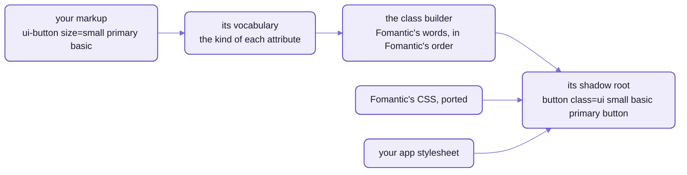
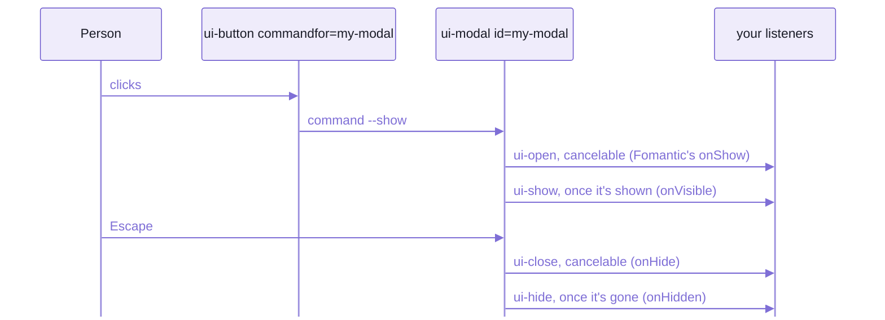

# Coming to Spell UI from Semantic UI, Fomantic UI or Semantic UI React

```html
<!-- Fomantic UI:  you write the classes -->
<button class="ui small primary basic button">Save</button>

<!-- Spell UI:  you write the same words, as attributes -->
<ui-button size="small" primary basic>Save</ui-button>
```

And this is what the second one draws inside its shadow root, read back from a headless Chrome:

```html
<button type="button" class="ui small basic primary button" part="button"><slot></slot></button>
```

Your class string didn't go away.
It moved inside the element, which writes it for you, in the order Fomantic needs.

That's the whole migration in miniature:  the words carry over, and so does the CSS under them,
Fomantic UI 2.9.4's, ported onto that inner markup.
Every one of Fomantic's families is here, plus a few of Spell UI's own ([README-components.md](README-components.md)).
What stays behind is the machinery:  jQuery, the LESS build, and page CSS that reaches into a component.

## Your classes moved inside

A Fomantic page is `<div>`s with class strings, and jQuery wakes them up.
Here the tag IS the component, and nothing has to wake it:  the page holds `<ui-button>` itself,
attributes and events on the outside, with a component behind it drawing a real `<button>` into its shadow root.



_The class grammar is still there, one level down:  that's why Fomantic's CSS ports, and why your overrides still fit._

- Each family's vocabulary ([the button's](src/components/ui-button/UIButton.en.ts)) lists its attributes and the kind
  of each;  [the class builder](src/elements/ClassBuilder.ts) turns them into the class string.
- If you know Semantic UI React, you know this already:  its components build the same string from props,
  and Spell UI's attribute kinds are copied from its `classNameBuilders`.
  - The difference is who holds the result.
    React calls a `<Button>` and keeps only the `<button>` it returns;  the page holds `<ui-button>` itself.
  - So it needs no wrapper in React, or in any other framework (below, "From Semantic UI React").
- One thing doesn't carry over:  that inner `<button>` is out of reach of a `.ui.button` rule on your page.
  Your CSS gets in through four doors instead (below, "Your CSS stops at the shadow root").

## A whole card, three ways

A bigger piece shows the rest of the pattern:  parts, a link and an icon.
Fomantic UI's classes:

```html
<div class="ui card">
  <div class="image"></div>
  <div class="content">
    <a class="header" href="#kristy">Kristy</a>
    <div class="meta"><span>Joined in 2013</span></div>
    <div class="description">Kristy is an art director living in New York.</div>
  </div>
  <div class="extra content">
    <a href="#kristy-friends"><i class="user icon"></i> 22 Friends</a>
  </div>
</div>
```

Semantic UI React's components:

```jsx
<Card>
  <Image src="kristy.png" alt="Kristy" wrapped ui={false} />
  <Card.Content>
    <Card.Header as="a" href="#kristy">Kristy</Card.Header>
    <Card.Meta><span>Joined in 2013</span></Card.Meta>
    <Card.Description>Kristy is an art director living in New York.</Card.Description>
  </Card.Content>
  <Card.Content extra>
    <a href="#kristy-friends"><Icon name="user" /> 22 Friends</a>
  </Card.Content>
</Card>
```

Spell UI's elements, as the docs' own [card example](src/components/ui-card/examples/elements/content.html)
writes them:

```html
<ui-card>
  
  <ui-content>
    <ui-header href="#kristy">Kristy</ui-header>
    <ui-meta><span>Joined in 2013</span></ui-meta>
    <ui-description>Kristy is an art director living in New York.</ui-description>
  </ui-content>
  <ui-extra><a href="#kristy-friends"><ui-icon name="user"></ui-icon> 22 Friends</a></ui-extra>
</ui-card>
```


_That card, drawn by Spell UI:  the docs site's snapshot of it, in the site's own theme rather than `classic`._

- The parts keep their names, as tags of their own:  `header`, `meta`, `description`, `extra`.
  - They're shared:  ONE `<ui-header>`, `<ui-content>`, `<ui-meta>` for every owner, never a `<ui-card-header>`.
  - Each styles itself by what it's in:  inside a card, it takes the `in-card` state and draws a card's part.
- `href` on a header draws an `<a class="header">`:  no `as="a"`.
- A simple card can take its parts as attributes instead:
  `<ui-card header="Kristy" meta="Joined in 2013" description="..." image="kristy.png">`.

## Every class word becomes an attribute

`class="ui small primary basic button"` becomes `<ui-button size="small" primary basic>`, by four rules:

- A bare word becomes a bare attribute:  `basic`, `raised`, `fluid`, `circular`, `inverted`.
- A word with a side or a direction takes it as a value:
  `left floated` → `floated="left"`, `left pointing` → `pointing="left"`.
- Size and colour take a value:  `size="small"`, `color="red"`.
- Attributes go in any order.
  Fomantic needs some words in a strict order (`ui left labeled right floated button`);
  Spell UI writes them in that order itself.

Twenty common classes.
Every element on the right was drawn in a headless Chrome and read back:
its shadow root carries the words on the left, except the icon's, which is an SVG.

| Fomantic UI | Spell UI |
| --- | --- |
| `<button class="ui button">` | `<ui-button>` |
| `class="ui primary button"` | `<ui-button primary>` |
| `class="ui small basic button"` | `<ui-button size="small" basic>` |
| `class="ui red button"` | `<ui-button color="red">` |
| `class="ui labeled icon button"` + `<i class="save icon">` | `<ui-button labeled icon="save">` |
| `class="ui left floated segment"` | `<ui-segment floated="left">` |
| `class="ui raised segment"` | `<ui-segment raised>` |
| `class="ui top attached segment"` | `<ui-segment attached="top">` |
| `class="ui center aligned segment"` | `<ui-segment text-align="center">` |
| `class="ui warning message"` | `<ui-message state="warning">` |
| `<h2 class="ui dividing header">` | `<ui-header level="2" dividing>`:  it draws the `<h2>` |
| `class="ui left pointing label"` | `<ui-label pointing="left">` |
| `class="ui vertical menu"` | `<ui-menu vertical>`:  it draws a `<nav>` |
| `class="active item"` | `<ui-item selected>` |
| `class="ui three column grid"` | `<ui-grid columns="3">` |
| `class="four wide column"` | `<ui-column width="4">`, or `width="1/4"`, or `width="25%"` |
| `class="ui toggle checkbox"` | `<ui-checkbox type="toggle">` |
| `class="ui disabled button"` | `<ui-button disabled>` |
| `class="ui loading form"` | `<ui-form loading>` |
| `<i class="user icon">` | `<ui-icon name="user">`:  an SVG from Font Awesome 7 Free, not a font glyph |

- The taxonomy is the same too:  each family's docs page has Fomantic's Types, Content, States and Variations,
  with Fomantic's own examples, live.
- Fomantic's icon names mostly draw as they are:  `user` and `address book` both do.
  They're also a pack of their own, opt-in:  `<ui-root icons="fomantic">`.
- Fomantic's emoji names work with `<ui-root emoji="fomantic">`;  the default is Unicode's, `cldr`.

<details>
<summary>Every kind of attribute, and the class it writes</summary>

Each family's vocabulary says what kind each attribute is, and the kind decides the class word.
The word is the attribute's name with `-` as a space, unless the vocabulary names another.

| Kind | Attribute | Class |
| --- | --- | --- |
| a size (`size`) | `size="small"` | `small` |
| | `size="medium"` | nothing:  the default size |
| a colour (`color`) | `color="red"` | `red` |
| a value only (`valueOnly`) | `state="warning"` | `warning` |
| an icon (`icon`) | `icon="user"` | nothing:  a glyph name |
| a bare word (`keyOnly`) | `basic` | `basic` |
| | `very-short` | `very short` |
| value and word (`valueAndKey`) | `floated="left"` | `left floated` |
| | `floated`, bare | nothing |
| word, or value and word (`keyOrValueAndKey`) | `pointing` | `pointing` |
| | `pointing="left"` | `left pointing` |
| several (`multiple`) | `only="mobile tablet"` | `mobile only tablet only` |
| a width (`width`) | `width="4"`, `"four"`, `"1/4"`, `"25%"` | `four wide` |
| | `columns="equal"` | `equal width` |
| text alignment (`textAlign`) | `text-align="left"` | `left aligned` |
| | `text-align="justified"` | `justified` |
| vertical alignment (`verticalAlign`) | `vertical-align="middle"` | `middle aligned` |
| a typed property (`boolean`, `enum`, `string`, `number`, `json`) | `href`, `value`, `options` ... | nothing |

- Booleans follow HTML, with one difference:  `basic="false"`, `basic="no"` and `basic="0"` mean NOT basic.
  - Except `disabled` on a form control:  the browser disables it whenever the attribute is present,
    so remove the attribute instead.
- A value that isn't allowed is dropped, with a "did you mean" warning in development:
  `color="gren"` draws a plain button and suggests `green`.
- The live page, with every example:  the docs site's [Grammar page](docs/grammar.html).

</details>

## What changes under the words

The words stay;  the machinery under them is today's platform.
A shadow root instead of one global stylesheet, events instead of jQuery,
and the browser's own `<dialog>`, popover and form controls instead of `<div>`s playing them.

### Your CSS stops at the shadow root

A rule like `.ui.card .header` on your page no longer reaches the header:  it's inside the card's shadow root.

Four doors are open on purpose, and a Fomantic project's pieces each go through one.
[Spell UI's front page](README.md#your-css-stops-at-the-shadow-root--four-doors-let-it-in) shows the doors;
[README-themes.md](README-themes.md#four-recipes) has the recipes.

| In your Fomantic project | In Spell UI |
| --- | --- |
| `.variables` files, LESS variables | tokens:  CSS custom properties, which inherit into every shadow root (`--ui-primary`, `--ui-button-*`) |
| `.overrides` files | the app stylesheet, `<style id="ui-app-stylesheet">`, nearly unchanged:  it's mirrored into every shadow root, where the class grammar it targets lives |
| `theme.config`, a theme per component | ONE theme for the whole page, `UI.themes.apply("github")`;  mix looks with a component's own tokens |
| the gulp build, `semantic.json`, CDN links, the CSS, LESS and SASS distributions | one package and nothing to build:  import the root, and each family loads the first time the page uses it ([README.md](README.md));  themes are CSS files |

Nothing in a Fomantic project maps to the other two doors, utility classes and `::part()`:
they're new, and there when a token isn't enough.

Spell UI's own look isn't Fomantic's:  the system's UI font, a 16px base, an OKLCH palette for light and dark.
For the page you had, apply `classic`, Fomantic's original look:

```js
import { UI } from "spell-ui/core"

const { themes } = await UI.load()
await themes.apply("classic")
```

- In a headless check, that took the base size from 16px to 14px, the font to Lato,
  and a button's corners from 6px to 4px.
- The catch:  `classic` loads no font.
  Add Lato yourself (from Google Fonts, say), or the page falls back to the system's font
  and looks ALMOST right, which is worse.

Your Fomantic theme is probably here under its own name:  24 of Fomantic's 25 looks are ported.
Two names changed:  Fomantic's `default` look is `classic` here, and its own `classic` theme is `fomantic-classic`.
The one left out, Lead By Example, has `github` standing in;
every theme, in a line, is on [README-themes.md](README-themes.md#the-themes--classic-23-of-fomantics-and-spells-own).

### jQuery calls become properties and events

There's no `$('.ui.dropdown').dropdown({ ... })`.
Settings are attributes and properties, and behaviours are the elements' own.
Every callback is an event:  a `CustomEvent` named `ui-*`,
which bubbles out of the shadow root with its state in `detail`.



_A modal's life, as it ran in a headless Chrome:  each callback is an event, and the cancelable ones ask first._

| Fomantic, with jQuery | Spell UI |
| --- | --- |
| the modal's behaviours:  `$(".ui.modal").modal("show")`, `"hide"`, `"toggle"` | the `visible` property:  `modal.visible = true` or `false`;  or a button, `<ui-button commandfor="my-modal" command="--show">`, with `--close` and `--toggle` |
| the modal's `onApprove` returning `false` | `ui-approve`, then `event.preventDefault()`;  `ui-deny` for `onDeny` |
| the dropdown's `onChange` | `ui-change`, with the value in `event.detail.value` |
| `$(".ui.form").form({ fields })` | `form.rules = fields`:  the same object |
| the form's `onSuccess`, `onFailure` | `ui-success`, `ui-failure` |

- Setting `visible` from code shows the modal without `ui-open`:  only a person's action asks first.
- `commandfor` and `command` are the browser's own invoker commands, a button naming what it acts on.
  - `<ui-modal>`, `<ui-flyout>`, `<ui-sidebar>`, `<ui-dimmer>`, `<ui-popup>` and `<ui-dropdown>` answer `--show`,
    `--close` and `--toggle`;  `<ui-toast>` answers `--close`.
  - In a browser without them, a `<ui-button>` runs the command itself.

Form validation keeps Fomantic's rules, and their shape.
Before, with jQuery:

```js
$(".ui.form").form({
  fields: {
    email: "email",
    password: ["notEmpty", "minLength[6]"]
  }
})
```

After, the same object, as a property:

```html
<ui-form id="signup">
  <form>
    <ui-field label="E-mail"><ui-input name="email"></ui-input></ui-field>
    <ui-field label="Password"><ui-input name="password" type="password"></ui-input></ui-field>
    <ui-button primary type="submit">Sign up</ui-button>
  </form>
</ui-form>

<script type="module">
  import "spell-ui"

  document.querySelector("#signup").rules = {
    email: "email",
    password: ["notEmpty", "minLength[6]"]
  }
</script>
```

Submitted empty in a headless Chrome, it stopped the submit and showed Fomantic's own prompts:
"E-mail must be a valid e-mail", "Password must have a value", "Password must be at least 6 characters".
Filled in, it sent `ui-success`, with the values in `detail`.

- Forms are real forms.
  `<ui-form>` validates over a `<form>` you write, inside it or around it,
  and the controls are form-associated:  they submit, validate and reset like native ones.
- An invalid submit stops at `<ui-form>`:  your page's own submit handlers never see it, as natively.
- Semantic UI's `empty` rule is Fomantic's `notEmpty`:  rename it.
  A rule it doesn't know is skipped, with a "did you mean" warning in development.

### A few words changed

- `width`, never `wide`:  `<ui-column width="4">`.
  - `<ui-sidebar>` and `<ui-flyout>` take Fomantic's width words too, as the value:  `width="very wide"`.
- `selected`, never `active`, for the chosen item, tab or option.
  - Fomantic's own `selected` meant "highlighted", so it's the one word that changed meaning:
    grep your dropdown code for it.
  - `checked` is accepted on a checkbox or a radio.
  - A button's `active` still means pressed.
- A message's, a field's or a form's `warning`, `error`, `success` is `state="..."`:  `<ui-message state="warning">`.

<details>
<summary>What has no counterpart yet</summary>

Every family is ported;  some of Fomantic's settings and variations aren't.
Each family's docs page names what it leaves out, and why, in a short "Not ported" or "Not yet" note:
81 of them across 34 pages of the docs site, each next to the example it concerns.

- Fomantic's behaviours and callbacks as JavaScript calls:  the elements' properties and `ui-*` events instead (above).
- Some of each module's settings, for example:
  - the modal's `allowMultiple: false`:  modals always stack, so close the first yourself when a second replaces it
  - the popup's `offset`, `boundary`, `scrollContext` and `lastResort`:  CSS anchor positioning places and flips it
  - the transition's group animations (`interval`, `reverse`):  not yet;
    a script calls each element's `transition()` in turn
  - Fomantic's API settings on a module:  a fetch is a few lines with `UI.api`
  - image, template, message and card toasts
  - HTML5 state history on tabs
  - social buttons:  give a button a `color` and an icon instead
- Fomantic's deprecated page grids (`ui page grid`):  put the grid in a `<ui-container grid>` instead.
- Translated tag sets (`<ie-tarjeta>`, a card in Spanish):  designed, partly built
  ([README-runtime.md](README-runtime.md)).

</details>

## From Semantic UI React:  the same words, no wrappers

Semantic UI React wraps each component in a React component.
Spell UI needs none:  React 19 renders `<ui-*>` tags directly,
and passes a prop as a PROPERTY when the element has one ([README-frameworks.md](README-frameworks.md)).

| Semantic UI React | Spell UI, in React 19 |
| --- | --- |
| a prop:  `size="small"`, `primary` | an attribute, the same word:  `size="small"`, `primary` |
| rich data:  `options={OPTIONS}` | a property, written the same way:  `options={OPTIONS}` |
| an option:  `{ key, text, value }` | `{ value, text }`, with `description`, `icon`, `image`, `flag` and `disabled` beside them |
| a callback:  `onChange={(e, data) => ...}` | a listener:  `onui-change={(event) => ...}`, with the data in `event.detail` |
| a sub-component:  `<Card.Header>`, `<Dropdown.Item>` | a tag:  `<ui-header>`, `<ui-item>` |
| a shorthand prop:  `options`, `header`, `content` | mostly the same name, as an attribute or a property |

Before, a Semantic UI React form:

```jsx
<Form onSubmit={save}>
  <Form.Input label="Name" placeholder="Your name" value={name} onChange={(e, { value }) => setName(value)} />
  <Form.Dropdown label="Fruit" selection options={OPTIONS} value={fruit} onChange={(e, { value }) => setFruit(value)} />
  <Form.Checkbox label="I agree" checked={agreed} onChange={(e, { checked }) => setAgreed(checked)} />
  <Form.Button primary>Save</Form.Button>
</Form>
```

After, with Spell UI:

```jsx
<ui-form>
  <form onSubmit={save}>
    <ui-field label="Name">
      <ui-input placeholder="Your name" value={name} onui-input={(event) => setName(event.detail.value)} />
    </ui-field>
    <ui-field label="Fruit">
      <ui-dropdown selection options={OPTIONS} value={fruit} onui-change={(event) => setFruit(event.detail.value)} />
    </ui-field>
    <ui-checkbox label="I agree" selected={agreed} onui-change={(event) => setAgreed(event.detail.selected)} />
    <ui-button primary type="submit">Save</ui-button>
  </form>
</ui-form>
```

That form ran in React 19, in a headless Chrome, typed into and clicked the way a person would:
the state followed each keystroke, the pick and the checkbox, and one submit reached `save` with all three.
It also shows the five habits from Semantic UI React that need changing:

- Typing is `ui-input`.
  Semantic UI React's `onChange` on an input fires on every keystroke, as React's does;
  `ui-change` waits until the person commits, as the native `change` event does (it fired on leaving the field).
- `save` calls `event.preventDefault()`.
  Semantic UI React's `<Form>` did that for you, unless it had an `action`;  a native `<form>` doesn't.
- A field's label is `<ui-field label>`.
  On `<ui-input>`, `label` means something else:  a label joined to the box, Fomantic's labeled input.
  A control without a label of its own takes the one from the `<ui-field>` around it.
- The `<form>` is yours, inside `<ui-form>`:  Spell UI never creates or moves it, since your framework owns that DOM.
- The names in `detail` are each element's:  a checkbox sends `{ selected, value }`.
  Its docs page's API tab lists every event, and what its `detail` holds.

Two more belong to React itself:  define the families before React renders them,
and React 18 needs a `ref` for both properties and events ([README-frameworks.md](README-frameworks.md)).

## Moving a page today, by hand

There's no migration tool yet (below), so today a page moves family by family, with two pages open beside it.
And Spell UI isn't on npm yet, so all of it runs from a checkout of the kit.

1. Set up the kit and bring Spell UI in, as
   [the front page's thirty seconds](README.md#thirty-seconds-two-ways) do:
   the kit's [setup from zero](https://github.com/spell-app/spell-kit/blob/main/README.md#setup-from-zero), then `yarn clone spell-ui`.
2. See every example in both forms:

   ```sh
   cd ~/www/spell/spell-ui
   yarn dev
   ```

   - It opens [the demo page](src/tools/demo/index.html) in your browser:
     each example's class markup on the left, the same example as elements on the right.
   - It covers the 59 families that have examples;  `?only=card` shows one.
3. Open the family's page on the docs site ([README-site.md](README-site.md) says how to serve it), and use its tabs:
   - Examples:  Fomantic's Types, Content, States and Variations, live, with its "Not ported" notes beside them
   - API:  every attribute and its values, every event and its `detail`
   - Theming:  the family's tokens, with their defaults
4. Rewrite the markup with the twenty-row table, move your `.variables` and `.overrides` with the project table,
   and apply `classic`.
5. Replace each jQuery call with a property, an invoker command or a listener.

## 🌱 Coming:  the migration tool

**Not built:  no command migrates a page today, and `spell --help` lists none.**
The plan is one command that does this page's tables for you:  `spell migrate semantic <folder>`.
Planned, not started;  what someone migrating would want from it:

- a dry run first, that changes nothing and shows the diff
- one file at a time, as well as a whole folder
- class-grammar markup rewritten to `ui-*` tags:
  `<div class="ui small primary button">` → `<ui-button size="small" primary>`
- a codemod that does the same for Semantic UI React's JSX
- a report of every class it couldn't map, file by file, and why:  so you know what's left
- your theme carried over:  `.variables` to tokens, `.overrides` into the app stylesheet
- a checklist page left behind:  the files changed, what's left, what to check by eye
- a side-by-side check in the browser, the old page beside the new one

## See also

- [README.md](README.md):  Spell UI's front page, for loading, `<ui-root>` and the four doors into a component's CSS
- [README-themes.md](README-themes.md):  tokens, the app stylesheet and every theme:  where your `.variables` and
  `.overrides` end up
- [README-frameworks.md](README-frameworks.md):  React 19 in full, and Vue, Svelte, Solid and plain JavaScript,
  all but Svelte's checked by a page that runs
- [README-components.md](README-components.md):  every family with a picture, and a link to its docs page
- [README-site.md](README-site.md):  serving the docs site, whose pages hold the examples and the "Not ported" notes
