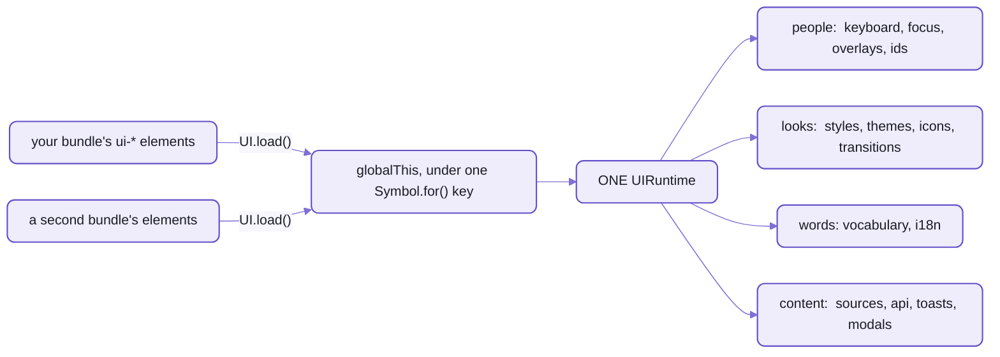
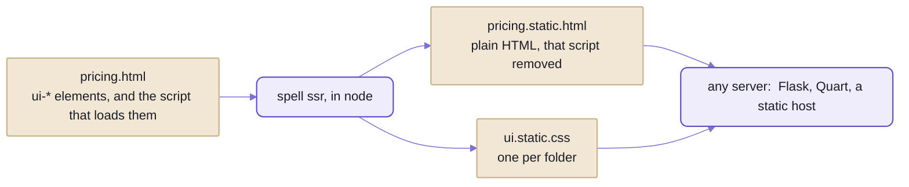

# Under Spell UI's elements:  one runtime per page

```html
<ui-root>
  <ui-button color="primary" icon="rocket">Launch</ui-button>
</ui-root>
```

One button.
Once its own code is in, this is everything else the page fetches for it, in the order the button asks:

| When | What arrives | Gzipped |
| --- | --- | --- |
| the button connects | the runtime, `UI`:  keyboard, focus, overlays, words, styles, icons and the rest, as one chunk | 16.9 kB |
| | the CSS foundation, as text:  every sheet the page and the shadow roots adopt | 17.3 kB |
| it draws its icon | the default pack's index, `fa7-free/pack.js` | about 14 kB |
| | `rocket.svg` | 0.4 kB |
| 99 more buttons connect | nothing:  they share the runtime, the sheets and the SVG | 0 |

_The library build's chunks, each minified and gzipped on its own, as a browser fetches them (`yarn measure`);
the icon files as a server would gzip them, the index 13.9 to 14.2 kB by gzip level._

Every row is the runtime, or something the runtime fetched:  the one set of services every `<ui-*>` element on a
page shares.
A page with no elements fetches none of it;  a page with a thousand fetches it once.

- Before any of that, the page fetched Solid, Spell UI's core and the button's own code:
  the whole page's numbers are on [Spell UI's front page](README.md).
- And only when the page asks for them:
  - a theme, one chunk each, from 0.2 kB to 39.4 kB, when `UI.themes.apply()` names it
  - the Temporal polyfill, 19.7 kB, for a `<ui-calendar>` in a browser that has no Temporal of its own

## One runtime per page, not one per tree

In React, what every component shares (a theme, a toast queue, a focus trap) is a provider you wrap around the tree,
and each React root gets its own.
A second copy of the library on the page is a second world.
Spell UI keeps ONE object per page, the runtime `UI`, and no element is wrapped in anything to reach it.



_Two bundles of Spell UI, one runtime:  whichever connects an element first creates it, and the other finds it._

- It lives on `globalThis`, under a `Symbol.for()` key that every copy of the package spells the same.
  So a micro-frontend, or a duplicate in your dependency tree, still shares one keyboard, one overlay stack and one
  scroll lock.
  In development, two different versions on one page print a warning.
- Elements reach it through `UI`, which works before the chunk has arrived:
  - `UI.load()` imports it, once however many elements ask, and resolves with it:  `const { themes } = await UI.load()`
  - anything else, `UI.keyboard` say, throws until then, and says to `await UI.load()` first:
    never a quiet `undefined`
  - a failed import isn't kept, so the next `UI.load()` tries again
- It builds in node too, for the static render (below):  a service touches the DOM only when it's used.

The cost:  the first element on a page renders, but shows only once the runtime and its sheets are in,
so nothing flashes unstyled.
That's one more round trip, which `<ui-root>` covers with skeletons;  every element after the first finds the
runtime already there.

## Eighteen services, one field each

Each service is a class, built when the runtime is, and held as one of its fields.
Your own code reads them the way the elements do, once the runtime is in:

```js
import { UI } from "spell/ui/core"

const { themes, i18n } = await UI.load()
await themes.apply("merlot") //             Spell's Merlot theme, on the page and in every shadow root
i18n.register("es", { close: "Cerrar" }) // every family's "Close", in Spanish
```

| Service | What it does |
| --- | --- |
| `UI.browser` | feature flags and sniffing, detected once:  `UI.browser.supports.invokers` ... |
| `UI.ids` | unique ids for ARIA wiring |
| `UI.keyboard` | shortcuts, with scopes |
| `UI.focus` | focus helpers that cross shadow roots |
| `UI.overlays` | the top-layer stack:  Escape, outside clicks, scroll lock, focus restore |
| `UI.styles` | the shared sheets every shadow root adopts, and the page's app stylesheet |
| `UI.themes` | the theme sheets, loaded on demand, and `apply()` ([README-themes.md](README-themes.md)) |
| `UI.transitions` | runs the animation catalogue (`fade up`, `scale`, `fly down` ...) |
| `UI.visibility` | scroll-position callbacks and lazy images |
| `UI.i18n` | the texts people read, and `Intl` formatting |
| `UI.vocabulary` | the names authors type, canonical and translated;  `defineComponents()`, the page's language |
| `UI.toasts` | toasts from code (`<ui-toast>` provides them) |
| `UI.modals` | dialogs from code that return a promise (`<ui-modal>` provides them) |
| `UI.api` | `fetch` with URL templates, throttling and abort, after Fomantic's API behaviour |
| `UI.icons` | the page's icon packs and the SVG cache |
| `UI.sources` | the same-origin text files `<ui-include>`, `<ui-code>` and `<ui-markdown>` load and save |
| `UI.code` | languages `<ui-code>` colours beyond its own:  `UI.code.register()` |
| `UI.propertyControls` | what `<ui-property-editor>` draws, by name:  control kinds, choice sources, rules |

<details>
<summary>The runtime's API, and what UI.sources and UI.api promise</summary>

- `UI.load()`:  imports the runtime once and resolves with it;  `loadUI()` is the same function.
- `UI.ready`:  resolves once every service is built and the runtime is on `globalThis`.
- `UI.version`:  this build's version;  a runtime from another bundle may differ.
- `UI.toast(options)` and `UI.observeVisibility(element, options)`:  shortcuts for `UI.toasts.show()` and
  `UI.visibility.observe()`, the last returning its undo.
- `UI.sources`:
  - same origin ONLY:  a URL on another origin is refused before any fetch,
    and so is everything on a page opened as a file
  - cached per URL as the in-flight promise, so elements asking for the same file share one fetch;
    `load(url, { fresh: true })` fetches again, and a caller's `signal` cancels only its own wait
  - saving:  `save()` hands the text to a `saver` the host page registers (`UI.sources.saver`);
    Spell UI can't know your server, and with none registered it rejects
- `UI.api`:
  - `{name}` in a URL template is required:  a missing value throws, so a half-built URL never goes out
  - `{/name}` is an optional path segment:  `/users/{/id}` gives `/users/5` or `/users`
  - a newer request with the same throttle key cancels the older one;  a response that isn't 2xx rejects
- The source:  [`src/runtime/`](src/runtime/), one file per service;
  [`UIRuntime.ts`](src/runtime/UIRuntime.ts) holds them, and [`load.ts`](src/runtime/load.ts) is the small eager
  half every page's core carries.

</details>

## Vocabularies and localization

This is a Spell UI page, written in Spanish:

```html
<html lang="es">
  <ui-root>
    <es-boton color="rojo" tamano="pequeño">Borrar</es-boton>
    <es-tarjeta>
      <es-contenido><es-encabezado>Informe</es-encabezado></es-contenido>
    </es-tarjeta>
  </ui-root>
</html>
```

- The root reads the page's language:  its own `lang`, else the document's.
- Spanish is one Spell UI ships, so the root loads it first, once per page:  a chunk of its own.
- Then each Spanish tag loads its family on demand, as a `ui-*` tag does.
  `<es-boton>` is Spell UI's button, drawn as `ui small red button`.
- And the texts people read are Spanish too:  a modal's close button says "Cerrar".

From code, the same thing is two calls on the runtime:

```js
import { UI } from "spell/ui/core"
import { es } from "spell/ui/components/components.es"

const { vocabulary, i18n } = await UI.load()
vocabulary.defineComponents({ prefix: "es", dictionary: es }) // every component, named in Spanish
i18n.registerDictionary(es) //                                   and its texts

const boton = document.querySelector("es-boton")
boton.color = "verde"
boton.getAttribute("color") // "verde"
boton.color //                 "green", and it now draws `ui green button`
```

_What [the translation smoke page](src/tools/smoke/translate.html) checks, in headless Chromium, on every
`yarn smoke`._

- `defineComponents()` defines every component the dictionary names a tag for:
  the ones defined already at once, and each one defined later (a family loaded on demand) as it's defined.
- One tag still names one component:  it throws on a prefix another dictionary has, or two components given one tag.
- One component, `UIButton.define("es-boton", es)`, for a page that wants only a few.

The page wrote Spanish;  the component's code read English, and didn't change.

That works because the code never writes a name of its own.
Every name a tag uses is data, in ONE file per tag, its vocabulary, `UI<Name>.en.ts`:

```ts
// src/components/ui-button/UIButton.en.ts, shortened
export const buttonVocabulary = {
  tag: "ui-button",
  topics: ["buttons", "basic", "controls", "forms", "elements"],
  aka: ["btn", "action", "submit", "link button"],
  skeleton: "inline 6 x 2.5",
  description: "A button indicates a possible action.",
  attributes: [
    { name: "size", kind: "size", description: "Size, `mini` ... `massive`;  `medium` is the default." },
    { name: "color", kind: "color", description: "Hue;  fills the button (or its ring and text when `basic`)." },
    // ...
  ],
  events: [
    { name: "ui-toggle", detail: "{ active: boolean, originalEvent?: Event }" /* ... */ }
  ],
  // ... slots, parts, states
  texts: [{ key: "loading", text: "Loading…", description: "Announced while `loading`." }]
} as const satisfies E.ComponentVocabulary
```

Two fields aren't about the element at all.
`topics` and `aka` are how people find it (search the docs for `btn`, and you get `<ui-button>`),
and `skeleton` is the grey box `<ui-root>` draws in its place while it loads.

- One file feeds everything that needs the names:
  - the root's catalog of which family defines a tag (`yarn gen:root`)
  - the docs site's data and its API tables
  - VS Code's autocomplete and hover docs for every `<ui-*>` tag, attribute and value:
    a Custom Elements Manifest and VS Code's HTML custom data, written by `yarn site:data` and committed
  - the cards of Spell's design system on claude.ai (`spell design build`)
- From code, `UIButton.describe()` returns the whole of it:  `UIButton.describe().topics`.
- How the kit's element framework reads a vocabulary:  [README/element.md](https://github.com/spell-app/spell/blob/main/README/element.md).

Its Spanish is a file beside it, `UIButton.es.ts`, with what only that tag says:

```ts
// src/components/ui-button/UIButton.es.ts, shortened
export const buttonEs = {
  lang: "es",
  tag: "ui-button",
  name: "boton", //                   <es-boton>
  aka: ["botón", "acción", "enviar", "botón de enlace"],
  attributes: { "active-text": "texto-activo", "inactive-text": "texto-inactivo" /* ... */ },
  events: { "ui-toggle": "alternar" }, // es-alternar
  texts: { loading: "Cargando…" }
} as const satisfies E.TagDictionary
```

- What many tags share is translated once, in [components.es.ts](src/components/components.es.ts):
  - names (`size` is `tamano` everywhere, `ui-change` is `es-cambio`)
  - the shared value sets (hues, sizes, positions, devices ...), and every other value (`left` is `izquierda`)
  - the texts every family shares (`close`, `ok`, `noResults` ...)
- It gathers the tag files into one `Dictionary`, `es`.
- Names are ASCII (`tamano`, `es-boton`).
  Values may hold accents (`pequeño`), and are found without them too.

Localization comes in two halves:
- NAMES, what authors type:  a dictionary renames tags, attributes, values, events, slots and parts.
  The dropdown, `<es-desplegable>`, sends `es-cambio` where Spell UI's sends `ui-change`.
  - A Spanish tag's properties are Spanish too:  `desplegable.abierto`, not `open`.
  - A part keeps its English name beside the Spanish one (`part="header encabezado"`):  a stylesheet works in both.
- TEXTS, what people read:  `UI.i18n.registerDictionary(es)`, or one at a time,
  `UI.i18n.register("es", { close: "Cerrar" })`, for every component, or for one with a third argument, its tag.
- What stays English whatever the language:
  - CSS classes, `:state()`s, JavaScript property names of the English tags, `detail` keys, tokens, utility classes
  - the platform's own attributes, and their values:  `href`, `name`, `value`, `min`, `max`, a button's `type` ...
  - names that are names:  ad units (`leaderboard`), video providers (`youtube`)
  - the animations' names (`animation="fade up"`)

The price is that the names ship.
`<ui-button>`'s vocabulary is 3.0 kB of its own 11.6 kB gzipped,
because the element reads its names as it runs, and a dictionary needs them there.

**Real today:**  Spanish, every family:  the names, the texts, and `<ui-root lang="es">`.
- Its names and texts are a chunk only a Spanish page loads.
- It's a first draft, for a native speaker to review.

**Not yet:**  no other language, and no translated emoji names.

<details>
<summary>How a text is looked up, and emoji names</summary>

`UI.i18n` looks a text up in this order, and takes the first it finds:
1. the exact locale (`pt-BR`)
2. the language (`pt`)
3. `en`
4. the English default:  the tag's own `texts`, then Spell UI's shared ones
5. the key itself, so a missing text shows up rather than going blank

- At each locale, a component's own texts come before the shared ones:
  so a shared translation covers every family that uses the key, and a scoped one overrides it for one.
- `UI.i18n.register("en", { close: "Dismiss" })` rewords an English default.
- The locale is the browser's (`navigator.language`) until you set `UI.i18n.locale`.
- Numbers and dates format through `Intl`, each formatter built once per locale and options.
  Temporal is the browser's own, or the polyfill, a chunk only browsers without it fetch.
- Emoji names come in two sets:  `cldr` (the default) and `fomantic`.
  - A root picks one, `<ui-root emoji="fomantic">`;  page-wide, `EmojiData.use("fomantic")`.
  - The names load by first letter:  a page that draws `smile` fetches the s's, 3.6 kB gzipped.
  - 🌱 Translated sets are planned.

</details>

## Icons

```sh
spell icon rocket
```

<details>
<summary>Output</summary>

```text
rocket      fa7-free
rocket      fomantic
rocketchat  fa7-brands
rocketchat  fomantic
```

</details>

An icon is an SVG file, and a pack is a folder of them, plus `pack.js`:  its id, label, licence,
and each icon's size and other names.
`<ui-icon name="rocket">` draws one, and so does any element with an `icon` attribute:
each asks `UI.icons` for a name, and it decides which file to fetch.

| Pack | What it is | In it |
| --- | --- | --- |
| `fa7-free` | Font Awesome 7 Free, solid and regular (`bell outline`):  the default | 1,595 SVGs:  1,422 solid, 169 regular, four logos |
| `fa7-brands` | Font Awesome's logos of companies and products, opt-in | 572 SVGs |
| `fomantic` | Fomantic UI's icon names (`address book`) over the same files, opt-in | an index, no files of its own |

- One name per icon, words separated by spaces.
  What you type is normalized the same way, so `address-book`, pasted from Font Awesome's site, works.
- Packs stack, and the LAST one added wins a name;  `fa7-brands:github` asks one pack.
- For a part of the page, `<ui-root icons="fa7-brands, fomantic">`, over the outer root's packs;
  for the whole page, `UI.icons.use()`.
- `spell icon <query>` finds an icon by name, alias or keyword, and `--open` shows them as pictures to click and copy:
  every option on [the command line's page](https://github.com/spell-app/spell/blob/main/README/cli.md#spell-ui).

Icons cost nothing until the first one draws, then its pack's index (about 14 kB for `fa7-free`) and one small file
per icon.
Each SVG is fetched once per page, and shared by every root and every bundle on it.

Two catches:
- There's no sanitizing at run time.
  The pack builder checked the SVGs (below), and adding a pack runs its `pack.js`:
  trust a pack the way you'd trust a script.
- The built-in packs load from `icon-packs/` beside the chunk that holds Spell UI's core.
  Bundle Spell UI into your own app and that folder doesn't follow:
  copy it next to your chunks, or point `<ui-root assets>` at wherever it is.

### Using another icon set

**What works today:**  any folder of SVGs becomes a pack, filled or stroked.
The builder runs in `spell-ui`, in a checkout of the kit ([setup from zero](https://github.com/spell-app/spell/blob/main/README.md#setup-from-zero)):

```sh
cd ~/www/spell/spell-ui
yarn icons:pack ../my-site/icons --id my-icons
```

<details>
<summary>What it printed</summary>

```text
IconPackBuilder.build():  pack "my-icons" has 1 problem(s) in …/my-site/icons;  fix the SVGs, or sanitize,
  skip or allow them (`--sanitize`, `--skip-unsafe`, `--allow-unsafe`)
  tracker.svg:  onload attribute on <svg>
```

</details>

```sh
yarn icons:pack ../my-site/icons --id my-icons --sanitize
```

<details>
<summary>What it printed</summary>

```text
…/my-site/icons/pack.js:  3 icons
  added:  rocket, tracker, wide-arrow
  sanitized tracker.svg:  removed onload attribute on <svg>
```

</details>

```js
// my-site/icons/pack.js, as written (its two comment lines left out)
export default {
  "id": "my-icons",
  "defaults": {"width":24,"height":24},
  "icons": {
    "rocket": {},
    "tracker": {},
    "wide-arrow": {"width":32}
  }
}
```

```html
<ui-root icons="/icons/pack.js">
  <ui-icon name="rocket"></ui-icon>
  <ui-icon name="my-icons:wide arrow"></ui-icon>
</ui-root>
```

- The builder never touches an SVG unless asked.
  If any file could run a script or load another resource, it refuses the whole pack and names each file and why.
  - `--sanitize` strips the unsafe attributes first, rewriting those files.
  - What still fails:  `--skip-unsafe` leaves it out, `--allow-unsafe` keeps it anyway.
  - `--label` and `--license` fill in the pack's own lines;  `--force` replaces a `pack.js` that has another id.
- Run it again after adding files:  it keeps your hand edits to `pack.js` (an `alias` for a second name),
  and refreshes only the sizes.
- From code, `UI.icons.use("/icons/pack.js", { prefix, base, only })`:
  `prefix` adds a short name to ask it by, `base` serves its SVGs from elsewhere (a CDN),
  and `only: true` drops every pack before it, the default included.
- A handful of icons and no pack at all:  `UI.icons.register("logo", svgText)`, ahead of every pack.
- Stroked sets stay stroked:  an SVG whose root sets its own `fill` (`fill="none"`, Lucide's style) keeps it.
  Tested with a Lucide-style pack in the tests, not with Lucide's own files.

`spell icon` searches only the three built-in packs, though, and no set installs by name yet.

### 🌱 Coming:  named icon sets

What it will add:
- packs for the popular sets, installed by name:  Material Symbols, Lucide, Heroicons and Phosphor,
  so `icons="lucide"` works the way `icons="fa7-brands"` does today
- an icon browser that searches across every pack, yours included
- a pack chosen per element, not only per root

None of it is built;  today a set gets in as a folder of SVGs (above).

## Styles

A web component that carries its CSS in a `<style>` puts a copy into every instance's shadow root.
Spell UI makes each sheet ONCE per page, as a `CSSStyleSheet`, and every shadow root adopts that same object
(`adoptedStyleSheets`):  a thousand buttons, one parse of the button's CSS.

The foundation is a set of sheets in [`src/styles/`](src/styles/), one per concern, each in its cascade layer:

| Sheet | What | Layer |
| --- | --- | --- |
| `layers.css` | the layer order;  MUST come first in the page and in every shadow root | -- |
| `reset.css` | box-sizing and margins for shadow markup, never the page | `ui.reset` |
| `tokens.css` * | type, spacing, radii, borders, ink, shadows, motion, z-index, breakpoints | `ui.tokens` |
| `colors.css` * | the palette, semantic colours, colour remaps and colour utilities | `ui.tokens`, `ui.utilities` |
| `sizes.css` * | size ratios, size remaps, font-size and spacing utilities | `ui.tokens`, `ui.utilities` |
| `animations.css` | the transition catalogue | `ui.utilities` |
| `utilities.css` | layout, text, theme and visibility utilities, for your markup and inside components | `ui.utilities` |
| `typography.css` | page typography, opt-in with `class="ui-typography"` | `ui.base` |
| `native.css` | plain HTML slotted into components, and CSS-only tooltips (`data-tooltip`) | `ui.components` |
| `themes/*.css` | the themes ([README-themes.md](README-themes.md)) | `ui.theme` |
| `ui.css` | all of it as one stylesheet, for pages without JavaScript | -- |

- \* Generated from [`styles.en.ts`](src/styles/styles.en.ts) by `yarn gen:styles`, and committed,
  so nobody using Spell UI needs a build step.
- `spell/ui/styles` exports each sheet as text, plus the two lists the runtime adopts:
  - `foundationCSS`:  for the page AND every shadow root
  - `pageCSS`:  for the page only, which adds typography and the native-markup rules
- Each family adds its own sheet, in `ui.components.<name>`, split into four sub-layers:
  the layer order, and why nobody writes `!important`, are on [README-themes.md](README-themes.md).

A page's own CSS still can't reach inside a shadow root.
It gets in through [four doors](README.md#your-css-stops-at-the-shadow-root--four-doors-let-it-in),
and the runtime runs the last of them, the app stylesheet (`id="ui-app-stylesheet"`),
adopting it LAST into every shadow root.
The other way round, nothing restyles your markup uninvited:  `typography.css` waits for its class,
and every rule in `reset.css` starts with `:host`, so on the page it matches nothing.

## The static render

Search engines and readers with JavaScript off get the same page, as plain HTML:  no shadow DOM, no script.
It looks the same, and its links and forms work.
Here's a page, the command, and what came out:

```html
<ui-root>
  <ui-card>
    <ui-header>Team</ui-header>
    <ui-label color="green">Popular</ui-label>
    <ui-button color="primary">Choose</ui-button>
  </ui-card>
  <ui-modal id="terms">
    <ui-header>Terms</ui-header>
    <p>The usual.</p>
  </ui-modal>
  <ui-button commandfor="terms" command="--show">Read the terms</ui-button>
</ui-root>
```

```sh
spell ssr pricing.html
```

<details>
<summary>What it printed</summary>

```text
Rendering 1 page...
pricing.static.html
pricing.html -> pricing.static.html  1.2 kB
  removed scripts:  inline
ui.static.css
ui.static.css  259.3 kB from 308.2 kB, 1 page this run, 6 tags in all
```

</details>

```html
<article data-ui="card" class="ui card" part="card">
  <div data-ui="header" data-state="in-card" class="header in-card" part="header">Team</div>
  <span data-ui="label" class="ui green label" part="label">Popular</span>
  <button data-ui="button" type="button" class="ui primary button" part="button">Choose</button>
</article>
<dialog data-ui="modal" data-state="hidden" id="terms" class="ui modal" part="modal" aria-labelledby="ui-modal-heading-2">
  <div data-ui="header" data-state="in-modal" id="ui-modal-heading-2" class="header in-modal" part="header">Terms</div>
  <p>The usual.</p>
</dialog>
<button data-ui="button" type="button" class="ui button" part="button" commandfor="terms" command="show-modal">Read the terms</button>
```

_`pricing.static.html`'s body, inside the root's wrapper, with each element's `data-ui-slotted` mark left out._

The card is an `<article>`, the label a `<span>`, the modal a real `<dialog>`.
And the modal still opens:  `--show` was Spell UI's command, and the render rewrote it to the browser's own,
`show-modal`, so in a browser with invoker commands the button opens the dialog with no script at all.



_Rendered once, ahead of time:  what the server sends is files._

- Each element is rendered to light DOM, and the scripts that load elements are removed;  your own scripts stay.
- What the browser can do without scripts is wired up:  invoker commands, a dialog's close buttons, popovers,
  and ids made unique where a render repeats one.
- ONE minified stylesheet per output folder, `ui.static.css`, linked from every page there,
  so a browser fetches it once.
  It holds the families its pages use, and grows as more pages are rendered:  rendering one page again never drops
  another's styles.
- `-o`, `--css`, `--inline-css` and `--no-minify` choose where the output goes:
  every option, and how the render works inside, on [the command line's page](https://github.com/spell-app/spell/blob/main/README/cli.md#spell-ui).

The cost is the stylesheet, and most of it is the foundation:
a page with one button gets 143 kB minified (20 kB gzipped), and the six tags above 259 kB (33 kB).

Where it stops:
- 55 of the 62 [families](README-components.md) render.
  The other seven stay as they are, and are listed on stderr:
  `ui-code`, `ui-markdown`, `ui-include`, `ui-panel`, `ui-property-editor`, `ui-tree-diagram`, and `ui-components`,
  the pack loader.
- What has no path without JavaScript stays as rendered:  tabs, and popups that open on hover.
- The page mustn't load the elements as well:  they'd take the flattened markup for slotted content, and show it twice.
  That's why the render removes the scripts.
- Declarative Shadow DOM, the other way to render on a server, is a probe, not a feature:
  a test renders `<ui-button>` into a `<template shadowrootmode>`, and an element given one uses it,
  but replaces its content as it renders, with no hydration.
  No command writes a page that way.

<details>
<summary>The static render from code</summary>

It's the `SSR` namespace, `spell/ui/static`, in [`src/static/`](src/static/):  node only, never in a browser bundle.
`StaticRender.page()` and `fragment()` do the work:

```ts
import { SSR } from "spell/ui/static"

await SSR.StaticCatalog.define() //        the 55 families it can render, once per process
await SSR.StaticRender.prepare(html) //    what the render reads:  icon packs, each family's own data
const page = SSR.StaticRender.page(html) // a whole document;  fragment(html) for body content
```

- It parses the page with linkedom, builds every component in document order (owners first), then renders each with
  Solid's server render.
- It has to run where Spell UI's JSX is compiled for the server, so not under plain node:
  `spell ssr` runs it from [`ssrCommand.ts`](src/cli/ssrCommand.ts), in a child process, through Vite.

</details>

### From Python, Flask or Quart

What `spell ssr` writes is files, so a Python server serves them like any others, today.
Render the pages once, then send `page.static.html` and `ui.static.css`:

```python
from flask import Flask, send_from_directory

app = Flask(__name__)


@app.get("/pricing")
def pricing():
    return send_from_directory("pages", "pricing.static.html")


@app.get("/ui.static.css")
def stylesheet():
    return send_from_directory("pages", "ui.static.css")
```

- Run with Flask's own server, both answer 200, `text/html` and `text/css`, and the modal above still opens.
- Quart, or any static host, serves them the same way.
- A Spell program compiled to Python runs its logic on Quart, and draws with JavaScript and Spell UI as usual:
  its compile writes a short Quart app beside it ([spell-parser's README-targets.md](https://github.com/spell-app/spell/blob/main/parser/README-targets.md)).

### 🌱 Coming:  rendering from a Python app

A render step a Flask or Quart app can call while it answers a request,
so a Python template can write `ui-*` markup and send plain HTML:
a node sidecar, or the static render as a small service.
Today the render runs ahead of time, from the command line.

## Spell UI's half of the element core

The element framework itself (the DOM element and the component behind every tag, the decorators, the lifecycle)
is the kit's:  [README/element.md](https://github.com/spell-app/spell/blob/main/README/element.md).
Spell UI adds what its families need on top, in [`src/elements/`](src/elements/),
and hands the framework its runtime, words and styles as its core loads.

<details>
<summary>The pieces, one line each</summary>

| Piece | What it's for |
| --- | --- |
| `FormComponent`, `DOMFormControl` | form controls:  a value, a name, validation, `disabled` from a fieldset, labels, reset |
| `PartComponent` | the generic content parts (`<ui-header>`, `<ui-meta>` ...), styled by what they're in |
| `LoadableComponent`, `DOMLoadableElement` | elements that show a text file:  `source` or inline text, loading and error looks, `save()` |
| `LoadableBody` | a section's body, loaded from `source` the first time it opens |
| `NativeFallback` | the plain-DOM stand-in a form control shows if its render throws, so it still submits |
| `ClassBuilder` | attributes to Fomantic's class words:  `<ui-button size="small" color="primary">` → `ui small primary button` |
| `Validator`, `MenuOptions` | form rules;  the options of dropdowns, selects and searches |
| `IconGlyph`, `RootSettings` | one icon, drawn from the packs of the root it's in;  what each `<ui-root>` sets for what's inside |
| `CloseButton` | the close button of a box that closes:  a message, a toast, a nag, a dialog |
| `SpellUISettings` | what Spell UI hands the kit's element framework as it loads:  the runtime, the words, the styles |

- Every family imports these through two entries:
  `spell/ui/core` (`E`) and, for form controls, `spell/ui/forms` (`F`).
- The states every element shares are the kit's `UIComponent`'s:
  `disabled`, `loading`, `visible` / `hidden`, `animation`.
  Spell UI's elements style them through the reset sheet.

</details>

<details>
<summary>More in the docs site</summary>

These guides are served by the page server from the content folder,
so they need a checkout with the content folder and the page server running ([README-site.md](README-site.md)).

- Spell UI's design notes on the runtime, icons, translation and fallbacks, in `/guides/ui/notes/`:
  `runtime.md`, `icons.md`, `translation.md`, `fallback.md`
- Custom Elements in Spell:  `/guides/custom-elements/custom-elements.html`
- The static render, from the epic that built it:  `/guides/seo/seo.html`

</details>

## See also

- [README-themes.md](README-themes.md):  the four ways your CSS gets inside a component, and the themes
- [README/element.md](https://github.com/spell-app/spell/blob/main/README/element.md):  the kit's element framework, which every family is written on
- [README-site.md](README-site.md#the-tools--the-librarys-own-checks-beside-the-sites):
  `yarn measure` and `yarn smoke`, which made this page's numbers and checks
- [The command line's page](https://github.com/spell-app/spell/blob/main/README/cli.md#spell-ui):  every option of `spell icon` and `spell ssr`
- [Spell UI's front page](README.md):  `<ui-root>`, how a page loads its families, and what a whole page weighs
