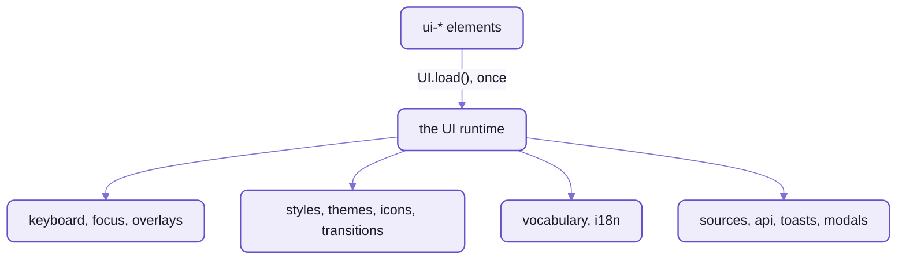

# What's under Spell UI's elements

Every Spell UI element on a page shares ONE runtime, `UI`:
the keyboard, the overlay stack, focus, styles, themes, icons, words and the rest.
The first element that connects loads it, as one lazy chunk;  a page with no elements never pays for it.

- It lives on the page, not in each element:  `globalThis.UI ??= new UIRuntime()`.
  So two copies of the package on one page (a micro-frontend, a duplicate bundle)
  still share one keyboard and one overlay stack.
- An element calls `UI.load()` as it connects;  the runtime's module is imported once, however many ask.
- This page walks through what it holds, then the vocabularies, icons, styles and the static render.



_One runtime per page:  every element talks to the same services._

## The services

Each service is a class, and a field of the runtime:  `UI.keyboard`, `UI.themes` ...

| Service | What it does |
| --- | --- |
| `UI.browser` | feature flags and sniffing:  `UI.browser.supports.invokers` ... |
| `UI.ids` | unique ids for ARIA wiring |
| `UI.keyboard` | shortcuts, with scopes |
| `UI.focus` | focus helpers that cross shadow roots |
| `UI.overlays` | the top-layer stack:  Escape, outside clicks, scroll lock, focus restore |
| `UI.styles` | the shared stylesheets every shadow root adopts, and the page's app stylesheet |
| `UI.themes` | the theme sheets, loaded on demand, and `apply()` |
| `UI.transitions` | runs the animation catalogue (`fade up`, `scale`, `fly down` ...) |
| `UI.visibility` | scroll-position callbacks and lazy images |
| `UI.i18n` | the texts people read, and `Intl` formatting |
| `UI.vocabulary` | the names authors type, canonical and translated |
| `UI.toasts` | toasts from code (`<ui-toast>` provides them) |
| `UI.modals` | dialogs from code that return a promise (`<ui-modal>` provides them) |
| `UI.api` | `fetch` with URL templates, throttling and abort, after Fomantic's API behaviour |
| `UI.icons` | the page's icon packs and the SVG cache |
| `UI.sources` | the same-origin text files `<ui-include>`, `<ui-code>` and `<ui-markdown>` load and save |
| `UI.code` | languages `<ui-code>` colours beyond its own:  `UI.code.register()` |
| `UI.propertyControls` | what `<ui-property-editor>` draws, by name:  control kinds, choice sources, rules |

<details>
<summary>The runtime's API, in more depth</summary>

- `UI.load()`:  imports the runtime once and resolves with it;  `const { themes } = await UI.load()`.
- `UI.ready`:  resolves once every service is built and the runtime is on `globalThis`.
- `UI.version`:  this build's version;  a runtime from another bundle may differ.
- It builds outside a browser too (the static render):  services touch the DOM only when used.
- `UI.sources`:
  - same origin ONLY:  a URL on another origin is refused before any fetch,
    and so is everything on a page opened as a file
  - cached per URL as the in-flight promise, so elements asking for the same file share one fetch;
    `load(url, { fresh: true })` fetches again
  - saving:  `save()` hands the text to a `saver` the host page registers;
    Spell UI can't know your server, and with none registered it rejects
- `UI.api`'s URL templates:
  - `{name}` is required:  a missing value throws, so a half-built URL never goes out
  - `{/name}` is an optional path segment:  `/users/{/id}` gives `/users/5` or `/users`
- The source:  [`src/runtime/`](src/runtime/), one file per service;
  [`UIRuntime.ts`](src/runtime/UIRuntime.ts) holds them.

</details>

## Vocabularies and localization

Every tag has ONE vocabulary file, `UI<Name>.en.ts`:  every name the tag uses, as data.
The component's code reads its names through it, never as string literals.

```ts
// components/ui-button/UIButton.en.ts, shortened
export const buttonVocabulary = {
  tag: "ui-button",
  topics: ["buttons", "basic", "controls", "forms", "elements"],
  aka: ["btn", "action", "submit", "link button"],
  skeleton: "inline 6 x 2.5",
  description: "A button indicates a possible action.",
  attributes: [
    { name: "size", kind: "size", description: "Size, `mini` ... `massive`;  `medium` is the default." },
    { name: "primary", kind: "keyOnly", description: "Primary emphasis:  the `primary` brand colour." }
    // ...
  ]
}
```

- It holds:
  - the tag, its attributes (each with a kind and its allowed values)
  - its events, slots, parts, states and the texts it shows
  - `topics` and `aka`:  how people search for it
  - `skeleton`:  what the root draws while it loads
- One file feeds everything that needs the names:
  - the root's catalog of which family defines a tag
  - the docs site's data, and its API tables
  - VS Code's autocomplete for `<ui-*>`:
    a custom-elements manifest and VS Code's HTML data, written by `yarn site:data`
  - the claude.ai design system's cards
- Live in a browser's console:  `UIButton.describe()`.

Localization comes in two halves:

- NAMES, what authors type:  a dictionary renames tags, attributes, values and events.
  `UIButton.define("ie-boton", es)` registers `<ie-boton primario color="rojo">`;
  values arrive in English, so the component's code is unchanged.
- TEXTS, what people read:  `UI.i18n.register("es", { label: "Etiqueta" })`, for every component or one.
- What stays in English whatever the language:
  CSS classes, `:state()`s, JavaScript property names, `detail` keys, tokens, utility classes.

Where it stands:
the mechanism works, tested with a Spanish dictionary on [the translation smoke page](tools/smoke/translate.html).
But no real translations ship, and the page-wide call that would rename every family at once isn't built yet.

<details>
<summary>How a text is looked up</summary>

`UI.i18n` looks a component's text up in this order, and takes the first it finds:

1. the exact locale (`pt-BR`)
2. the language (`pt`)
3. `en`
4. the English default in the tag's vocabulary (its `texts`)
5. the key itself, so a missing text shows up rather than going blank

- Numbers and dates format through `Intl`;  Temporal through a polyfill where the browser lacks it.
- Emoji names come in two sets, `cldr` (the default) and `fomantic`.
  A root picks one (`<ui-root emoji>`);  translated sets are planned.

</details>

## Icons

Icons are SVG files in PACKS, loaded by `UI.icons` and cached.
`<ui-icon name="home">` draws one;  so does any element with an `icon` attribute.

- The built-in packs:
  - `fa7-free`:  Font Awesome 7 Free, solid and regular:  the default
  - `fa7-brands`:  Font Awesome's brand logos, opt-in
  - `fomantic`:  Fomantic UI's icon names (`address book`) over the same files, opt-in
- Choose packs for a part of the page with `<ui-root icons="fa7-brands, fomantic">`,
  or for the whole page with `UI.icons.use()`.
- A pack is a folder of SVG files and a `pack.js` index:  its id, label, licence and each icon's other names.
- `spell icon <query>` finds an icon by name, alias or keyword;  `--open` shows them as pictures to click and copy.

### Using another icon set

What works today:  any folder of SVGs becomes a pack.

```sh
cd spell-ui
yarn icons:pack ../my-site/icons --id my-icons     # checks every SVG (no scripts, nothing external), writes pack.js
```

```html
<ui-root icons="my-icons/pack.js">
  <ui-icon name="rocket"></ui-icon>
</ui-root>
```

- `--sanitize` strips unsafe attributes first.
  The files that still fail:  `--skip-unsafe` leaves them out, `--allow-unsafe` keeps them.
- Re-running keeps the hand edits in `pack.js` (aliases), refreshing only sizes.

### 🌱 Coming:  named icon sets

What it will add:

- packs for the popular sets, installed by name:  Material Symbols, Lucide, Heroicons and Phosphor,
  so `icons="lucide"` works like `fa7-brands` does today
- an icon browser that searches across every pack
- a pack chosen per element, not only per root

Today a set gets in as a folder of SVGs (above).

## Styles

Spell UI's CSS foundation is a set of sheets in [`src/styles/`](src/styles/), one per concern, each in its layer.
Every shadow root adopts the same sheet objects (`adoptedStyleSheets`):  made once per page, never copied.

| Sheet | What | Layer |
| --- | --- | --- |
| `layers.css` | the layer order;  MUST come first in the page and in every shadow root | -- |
| `reset.css` | box-sizing and margins for shadow markup, never the page | `ui.reset` |
| `tokens.css` * | type, spacing, radii, borders, ink, shadows, motion, z-index, breakpoints | `ui.tokens` |
| `colors.css` * | the palette, semantic colours, colour remaps and colour utilities | `ui.tokens`, `ui.utilities` |
| `sizes.css` * | size ratios, size remaps, font-size and spacing utilities | `ui.tokens`, `ui.utilities` |
| `animations.css` | the transition catalogue | `ui.utilities` |
| `utilities.css` | layout, text, theme and visibility utilities | `ui.utilities` |
| `typography.css` | page typography, opt-in with `class="ui-typography"` | `ui.base` |
| `native.css` | plain HTML slotted into components, CSS-only tooltips | `ui.components` |
| `themes/*.css` | the themes ([README-themes.md](README-themes.md)) | `ui.theme` |
| `ui.css` | all of it as one stylesheet, for pages without JavaScript | -- |

- \* Generated from [`styles.en.ts`](src/styles/styles.en.ts) by `yarn gen:styles`, and committed,
  so nobody using Spell UI needs a build step.
- `spell-ui/styles` exports each sheet as text, plus:
  - `foundationCSS`:  for the page AND every shadow root
  - `pageCSS`:  for the page only
- Each family adds its own sheet, in `ui.components.<name>`, with four sub-layers (types, content, variations, states):
  so a state beats a variation without `!important`.
- The app stylesheet (`id="ui-app-stylesheet"`) is adopted LAST into every shadow root:
  [README-themes.md](README-themes.md).

## The static render

The static render turns a page of `ui-*` elements into plain HTML in node:  no shadow DOM, no JavaScript.
It's for search engines and for readers without JavaScript;  the page looks the same, and links and forms work.

```sh
spell ssr docs/getting-started.html         # writes getting-started.static.html, and ui.static.css beside it
```

- Each element is rendered to light DOM, and the scripts that load elements are removed;  your own scripts stay.
- ONE minified stylesheet per output folder, `ui.static.css`, linked from every page there, so a browser fetches it
  once.
  It holds the families its pages use, and grows as more pages are rendered.
- `-o <file or folder>`, `--css <file>` (one stylesheet elsewhere), `--inline-css` (each page its own `<style>`),
  `--no-minify`.
- Inside, it's the `SSR` namespace in [`src/static/`](src/static/):  node only, never in a browser bundle.
  `StaticRender.page()` and `fragment()` do the work, on linkedom and Solid's server render.
- Elements can also render to Declarative Shadow DOM on the server.

### From Python, Flask or Quart

What works today:  a Python server can serve what the static render wrote, as it would any HTML.

- Render the pages once (`spell ssr`).
  Then serve `page.static.html` and `ui.static.css` from Flask, Quart or any static host.
- A spell program compiled to Python serves its drawing half (JavaScript and `ui-*` elements) from Quart,
  and the page loads Spell UI as usual.

### 🌱 Coming:  rendering from a Python app

A render step a Flask or Quart app can call while it answers a request,
so a Python template can write `ui-*` markup and send plain HTML:
a node sidecar, or the static render as a small service.
Today the render runs ahead of time, from the command line.

## Spell UI's half of the element core

The element framework itself (the DOM element and the component behind every tag, the decorators, the lifecycle)
is the kit's:  [README-element.md](../README-element.md).
Spell UI adds what its families need on top, in [`src/elements/`](src/elements/),
and hands the kit's framework its runtime as it loads.

| Piece | What it's for |
| --- | --- |
| `FormComponent`, `DOMFormControl` | form controls:  a value, a name, validation, `disabled` from a fieldset, labels, reset |
| `PartComponent` | the generic content parts (`<ui-header>`, `<ui-meta>` ...), styled by what they're in |
| `LoadableComponent`, `DOMLoadableElement` | elements that show a text file:  `source` or inline text, loading and error looks, `save()` |
| `LoadableBody` | a section's body, loaded from `source` the first time it opens |
| `NativeFallback` | the plain-DOM stand-in a form control shows if its render throws, so it still submits |
| `ClassBuilder` | attributes to Fomantic's class words:  `<ui-button size="small" primary>` → `ui small primary button` |
| `Validator`, `MenuOptions` | form rules;  the options of dropdowns, selects and searches |
| `IconGlyph` | one icon, drawn from the page's packs |
| `SpellUISettings` | what Spell UI hands the kit's element framework as it loads:  the runtime, the words, the styles |

- Every family imports these through two entries:
  `spell-ui/core` (`E`) and, for form controls, `spell-ui/forms` (`F`).
- The states every element shares are documented on the kit's `UIComponent`:
  `disabled`, `loading`, `visible` / `hidden`, `animation`.
  Spell UI's elements style them through the reset sheet.

<details>
<summary>More in the docs site</summary>

These guides are served by the page server from the content folder,
so they need a checkout with the content folder and the page server running ([README-site.md](README-site.md)).

- Spell UI's design notes on the runtime, icons, translation and fallbacks, in `/guides/ui/notes/`:
  `runtime.md`, `icons.md`, `translation.md`, `fallback.md`
- Custom Elements in Spell:  `/guides/custom-elements/custom-elements.html`
- The static render, from the epic that built it:  `/guides/seo/`

</details>

## See also

- [README.md](README.md):  Spell UI's front page
- [README-themes.md](README-themes.md):  tokens, layers, themes
- [README-components.md](README-components.md):  every family
- [README-frameworks.md](README-frameworks.md):  using the elements from a framework
- [README-site.md](README-site.md):  the docs site and the tools
- [The kit's front page](../README.md), and its [element framework](../README-element.md)
- Also beside it:  [README-migrating.md](README-migrating.md)
