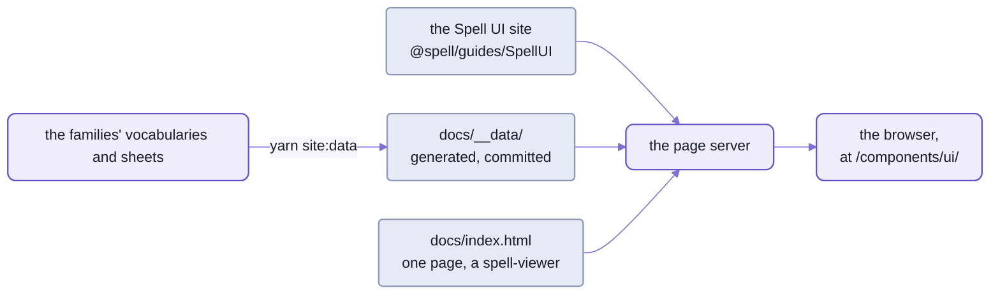

# The Spell UI site

```spell
<section label="Button" sticky="stack" collapsible dividing>
	<example "Button" description="A standard button.">
		<button>Follow</button>
	</example>
</>
```

_The first example on the Button's Examples page, as it's written on disk:
[Examples.spell](../app/spaces/@spell/guides/SpellUI/Button/Examples.spell)._

That's a whole example, and all of its source.
On the page it's a live `<ui-button>` under its description, with a code button that shows these same lines.
Nobody typed them twice:  an example shows its own markup.

Spell UI's docs are a Spell guide, the Spell UI site:  one project of notebook pages,
`@spell/guides/SpellUI`, in the app folder's built-in projects.
- 435 pages, with 2,074 live examples (counted 2026-11-22).
- A component has a folder of four pages, Usage, Examples, API and Theming;
  its Usage page is its address (`/button`), the others under it (`/button/examples`).
- Nine more:  the home page, getting started, the class grammar, theming, icons, utilities,
  the component index, the kitchen sink and the theme bench.
- The site file, [SpellUI.spell](../app/spaces/@spell/guides/SpellUI/SpellUI.spell),
  says where each page is and what the side navigation calls it.
- Where an element can't do what a page needs, that's a gap in the library:
  it gets fixed in the element, never patched in the page.

Until epic `editor` P43 the docs were 121 hand-written HTML pages in `docs/`, the components pages.
They're gone:  the Spell UI site has every page they had,
and a link written for one (`/components/ui/ui-button.html`) is mended to its Spell page's address
(`/components/ui/button`) by the page server's link mender.



_Three things make the site:  the Spell pages, data a script writes from the elements, and one page that shows them._

## Viewing it:  at /components/ui/, with no editor

```sh
spell server start
```

Then open `/components/ui/` on the page server, or any page's address under it:
`/components/ui/button/api` is the Button's API page, `#section` and all.

- Every address under `/components/ui/` gets the same page, [docs/index.html](docs/index.html):
  a `<spell-viewer>` showing the Spell UI site, at the page the address names.
  - It's Spell UI's component set's `sitePage`, in its part of the page server's settings
    (`"pageServer"`, in [package.json](package.json)).
  - Going to another page changes the address, so back, forward and a reload work as with plain pages.
  - The page server compiles the guides as it starts.
- In the editor, the same site is the project `/run/@spell/guides/SpellUI`:
  that's where a page is changed, with Change this.
  The page at `/components/ui/` is for reading.
- Links to the site are worked out in one place, [SpellUIGuide](src/util/SpellUIGuide.ts):
  the editor's Inspector, the theme bench, `spell ui icon`, the components catalogue and the link mender ask it.
- The pages read Spell UI's docs folder, served at the same address:
  - its data, `__data/`:  the API tables, the search, the component index
  - Fomantic's docs pictures, `images/`, and the files examples load, `examples/`
- Under a worktree's address too:  `/worktrees/<epic>/components/ui/...`.
- Just the elements, no server:  `yarn dev` in `ui/` opens [the demo](src/tools/demo/index.html),
  every example in class grammar beside the elements, with hot reload.

<details>
<summary>The docs folder and the build folder, file by file</summary>

| Path | What |
| --- | --- |
| [docs/index.html](docs/index.html) | the page that shows the Spell UI site at every one of its addresses, with no editor |
| [docs/\_\_data/](docs/__data/) | `components.json5`, `custom-elements.json`, `html-custom-data.json`, `css-custom-data.json`:  GENERATED by `yarn site:data`;  `search.json5`, GENERATED by `yarn site:check --all` from the Spell pages as drawn;  all committed, since the pages fetch them as they are;  `pages.json5`, kept by hand |
| [docs/examples/](docs/examples/) | files the pages' examples load:  `<ui-include source>`, `<ui-markdown source>`, an icon pack |
| [docs/images/](docs/images/) | Fomantic's docs images, at fomantic-ui.com's `/images/...` paths;  `components/`, the catalogue's 40 thumbnails (`yarn readme:components`) |
| [site/\_src/](site/_src/) | the component sets' HTML pages' bundle, which no set's pages load since their guides became Spell:  [site.ts](site/_src/site.ts), the entry (what's in it and why);  [SitePacks.ts](site/_src/SitePacks.ts), the component packs' globals;  `SiteShell.ts`, which mounts a set's layout;  `SiteRouter.ts`, which swaps pages;  [SitePatch.ts](site/_src/SitePatch.ts), which patches an edited page in place (the kit's `PagePatch`);  [SiteSections.ts](site/_src/SiteSections.ts), sticky offsets, folds and landing on a hash (through `HashLanding`);  `snapshot.ts`, the examples' markup;  [site.types.ts](site/_src/site.types.ts), their shared constants;  [site.css](site/_src/site.css), layout glue only.  Its config:  [vite.site.config.ts](vite.site.config.ts) |
| `site/_assets/` | GENERATED, NOT committed:  the bundle (`site.js`, `site.css`, a lazy chunk per family);  `.bundle.json`, its sources' hash, so the page server doesn't build it again;  `icon-packs`, a link to `../../src/icons/icon-packs` (2,167 SVGs, 8.7 MB:  committed once, never copied).  NEVER edit |

- The bundle is still built here, though no component set's pages are HTML any more:
  Epic UI's and App UI's guides are Spell, as this site is, at `/components/epics/` and `/components/app/`.
  - Each set takes the folder above its `_assets/` as the site's root, for its layout and its data.
  - Git-ignored because its hashed chunk names churned every diff;
    how the page server builds bundles on demand:  [the kit's README/server.md](https://github.com/spell-app/spell/blob/main/README/server.md).
- `site.ts`, `snapshot.ts` and `SitePacks.ts` are imported for what they do, not for exports:
  each is listed in `package.json`'s `sideEffects`, or the bundler drops it.

</details>

## Writing a page:  in the editor, as Spell

A page is a notebook page of the Spell UI site, changed in the editor (`/run/@spell/guides/SpellUI`) or in its file.
A new component's pages come from `yarn site:new`, in `ui/`:

```sh
yarn site:new ui-card
```

- A tag (any tag of the family:  `ui-cards` works too) writes its four pages in the Spell UI site,
  `Card/Usage.spell`, `Examples.spell`, `API.spell` and `Theming.spell`, and their lines in the site file and
  the project file, A to Z.
- A sub-tag its family lists under `pages` gets pages of its own:
  ONE tag's API (`<ui-docs-api tag>`), and a Theming page only when a family token names it.
- Title, summary and status come from [the pages data](docs/__data/pages.json5):
  fix a summary THERE, then `yarn site:data`.
- It starts from its template,
  [ComponentPage.template.html](src/tools/ComponentPage.template.html),
  filled in memory and written as Spell ([SpellUISite](src/tools/SpellUISite.ts), on [SpellMarkup](src/tools/SpellMarkup.ts)).
- What it couldn't write as Spell (a script that drives an example) it lists, to tidy by hand.
- A component the site has already is left as it is:  `--force` writes it again, and loses what you wrote.
- A guide page (not a tag) is written in the site by hand, with its line in the site file:
  `yarn site:new` says so, and writes nothing.

How a page is laid out:
- Examples:  Fomantic's page, section by section and in its order, a `<section label>` per topic,
  and a section of its own around each example.
  - An example is an `<example "Name" description="...">` around live markup:  the markup IS the code shown.
  - Every section's title sticks below the ones above it, and folds.
  - The table of contents names each section by its label as it draws:  no ids to write.
- Usage:  what to write, the events with their `detail`, keyboard and accessibility, in sections like Examples'.
- API:  done already.
  A section per kind of table the family has (Attributes, Events ...),
  each holding `<ui-docs-api family="ui-button" only="attributes">`, which draws the table from the vocabularies.
  - A family of 2+ tags gets a Tags section first:  each tag with its one-line summary,
    its name a link to its first table below (`only="tags"`).
  - A tag's first event, after `yarn site:data`, needs an Events section by hand.
- Theming:  `<ui-docs-tokens family="ui-button" playground>` around the family's main example,
  and the family's tokens explained around it.
  The playgrounds are kept by hand since epic `editor` P43;  before, `yarn site:kitchen` filled the HTML pages' ones.

<details>
<summary>The pages guide in five lines, and the sub-tag pages</summary>

The pages guide (below, "More in the docs site") says how a page is written.
In five lines:
1. Fomantic's page, section by section and in its order, with its headers and descriptions;  our own extras after.
2. The only attributes that exist are the family's vocabulary, `UI<Name>.en.ts`.
   Its `examples/elements/` files are Fomantic's examples already in element markup:  reuse them.
3. The markup IS the code shown:  clean markup, no `style=`, and no comments inside an example.
4. A Fomantic feature left out on purpose gets one line in its place:  a small message saying "Not ported".
5. What an element can't render yet is a gap:  a comment before its example's section, naming its issue,
   and a fix in the element, never CSS in the page.

The gap that catches everybody once, from the Button page:

```html
<!-- GAP I23:  Fomantic's `right arrow` / `left chevron` draw nothing;  use the canonical `arrow right`, `chevron left`. -->
```

A sub-tag gets pages of its own once its family's entry in `pages.json5` lists it under `pages`
(title, summary, status).
- Then `yarn site:data`, and `yarn site:new <tag>` writes them.
- Its family's pages keep the whole family's API, and a one-line link to it.
- Today:  `ui-radio` (from `ui-checkbox`), `ui-textarea` (from `ui-input`),
  and twelve content parts (from `ui-parts`, whose own page is the content parts').

</details>

## The scripts:  what rebuilds what the site reads

From `ui/`.
After changing a vocabulary, a family's sheet or an example, run `yarn site:build`.
Then commit what it changed in `docs/__data/` and the Spell UI site;  the bundle is never committed.

| Script | What it writes |
| --- | --- |
| `yarn site:data [--check]` | the site's data, from the vocabularies and the families' sheets:  `components.json5`;  the editors' manifests, `custom-elements.json`, `html-custom-data.json` and `css-custom-data.json`, and the JSX types, `src/jsx.ts`;  and a new family's entry in `pages.json5` |
| `yarn site:kitchen [--check]` | the Spell UI site's Kitchen Sink page, [KitchenSink.spell](../app/spaces/@spell/guides/SpellUI/KitchenSink.spell), between its `kitchen:start` / `kitchen:end` comments:  each family's main example file (`examples/elements/types.html`), three sections a family at most |
| `yarn site:bundle` | `site/_assets/`, the other component sets' bundle, from [the site's entry](site/_src/site.ts) and [its Vite config](vite.site.config.ts);  prints the sizes.  The page server runs it as `spell bundle ui-site` |
| `yarn site:build` | the three above, in turn |
| `yarn site:dev` | `site:bundle`, then live editing:  the page server (started if needed) while a Vite watch build rebuilds the bundle on every source edit, and the open pages reload |
| `yarn site:new <tag>` | a new component's four Spell UI site pages (above) |
| `yarn site:check <page...> \| --all \| --search` | loads pages in a headless browser, and fails on what's broken (below);  `--all` and `--search` write `search.json5`, every page's sections for the site search (rerun after adding, renaming or moving a section) |
| `yarn readme:components [--check]` | the catalogue in [README-components.md](README-components.md), from the site's data;  `--shoot <url> [family ...]` retakes its thumbnails from the served site |
| `yarn design:build [--out <dir>]` | the claude.ai design system's files, from the site's data, the element examples and the Spell theme, into `<dir>/project/` (by default `build/design-system/`, git-ignored);  also `spell design build` |

- `--check` writes nothing, and exits 1 if a file would change.
- `site:kitchen` and `readme:components` write only between their pages' markers:
  the rest of each page is kept by hand.
- A comment typed into one of the `.json5` data files stays when `site:data` rewrites it.
- Gone with the HTML pages in epic `editor` P43:
  - `yarn site:index`, which wrote the component index's cards:  the index element draws them from the site's data
  - `yarn site:sections`, which nested a page's flat headers into sections and wrote their ids:
    a Spell page is written in sections, and the table of contents names them
  - `icons.json5`, the icon browser's search terms:  the icon browser searches with `IconCatalog`, as the icon picker does
- `site:dev` doesn't watch the data or the kitchen sink:  rerun `yarn site:build` for those.
  - A watch rebuild leaves old hashed chunks behind;  `yarn site:build` clears them.
  - `Ctrl-C` stops the watch, not the page server.
- A stale bundle, by hand:

  ```sh
  spell bundle check ui-site
  ```

  <details>
  <summary>What it printed</summary>

  ```text
  ui-site:  STALE (built from older sources)
  fix:  spell bundle ui-site
  ```

  </details>

### Checking:  a real browser, at desktop, phone width and dark

`yarn site:check <page...>`, or `yarn site:check --all`, loads pages of the Spell UI site
(the Spell pages of `@spell/guides/SpellUI`) as the page server shows them at `/components/ui/`, with no editor
(this checkout's page server, started if needed;  `--server <origin>` for another),
in Playwright's Chromium, and fails on:
- console errors, page errors, failed requests and responses of 400 or more
- `ui-*` or `spell-*` elements still undefined once settled, or defined ones with no shadow root
- the contents (`ui-toc`) hidden or empty on desktop on a page with sections, or showing on a phone
- a deep link to a section that doesn't land near the top
- horizontal scroll at phone width:  it names the elements past the edge, which is what a fix needs
- a nav button whose drawer won't open

A page is its address in the site (`/button/examples`, `button`), or a tag (`ui-button`).
Until epic `editor` P42 it checked Spell UI's components pages (`docs/*.html`) instead.

`--all` also writes the site's search file, `docs/__data/search.json5`:
every page and its sections, read from each page as it's drawn, for the search field in every page's app menu.
- `--search` only writes it:  no checks, every page in one browser page, clicking from one to the next.
- It's written only when every page was read.

It checks every page, whatever failed before it.
Problems go to stderr, a JSON summary is the last thing on stdout,
and it exits 0 when clean, 1 on any problem, 2 when it can't start (no such page, no page server to start).

**What it can't see:  overlap, clipping or ugly wrapping.**
The screenshots go to `results/site-check/` (or `--out <dir>`):  LOOK at them.
The command is [site-check.ts](scripts/site-check.ts), on [SiteCheck](src/tools/SiteCheck.ts).

### 🌱 Deploying

The site isn't deployed anywhere yet:  it runs locally, from the page server.
What a static host would take, from what's built today:
- the viewer page, `docs/index.html`, answering every address under the site's own
- the editor's built `<spell-viewer>` (`/element/spell-viewer.js`) and the guides it shows, compiled
- the docs folder's data, pictures and example files beside it

## The tools:  the library's own checks, beside the site's

The scripts above share a home with the tools that measure the library, run it in every framework,
and screenshot every example.
They're node programs in [src/tools/](src/tools/), each a class, run through yarn scripts;
their results land in `results/`, git-ignored.

| Script | What it does |
| --- | --- |
| `yarn build` | the library, into `dist/` |
| `yarn vendor` | ONE copy of each peer (Solid) into `vendor/`, with an import map, for import-map pages |
| `yarn measure` | builds the library in memory and measures it:  each family's own code, the shared entries, the lazy chunks;  prints a `CHECK` line for a module it can't place, or shared code outside its own chunk, and still exits 0 |
| `yarn smoke` | builds, checks the declarations, then loads every framework page in headless Chromium ([README-frameworks.md](README-frameworks.md)) |
| `yarn report` | lines of code, then the tables of the generated status report |
| `yarn serve` | the smoke pages and their import map, for a person:  prints the URLs, runs until stopped.  Not the docs site:  that's the kit's page server, `spell server start` |
| `yarn test:hmr` | hot reload end to end:  a dev server, headless Chromium and real edits to source files, 8 scenarios, every file restored after |
| `yarn test:visual` | screenshot tests of every element example, light and dark, per browser (below) |
| `yarn screenshots [families]` | one PNG per example pair of the demo page, for a quick look;  no baselines |
| `yarn icons:pack <folder> --id <id>` | checks a folder of SVGs and writes its icon pack ([README-runtime.md](README-runtime.md)) |

The order to run the package tools in:

```sh
yarn build
yarn vendor
yarn measure
yarn test       # writes perf-results.json
yarn smoke
yarn report
```

### The visual tests:  1,242 screenshots, all from macOS

`yarn test:visual` screenshots every page in each family's `examples/elements/`, light and dark,
and compares each with [its baseline](src/test-helpers/visual/baselines/).

```sh
yarn test:visual [--os local|linux|both] [--browsers all|chrome|webkit|firefox] [--update] [--grep <family>] [--parity] [--static] [--workers <n|n%>]
```

- `--os linux`, the default, renders in Playwright's Docker image, so it needs Docker;
  `--os local` renders on this machine.
- **Not yet:  the baselines are macOS's only.**
  1,242 of them, 414 each for Chromium, Firefox and WebKit;  Linux's wait on a working Docker.
- `--update` (or `yarn test:visual:update`) writes new baselines:  only after looking at every diff in the HTML report.
- `--grep ui-button,ui-modal/types` runs only those families and examples;  the `ui-` may be left out.
- `--parity` also compares the class grammar with the elements;  `--static` compares only the static server render
  with the elements.
  Both are reports, in `results/visual/`, with no baselines.
- It isn't part of `yarn review`, being slow and needing Docker;
  but a change that alters rendering runs it, and updates its baselines in the same change.

<details>
<summary>Every file in src/tools/, one line each</summary>

| File | What |
| --- | --- |
| [cli.ts](src/tools/cli.ts) | the command line behind `yarn vendor`, `measure`, `smoke` (`declarations`, then `smoke`), `serve`, `report` (`loc`, then `report`), `icons:pack` |
| [index.ts](src/tools/index.ts) | the barrel:  the measure, vendor, LOC, report, smoke and icon-pack classes;  NOT the site and design tools, the static renderer, the pages or the scripts (its header says why) |
| [package.config.ts](src/tools/package.config.ts) | `PACKAGE`:  entries, shared entries (`core`, `forms`), externals, peer list, module → bucket;  `DIST_IMPORTS` for import maps |
| [tools.types.ts](src/tools/tools.types.ts) | `PackageConfig`, result shapes (`MeasureResults`, `SmokeResults`, `LocResults`) and `kB()`, `SolidIdentityHook`, Spell UI's folder (`SPELL_UI_ROOT`), the docs folder and the bundle's (`SITE_PAGES`, `SITE_BUILD`), the Spell UI site's folder (`SPELL_UI_SITE_FOLDER`), the static pages' and the design export's shapes, the error classes `IconPackError` and `SiteCheckError` |
| [BundleMeasure.ts](src/tools/BundleMeasure.ts) | an in-memory `vite build` with the repo's config, modules bucketed into library / shared entries / own per family / lazy;  the library as used and in full;  standalone per-family builds;  structural checks |
| [PeerVendor.ts](src/tools/PeerVendor.ts) | one ES module per peer specifier, plus `importmap.json`, in `vendor/`:  deduped (ONE Solid), tree-shaken to the bindings `dist/` and the pages import |
| [DeclarationCheck.ts](src/tools/DeclarationCheck.ts) | run by `yarn smoke` after the build:  every published `exports` `types` path exists, and every import in `dist/`'s declarations is a bare package name or a path inside `dist/`:  no `#` alias, no `spell/ui/...`, no `spell/util` or `spell/element` (theirs ship in `dist/_util/` and `dist/_spell-element/`) |
| [HostApp.ts](src/tools/HostApp.ts) | compiles the Solid 2 host app (`frameworks/solid/app.tsx`) with Solid external |
| [SmokeRunner.ts](src/tools/SmokeRunner.ts), [StaticServer.ts](src/tools/StaticServer.ts) | serve `dist/`, `vendor/` and `src/` from ONE static server (a thin wrapper over the kit's web server), inject the import map, drive each page in headless Chromium |
| [LocCount.ts](src/tools/LocCount.ts) | lines and code lines per file, by group |
| [ReportTables.ts](src/tools/ReportTables.ts) | rewrites the generated tables of the status report, in the epic folder's Spell UI notes |
| [peers.ts](src/tools/peers.ts) | the peer specifiers `dist/` imports |
| [IconPackBuilder.ts](src/tools/IconPackBuilder.ts) | `yarn icons:pack`:  checks a folder of SVGs (no script, no external resources) and writes its `pack.js`, keeping hand edits;  `--sanitize`, `--skip-unsafe`, `--allow-unsafe`;  also run by `gen:icons` |
| [SiteDataBuilder.ts](src/tools/SiteDataBuilder.ts) | `yarn site:data`:  `components.json5` from every vocabulary and family sheet, and keeps `pages.json5` complete;  its test fails while they're stale.  Another folder's elements read the same way (`components`, `data`):  App UI's web components |
| [SiteSearchBuilder.ts](src/tools/SiteSearchBuilder.ts) | `search.json5`:  every page's title and sections, for `<ui-docs-search>`;  Spell UI's from its Spell pages as `site:check` draws them |
| [ElementManifests.ts](src/tools/ElementManifests.ts) | what editors read about the elements, written by `yarn site:data`:  in `docs/__data/`, `custom-elements.json` (Custom Elements Manifest 2.1), `html-custom-data.json` (VS Code's HTML data) and `css-custom-data.json` (VS Code's CSS data:  custom properties, `::part()` and `:state()` names), which spell-app's VS Code extension copies when it's built, for every window;  and the JSX types, `src/jsx.ts` (`spell/ui/jsx`) |
| [FamilyFiles.ts](src/tools/FamilyFiles.ts) | where a family's own files are, by name:  `ui-button` => `UIButton.css`, `UIButton.types.ts` ...;  for the tools that look one up (`FamilyTokens`, `yarn gen:root`) |
| [FamilyExamples.ts](src/tools/FamilyExamples.ts) | a family's element examples, read one way:  its files, main one first, and each file's sections;  for the Kitchen Sink page and the design export |
| [FamilyTokens.ts](src/tools/FamilyTokens.ts) | one family's public CSS tokens, read from its sheets:  its Theming page's token table |
| [FoundationTokens.ts](src/tools/FoundationTokens.ts) | the foundation tokens (`--ui-font-size`, palette, radii, motion ...), grouped for the theming page, read from the generated sheets |
| [SiteCheck.ts](src/tools/SiteCheck.ts) | `yarn site:check`:  the Spell UI site's pages in headless Chromium, as the page server shows them at `/components/ui/` (`--site epics` / `app`:  Epic UI's or App UI's guide) (`spell server start`, from the kit's root;  `--server <origin>` for another);  the checks above, screenshots in `results/site-check/`, a JSON summary on stdout |
| [ComponentPage.template.html](src/tools/ComponentPage.template.html) | `yarn site:new`'s template:  a new component's four pages as Spell UI's HTML, which it writes as Spell (spell-epic's components page template until epic `editor` P44) |
| [pageServer.ts](src/tools/pageServer.ts) | the kit whose page server `site:dev` and `site:check` start, from its root, and the kit's own `spell`:  both found by package, never the `spell` on the `PATH`;  `ensurePageServer()` starts it;  `SPELL_UI_SITE_FILE`, the site's own file, which lists its pages |
| [StaticRenderer.ts](src/tools/StaticRenderer.ts) | the server-only Vite server the static render runs on from node:  it compiles the components' JSX for the server, which `tsx` can't;  used by the visual tests' static pages, and by `spell ssr` in its child process (`src/cli/runner/renderStatic.ts`) |
| [StaticDocument.ts](src/tools/StaticDocument.ts) | loaded BY that server, never by node:  `render(html, options)` turns a whole page static, `stylesheet(tags)` builds and minifies (Lightning CSS) the sheet for those families;  `spell ssr`'s engine |
| [DesignExport.ts](src/tools/DesignExport.ts), `DesignTokens.ts`, `DesignColor.ts`, `DesignComponents.ts` | `yarn design:build`, also `spell design build`:  the claude.ai design system's files in `<dir>/project/`:  `tokens.json`, `components/index.d.ts`, a README and `preview.html` per family, the cover, `design-system.json`;  it leaves the design bundle's `components/bundle.js` and `bundle.css` alone |
| [environment.ts](src/tools/environment.ts) | the environment variables ([below](#environment-variables)), parsed once |
| [generatedFiles.ts](src/tools/generatedFiles.ts) | what Spell UI's scripts that write generated files share:  formatting in memory as `yarn format` would (`formatted()`), a page's status words;  write-or-`--check` and splicing between markers are the kit's (`spell/element-tools/generatedFiles`), escaping markup the kit's `escapeHTML()` |
| [hmr.e2e.ts](src/tools/hmr.e2e.ts) | `yarn test:hmr`:  8 scenarios, as a plain `node:test` script |
| [screenshots.ts](src/tools/screenshots.ts) | `yarn screenshots`:  one PNG per example pair of `demo/index.html`, into `.cache/screenshots/` |
| tests | in [tests/tools/](tests/tools/):  `DesignExport`, `IconPackBuilder`, `SiteDataBuilder` (fails while `docs/__data/` is stale), `SiteSearchBuilder` ...;  in the `ssr` project |
| `results/` | what the tools write (git-ignored):  `measure-results.json`, `perf-results.json`, `site-check/`, `visual/` |
| [frameworks/](src/tools/frameworks/) | the host pages:  `vanilla`, `react` (esm.sh), `vue` (unpkg), `solid` (a Solid 2 app and the `identity.js` probe), the shared round trip `check.js`, `perf.html` |
| [smoke/](src/tools/smoke/) | more import-map pages:  `compat-solid-1.9.html`, `translate.html`, `perf-adapter.js` |
| [visual/](src/tools/visual/) | `yarn test:visual`:  `cli.ts` (flags) → `VisualRunner` (dev server, one Playwright run per OS, pruning) and `DockerBrowserServer` (Docker checks, the browser server container);  `playwright.config.ts`, `visual.spec.ts` (tests generated by `VisualExamples`), `fixture.html` / `fixture.ts` (one example, settled), `ParityReport` (`--parity` / `--static`);  for `--static`, `StaticPages` and `StaticFixture` (its families:  the static render's `StaticFamilies`);  `VisualSettings` (viewport, time, tolerances, paths);  `visual.types.ts` |
| [demo/](src/tools/demo/) | the `yarn dev` pages:  every example side by side (`index.html`), `perf`, `translate`, `hmr`;  `fallback.html` is also a smoke page;  `FamilySheets` puts every family sheet on the page |

The generic tools are the kit's, `spell/element-tools/<Name>`, in [its src/element-tools/](https://github.com/spell-app/spell/tree/main/src/element-tools):
- `Terminal`, where every tool and script prints;  `NodePackage`, finding an installed dependency
- `ComponentPack` and `packModules`, a component pack's build (`spell-pack build | check`)
- `RootCatalog` and `VocabularyFiles`, which `yarn gen:root` and `yarn site:data` read the vocabularies with
- `DevServer`, the dev server `test:visual`, `test:hmr` and `screenshots` start
- `HotElements`, the hot-reload plugin
- `elementBaseConfig()`, `CSS_TARGETS`, `SOLID_DEDUPE`:  the Vite settings Spell UI's `baseConfig()` starts from

</details>

<details>
<summary>How the tools are written:  imports, pages, the identity probe, buckets</summary>

- The CLASSES live in `src/tools/`, in PascalCase files.
  - A yarn script that only runs one is a few lines in [scripts/](scripts/), named for the script:
    `yarn site:check` → [site-check.ts](scripts/site-check.ts) → `SiteCheck.main()`.
  - A folder with its own flags has a `cli.ts`:  [the tools'](src/tools/cli.ts), [the visual tests'](src/tools/visual/cli.ts).
- Output goes through `Terminal` (stdout and stderr), never `console.*`.
- Environment variables are read through `environment`.
- Imports:  these are node scripts, run by `tsx`.
  - By package name, as all of Spell UI's code is (`spell/ui/tools/SiteCheck`, `spell/server`;
    [AGENTS.md](AGENTS.md), "Imports");  a same-folder peer stays relative (`./tools.types.ts`).
  - Their TypeScript settings are the node ones, [tsconfig.node.json](tsconfig.node.json),
    with `src/cli/`, `scripts/` and the configs.
  - Browser-side helpers the static server serves are transpiled on the fly, and may import types only
    ([PerfRun](src/test-helpers/PerfRun.ts)).
- Pages:
  a smoke page imports `spell-ui...` and the peers by name, and publishes `window.smokeResult = { ok, label, checks }`.
  - `kind: "compat"` is reported as COMPATIBILITY.
  - A page module that imports a peer binding itself must be listed in `PeerVendor`'s `usedBy`,
    in [the tools' command line](src/tools/cli.ts):
    else the vendored file lacks it ("does not provide an export named ...").
- The identity probe ([identity.js](src/tools/frameworks/solid/identity.js)) is the ONLY place that proves
  the host app and the components share one Solid.
  It binds `createSignal` and `render`, and never `import * as` a package, so the vendored Solid stays tree-shaken.
- Buckets, which `yarn measure` checks and reports on stderr, without failing:
  - a module [the package config](src/tools/package.config.ts) can't place is `other`, flagged by the `unattributed` check
  - a `shared:<name>` module outside `<name>.js` is flagged by `coreOutsideCore`;
    today that's two of `src/property/`'s files, `PropertySchemas.ts` and `PropertyEditorPages.ts`

</details>

### Environment variables

The tools, the scripts and the configs read them in ONE place, [`environment`](src/tools/environment.ts),
parsed once.
Ours start `SPELL_UI_`;  `CI` and `INIT_CWD` are other tools' names, read as they are.

| Variable | Read as | What |
| --- | --- | --- |
| `SPELL_UI_TEST_ALL` | `environment.isAllBrowsers` | run the `browser` tests in Chromium, Firefox AND WebKit;  set by `yarn test:all` |
| `SPELL_UI_SOLID_PROD` | `environment.isSolidProduction` | Solid's production runtime under `vite dev`, for timing `src/tools/demo/perf.html`;  set by hand |
| `SPELL_UI_FA_PACKAGE_DIR` | `environment.fontAwesomeDir` | an extracted Font Awesome package for `yarn gen:icons`, instead of downloading one |
| `SPELL_UI_VISUAL_OS`, `_BASE_URL`, `_WS`, `_PARITY`, `_STATIC`, `_WORKERS` | `environment.visual` | `yarn test:visual`'s choices, set by `VisualRunner` for Playwright's workers (`VisualVariables`) |
| `CI` | `environment.isCI` | set by the CI service:  tests skip their timing budgets |
| `INIT_CWD` | `environment.invocationDir` | set by yarn:  the folder a relative path argument is resolved against |

## Spell UI's `spell` commands

Spell UI adds four commands to `spell`:  `spell icon`, `spell ssr`, `spell pack` and `spell design`.
What each one does, with every option and real output, is on [the kit's README/cli.md](https://github.com/spell-app/spell/blob/main/README/cli.md#spell-ui);
this is their code.

- The kit's `spell` finds them through Spell UI's `package.json`:  `"spell": { "commands": "./src/cli/commands.ts" }`.
- Each action imports its command's file only when it runs, so `spell help` stays fast.
- Adding one:  the kit's recipe, "How a command is built" in [README/cli.md](https://github.com/spell-app/spell/blob/main/README/cli.md#how-a-command-is-built);
  the rules for writing one here, [src/cli/AGENTS.md](src/cli/AGENTS.md).

<details>
<summary>The DRY rule (one of each)</summary>

If you find yourself writing a second copy of any of these, stop and reuse.

- the `spell` program, its errors and exit codes, running another tool:  the kit's `spell/cli`
- building and checking a pack:  the kit's `ComponentPack` (`spell/element-tools/ComponentPack`)
- the static render:  [StaticRenderer](src/tools/StaticRenderer.ts) and [StaticDocument](src/tools/StaticDocument.ts)
- the icon packs:  Spell UI's icons (`BuiltInPacks`, `IconName`)

</details>

<details>
<summary>Every file in src/cli/, one line each</summary>

| Path | What |
| --- | --- |
| [src/cli/commands.ts](src/cli/commands.ts) | the list the kit's `spell` loads:  each command's name, flags and help |
| [cli.types.ts](src/cli/cli.types.ts) | the commands' options and reports:  types only |
| [iconCommand.ts](src/cli/iconCommand.ts) | `spell icon`:  the list, or (`--open`) the docs' icon browser on the page server;  `iconSearch.ts` finds them, by `IconName.search()` |
| [ssrCommand.ts](src/cli/ssrCommand.ts) | `spell ssr`:  which pages, where they go, the shared stylesheets;  renders in `runner/renderStatic.ts` |
| [packCommand.ts](src/cli/packCommand.ts) | `spell pack`'s four verbs, on `packCreate.ts` (create, add) and `packBuild.ts` (build, check) |
| [designCommand.ts](src/cli/designCommand.ts) | `spell design`:  each verb's tool, run with its arguments as typed |
| [templates/](src/cli/templates/) | the files `spell pack create` and `add` write from:  [their README](src/cli/templates/README.md) |
| tests | in [tests/cli/](tests/cli/) |

</details>

<details>
<summary>More in the docs site</summary>

These guides are served by the page server from the epic folder,
so they need a checkout with the epic folder and the page server running (above).

- The Spell UI docs site, how it was built:  `/guides/spell-ui-site.html`
- The commands guide, for adding a `spell` command:  `/guides/dev/commands/commands.md`
- The pages guide, how to write a docs page (sources, examples, usage, theming, gaps):  `/epics/spell-ui-pages/PAGES.md`
- Visual testing:  `/guides/ui/notes/visual-testing.md`
- The generated status report (bundle, speed, hosts, hot reload, fallbacks):  `/guides/ui/notes/report.md`
- Theming notes, "Stacking":  `/guides/ui/notes/theming.md`

</details>

## See also

- The guide:  [Spell UI's Docs Site](../guides/spell-ui-pages.html), in the kit's guides/ folder
- [README.md](README.md):  Spell UI's front page, for what the elements are before the pages about them
- [README-components.md](README-components.md):  every family with a picture, the catalogue `yarn readme:components` writes
- [The kit's README/server.md](https://github.com/spell-app/spell/blob/main/README/server.md):  the page server the site runs on, its addresses and its live reload
- [README-frameworks.md](README-frameworks.md):  the framework pages `yarn smoke` runs
- [AGENTS.md](AGENTS.md):  the rules for working here, "The docs site" and "Commands" among them
