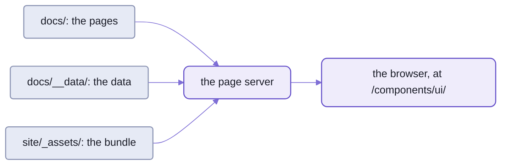

# Spell UI's docs site and tools

The docs site is plain HTML pages built only from `ui-*` elements, one page per family, in the style of fomantic-ui.com:
84 pages, with 1740 live examples (counted 2026-10-21).
The page server serves them at `/components/ui/`, with the site's bundle laid over them;
nothing is built to view a page.

- Each family's page has Examples, Usage, API and Theming tabs,
  every example live with its source a click away, and an "On this page" rail.
- A left nav lists every component, A-Z or by topic, with search.
- Where an element can't do what a page needs, that's a gap in the library,
  fixed there, not worked around in the page.
- The same tools that build the site also measure the library, run it in every framework, and screenshot every example:
  the second half of this page.



_Three things make the site:  hand-written pages, generated data, and one bundle built when it's stale._

## Viewing it

The page server serves the docs site, live-reloading;
it runs from spell-app, which holds the settings that name every component set.

```sh
cd ~/www/spell/spell-app
yarn serve                       # the page server and the editor;  prints the page server's address
```

- Then open `<address>/components/ui/`, or one page in it:  `ui-button.html`.
- The URL of any one file, starting the server if needed:  `spell server url <file>`.
- `spell server stop` stops it.
- It reloads an open page when the page, its parts, its data or the bundle change.
- A worktree's pages are at `/worktrees/<name>/components/ui/`, with THAT worktree's bundle.
- The epic server serves the same pages, at the same path.
- Just trying the elements, no server:
  `yarn dev` here serves every example, class grammar beside elements, with hot reload.
- A page opened from disk (`file://`) has no bundle beside it:  view pages through the page server.

<details>
<summary>Until repo-split P13 lands:  today's spelling of the commands on this page</summary>

The `spell` command line is moving into the kit, and its repo tools lose the word `dev`.
Until then:

| This page says | Today |
| --- | --- |
| `spell server start`, `url`, `stop`, `ensure` | `spell dev server start`, `url`, `stop`, `ensure` (spell-app's `yarn serve` is `spell dev server start --all`) |
| `spell bundles build` | `spell dev bundles build` |
| `spell design build` | `spell dev design build` |

</details>

## How a page is put together

Every page is a component set's page, laid out as every set is:
pages in a flat folder, tracked with the branch, so a page changes in the same commit as its element.

- The pages, [`docs/`](docs/), and the build, [`site/`](site/), sit side by side.
- The page server lays the build's `_assets/` over the pages at `/components/ui/`,
  so a page's link to its bundle resolves.
  - spell-app's page server settings name each set's pages and assets:
    `componentSets`, in [its package.json](../spell-app/package.json).
- Every page loads the bundle from beside it:

  ```html
  <link rel="stylesheet" href="_assets/site.css" />
  <script type="module" src="_assets/site.js"></script>
  ```

- A page's `<body>` is ONE `<main id="main" class="site-main">`, nothing else.
  - On the first load, `site.js` fetches [the layout](docs/__parts/layout.html) and wraps the `main` in it.
  - THEN it defines `<ui-root display="when-ready">`,
    so the page stays hidden until the layout is in and every element is ready, and shows at once:
    no flash of unstyled markup, no jump.
    `site.css` hides the bare `main` until then (4 s at most).
  - Later clicks on links to other pages of the site:  the site's router fetches the page, loads the families it uses,
    swaps only the `main` (through a `<ui-include select="main#main">`) and pushes its real URL.
    The chrome stays;  back, forward, deep links and reloads work as with plain pages.
  - So inline scripts in `main` run again on every visit, and `<head>` styles DON'T follow a swap.
    Put page styles in `main`, or in the site's [layout glue](site/_src/site.css).
- Links are written as from the page's served address:
  `../../` is the checkout's root, `../epics/epic-item.html` another set's page.
- `<ui-root>` lazy-loads every family on first use,
  the doc-only `<ui-docs-*>` elements included:  [their folder](src/docs-components/).
  - The doc-only elements read the site's data ([`components.json5`](docs/__data/components.json5)),
    never the vocabularies.
- The layout's root is `<ui-root class="site" stack-with="page" ...>`,
  so stacking examples stack by the SCREEN, as on fomantic-ui.com, not by the narrower docs column.
- A page's source:  the site header's "open in VS Code" button.

Comments:  people comment on these pages as on every set's,
with the bullhorns, threads and Send of spell-epic's review tools.

- Every page loads them in its `<head>`, after the site's bundle:
  `<script defer src="/_epic/assets/spell-comments.js"></script>`.
  `yarn site:new` writes the line;  a page written by hand needs it.
- The layout loads the epics pack (`<ui-components source="/_epic/pack/epics.pack.js">`).
  Its `<epic-thread>` and `<epic-comment-pane>` draw the threads and the pane.
  - The site's bundle shares its Solid and Spell UI with it ([`SitePacks.ts`](site/_src/SitePacks.ts)).
- Both are the epic server's engine routes (`/_epic/...`), which the page server serves too.
- Comments are kept in `<page>.inbox.json5` beside the page, git-ignored;
  Send hands them to the standing epic for feedback.

<details>
<summary>The pages folder and the build folder, file by file</summary>

```text
spell-ui/docs/          the pages, served at /components/ui/
  index.html, getting-started.html, grammar.html, theming.html, utilities.html, icons.html, kitchen-sink.html
  components.html       the component index:  cards between markers, written by `yarn site:index`
  ui-<name>.html        one page per family, named for its main tag;  plus a page of their own for the sub-tags
                        pages.json5 lists under their family's `pages` (ui-radio, ui-textarea, the content parts but
                        ui-header)
  __parts/              layout.html:  EVERY page's chrome (top bar, nav, <ui-root>), written once;  footer.html
  __data/               components.json5, icons.json5, search.json5, custom-elements.json, html-custom-data.json
                        (GENERATED by `yarn site:data`, committed);  pages.json5 (hand-kept)
  examples/             files the pages' examples load (<ui-include source>, <ui-markdown source>, an icon pack)
  images/               Fomantic's docs images, at fomantic-ui.com's /images/... paths;  components/, the
                        catalogue's thumbnails (`yarn readme:components`)

spell-ui/site/          the build
  _src/                 site.ts (the bundle's entry:  what's in it and why), SitePacks.ts (the component packs'
                        globals), snapshot.ts, SiteShell.ts (mounts the layout), SiteRouter.ts (swaps pages),
                        SiteSections.ts (sticky offsets, folds, landing on a hash), site.types.ts (their shared
                        constants, which tools/SiteCheck.ts reads too), site.css (layout glue only)
  _assets/              GENERATED, NOT committed:  the bundle (site.js, site.css, a lazy chunk per family);
                        icon-packs is a SYMLINK to ../../src/icons/icon-packs.  NEVER edit
```

| Path | What |
| --- | --- |
| [`site/_src/`](site/_src/) | the bundle's entry ([`site.ts`](site/_src/site.ts):  what's in it and why), the component packs' globals ([`SitePacks.ts`](site/_src/SitePacks.ts)), its router, shell, sections, their shared constants ([`site.types.ts`](site/_src/site.types.ts)) and layout glue ([`site.css`](site/_src/site.css));  its config, [`vite.site.config.ts`](vite.site.config.ts) |
| `site/_assets/` | GENERATED, NOT committed (git-ignored:  its hashed chunk names churned every diff):  the bundle (`yarn site:bundle`), which the page server builds when it starts, if stale (`spell bundles build --stale`), for every component set;  `icon-packs` is a symlink to `../../src/icons/icon-packs`.  NEVER edit |
| *(the data)* | [`docs/__data/`](docs/__data/):  `yarn site:data` |

- EVERY component set's pages load this one bundle:
  - Epic UI, at `/components/epics/`
  - App UI, at `/components/app/`
  - the brand's, at `/components/brand/`
- `.bundle.json` beside the bundle records its sources' hash, so the page server doesn't build it again.

</details>

<details>
<summary>The history of the two folders</summary>

- The pages became Spell UI's component set in epic `people-and-orgs` (P18).
  From epic `claude-design` (P6) until then, they were shared content, a `ui/` folder at the checkout's root.
- The site's bundle has been git-ignored since 2026-10-07;  the page server builds it.
- The pages replaced an Astro site, in epic `spell-ui-pages`;
  pages left GitHub with the move, so they have no "edit on GitHub" link any more.

</details>

## Writing a page

From `spell-ui/`:

```sh
yarn site:new ui-card                                                         # docs/ui-card.html
yarn site:new getting-started --title "Getting started" --summary "One line."  # docs/getting-started.html
```

- It starts from spell-epic's page template, [`spell-ui-docs.html`](../spell-epic/templates/spell-ui-docs.html),
  with the title, summary and status from [the pages data](docs/__data/pages.json5):
  fix a summary THERE, then `yarn site:data`.
- It refuses to overwrite a page (`--force`).
- The model page:  [`ui-button.html`](docs/ui-button.html).
- `ui-*` for everything visible;  the site's `site.css` is layout glue only (grid areas, widths, sticky offsets).

<details>
<summary>Sections, examples and sub-tag pages, in more depth</summary>

- Content is nested `<ui-section id header sticky collapsible dividing>`s:
  a section per topic, a section per example inside it.
  - Their titles stick below the tabs' bar, which sticks too.
  - They fold;  folds are remembered per page, and everything starts open.
  - Their ids spell out the nesting:  `#examples-types-emphasis` opens the Examples tab, unfolds what hides it,
    and lands its title just below the stuck ones ([`SiteSections`](site/_src/SiteSections.ts)).
    Old hashes still land (`#types`, `#emphasis`).
  - Write flat headers and headed examples, then `yarn site:sections` nests them and writes the ids.
    Rerun it after renaming a header.
- An example is a `<ui-docs-example description>` around live markup, inside its section.
  It shows the markup's own source, re-indented, so write the markup once.
- A sub-tag gets a page of its own once its family's entry in `pages.json5` lists it under `pages` (title, summary,
  status).
  - Then run `yarn site:data`.
    Its page comes from `yarn site:new <tag>`, as `<tag>.html`:
    - ONE tag's API (`<ui-docs-api tag>`, where `#<tag>` lands)
    - and a Theming tab only when a family token names it
  - Its family page keeps the whole family's API, and a one-line link to it.
  - The nav, search, card index and kitchen sink follow.

</details>

## The scripts

From `spell-ui/`:

- `yarn site:build` runs the first four in turn:
  after changing a vocabulary, a family's sheet, an example or any source the site shows.
- Then commit [`docs/__data/`](docs/__data/);  the bundle is git-ignored.

| Script | What it writes |
| --- | --- |
| `yarn site:data` | the site's data from the vocabularies and sheets:  `components.json5` and `icons.json5` (and seeds `pages.json5` for a new family);  `search.json5`, every page's sections for the site search (rerun after renaming or moving a section);  the editors' manifests, `custom-elements.json` and `html-custom-data.json` |
| `yarn site:index` | the component index's cards, [`components.html`](docs/components.html) |
| `yarn site:kitchen` | the kitchen sink's examples, [`kitchen-sink.html`](docs/kitchen-sink.html), from every family's `examples/elements/types.html` |
| `yarn site:bundle` | `site/_assets/`, from [the site's entry](site/_src/site.ts) ([its Vite config](vite.site.config.ts));  prints the sizes |
| `yarn site:dev` | `site:bundle`, then live editing:  the page server (started if needed) serves `/components/ui/` while a Vite watch build rebuilds the bundle on every source edit, and the open pages reload |
| `yarn site:new <tag\|page>` | a page, from the template |
| `yarn site:sections [--check] [page...]` | nests every page's flat headers into `<ui-section>`s and writes their ids;  idempotent |
| `yarn site:check <page...> \| --all` | loads pages in a headless browser and fails on what's broken (below) |
| `yarn readme:components` | the catalogue in [README-components.md](README-components.md) |
| `yarn design:build` | the claude.ai design system's files, from the vocabularies, the examples and the Spell theme |

- `site:dev` doesn't watch the data, index or kitchen sink.
  - A watch rebuild leaves old hashed chunks behind:  `yarn site:build` clears them.
  - `Ctrl-C` stops the watch, not the page server.
- `site:index`, `site:kitchen` and `site:new` run `site:sections`' converter on what they write.

### Checking

`yarn site:check <page...>` or `yarn site:check --all` loads pages from the page server in Playwright,
at desktop, phone width and dark, and fails on:

- console errors, 404s
- undefined or unrendered `ui-*` tags
- missing tabs, an empty "On this page"
- overflow at phone width, a nav flyout that won't open
- a section id that doesn't follow its nesting, a flat level 2 header, a deep link that doesn't land

Screenshots go to the tools' results folder, `results/site-check/`:  LOOK at them.
The command is [`site-check.ts`](scripts/site-check.ts), on [`SiteCheck`](tools/SiteCheck.ts).

### Deploying

Not deployed yet.

- A static host serves it as one folder:  `docs/`, with the site's `_assets/` copied in beside it.
  Copy through the `icon-packs` link (`cp -RL`).
- Every bundle URL is relative (`base: "./"`), so the site works under any path.

## The tools

The tools are node programs in [`tools/`](tools/), each a class, run through yarn scripts.
Their results land in `tools/results/` (git-ignored).

| Script | What it does |
| --- | --- |
| `yarn build` | the library, into `dist/` |
| `yarn vendor` | ONE copy of each peer (Solid) into `vendor/`, with an import map, for import-map pages |
| `yarn measure` | builds the library in memory and measures it:  each family's own code, the shared entries, the lazy chunks;  fails a module it can't place, or `core` code leaking into a family |
| `yarn smoke` | builds, checks the declarations, then loads every framework page in headless chromium ([README-frameworks.md](README-frameworks.md)) |
| `yarn report` | lines of code, then the tables of the generated status report |
| `yarn serve` | the smoke pages and their import map, for a person:  prints the URLs, runs until stopped |
| `yarn test:hmr` | hot reload end to end:  a dev server, headless chromium and real file edits, 8 scenarios |
| `yarn test:visual` | screenshot tests of every element example, light and dark, per browser (below) |
| `yarn screenshots [families]` | one PNG per example pair of the demo page, for a quick look;  no baselines |
| `yarn icons:pack <folder> --id <id>` | checks a folder of SVGs and writes its icon pack ([README-runtime.md](README-runtime.md)) |

The order to run the package tools in:

```sh
yarn build
yarn vendor
yarn measure
yarn test       # writes perf-results.json
yarn smoke
yarn report
```

### The visual tests

`yarn test:visual` screenshots every page in each family's `examples/elements/`, light and dark,
and compares each with [its baseline](test-helpers/visual/baselines/).

```sh
yarn test:visual [--os local|linux|both] [--browsers all|chrome|webkit|firefox] [--update] [--grep <family>] [--parity]
```

- `--os linux`, the default, renders in Playwright's Docker image, so it needs Docker;
  `--os local` renders on this machine.
  Baselines exist for macOS today;  Linux's wait on a working Docker.
- `--update` (or `yarn test:visual:update`) writes new baselines:  only after looking at every diff in the HTML report.
- `--static` compares the static render with the elements instead:  a report only.
- Not part of `yarn review` (slow, needs Docker),
  but a change that alters rendering runs it, and updates its baselines in the same change.

<details>
<summary>Every file in tools/, one line each</summary>

| File | What |
| --- | --- |
| [`cli.ts`](tools/cli.ts) | the command line behind `yarn vendor`, `measure`, `smoke` (`declarations`, then `smoke`), `serve`, `report` (`loc`, then `report`), `icons:pack` |
| [`index.ts`](tools/index.ts) | the barrel:  the measure, vendor, LOC, report, smoke and icon-pack classes;  NOT the site and design tools, the static renderer, the pages or the scripts (its header says why) |
| [`package.config.ts`](tools/package.config.ts) | `PACKAGE`:  entries, shared entries (`core`, `forms`), externals, peer list, module → bucket;  `DIST_IMPORTS` for import maps |
| [`tools.types.ts`](tools/tools.types.ts) | `PackageConfig`, result shapes (`MeasureResults`, `SmokeResults`, `LocResults`) and `kB()`, `SolidIdentityHook`, the site's two halves (`SITE_PAGES`, `SITE_BUILD`), the static pages' and the design export's shapes, the error classes `IconPackError` and `SiteCheckError` |
| [`BundleMeasure.ts`](tools/BundleMeasure.ts) | an in-memory `vite build` with the repo's config, modules bucketed into library / shared entries / own per family / lazy;  the library as used and in full;  standalone per-family builds;  structural checks |
| [`PeerVendor.ts`](tools/PeerVendor.ts) | one ES module per peer specifier, plus `importmap.json`, in `vendor/`:  deduped (ONE Solid), tree-shaken to the bindings `dist/` and the pages import |
| [`DeclarationCheck.ts`](tools/DeclarationCheck.ts) | run by `yarn smoke` after the build:  every `exports` `types` path exists, and no declaration in `dist/` imports an alias or leaves `dist/` |
| [`HostApp.ts`](tools/HostApp.ts) | compiles the Solid 2 host app (`frameworks/solid/app.tsx`) with Solid external |
| [`SmokeRunner.ts`](tools/SmokeRunner.ts), [`StaticServer.ts`](tools/StaticServer.ts) | serve `dist/`, `vendor/`, `tools/`, `test-helpers/` from ONE static server (a thin wrapper over the kit's web server), inject the import map, drive each page in headless chromium |
| [`LocCount.ts`](tools/LocCount.ts) | lines and code lines per file, by group |
| [`ReportTables.ts`](tools/ReportTables.ts) | rewrites the generated tables of the status report, in the content folder's Spell UI notes |
| [`peers.ts`](tools/peers.ts) | the peer specifiers `dist/` imports |
| [`IconPackBuilder.ts`](tools/IconPackBuilder.ts) | `yarn icons:pack`:  checks a folder of SVGs (no script, no external resources) and writes its `pack.js`, keeping hand edits;  `--sanitize`, `--skip-unsafe`, `--allow-unsafe`;  also run by `gen:icons` |
| [`SiteDataBuilder.ts`](tools/SiteDataBuilder.ts) | `yarn site:data`:  `components.json5` from every vocabulary and family sheet, `icons.json5`, and keeps `pages.json5` complete;  its test fails while they're stale |
| [`SiteSearchBuilder.ts`](tools/SiteSearchBuilder.ts) | `search.json5`:  every page's title and sections, read from the page files, for `<ui-docs-search>` |
| [`FamilyTokens.ts`](tools/FamilyTokens.ts) | one family's public CSS tokens, read from its sheets:  its page's token table |
| [`FoundationTokens.ts`](tools/FoundationTokens.ts) | the foundation tokens (`--ui-font-size`, palette, radii, motion ...), grouped for the theming page, read from the generated sheets |
| [`ThemeFamilies.ts`](tools/ThemeFamilies.ts) | which families each theme sheet touches, read from its CSS |
| [`SiteCheck.ts`](tools/SiteCheck.ts) | `yarn site:check`:  the docs pages in headless chromium, from the page server's `/components/ui/` (started with `spell server ensure`):  errors and failed requests, undefined or unrendered `ui-*`, the four tabs each loaded from its hash, the "On this page" rail, phone overflow (naming the offending elements), the nav flyout, dark;  screenshots in `tools/results/site-check/`, a JSON summary on stdout, exit 1 on any problem |
| [`StaticRenderer.ts`](tools/StaticRenderer.ts) | the server-only Vite server the static render runs on from node:  it compiles the components' JSX for the server, which `tsx` can't;  used by the visual tests' static pages and by `spell static` |
| [`StaticDocument.ts`](tools/StaticDocument.ts) | loaded BY that server, never by node:  `render(html, options)` turns a whole page static, `stylesheet(tags)` builds and minifies (Lightning CSS) the sheet for those families;  `spell static`'s engine |
| [`DesignExport.ts`](tools/DesignExport.ts), `DesignTokens.ts`, `DesignColor.ts`, `DesignComponents.ts`, `DesignBrand.ts` | `yarn design:build [--out <dir>] [--brand <folder>] [--brand-book <file>]`:  the claude.ai design system's files in `<dir>/project/` (default `build/design-system/`, git-ignored):  the brand book README, `tokens.json`, `components/index.d.ts`, a README and `preview.html` per family, the cover, `design-system.json`;  keeps the design bundle's `components/bundle.js` and `bundle.css`;  the tokens per scheme from the `spell-brand` theme;  a "Brand" group of `<brand-*>` cards read from the GIVEN brand folder's data, since Spell UI imports nothing of the brand |
| [`ElementManifests.ts`](tools/ElementManifests.ts) | `custom-elements.json` (Custom Elements Manifest 2.1) and `html-custom-data.json` (VS Code's `html.customData`, loaded by the repo's `.vscode/settings.json`), written by `yarn site:data` into `docs/__data/` |
| [`environment.ts`](tools/environment.ts) | EVERY environment variable `tools/`, `scripts/` and the configs read, parsed once;  nowhere else reads `process.env` |
| [`hmr.e2e.ts`](tools/hmr.e2e.ts) | `yarn test:hmr`:  8 scenarios, as a plain `node:test` script |
| [`screenshots.ts`](tools/screenshots.ts) | `yarn screenshots`:  one PNG per example pair of `demo/index.html`, into `.cache/screenshots/` |
| tests | in [`tests/tools/`](tests/tools/):  `DesignExport`, `IconPackBuilder`, `SiteDataBuilder` (fails while `docs/__data/` is stale), `SiteSearchBuilder` ...;  in the `ssr` project |
| `results/` | what the tools write (git-ignored):  `measure-results.json`, `perf-results.json`, `site-check/`, `visual/` |
| [`frameworks/`](tools/frameworks/) | the host pages:  `vanilla`, `react` (esm.sh), `vue` (unpkg), `solid` (a Solid 2 app and the `identity.js` probe), the shared round trip `check.js`, `perf.html` |
| [`smoke/`](tools/smoke/) | more import-map pages:  `compat-solid-1.9.html`, `translate.html`, `perf-adapter.js` |
| [`visual/`](tools/visual/) | `yarn test:visual`:  `cli.ts` (flags) → `VisualRunner` (dev server, one Playwright run per OS, pruning) and `DockerBrowserServer` (Docker checks, the browser server container);  `playwright.config.ts`, `visual.spec.ts` (tests generated by `VisualExamples`), `fixture.html` / `Fixture.ts` (one example, settled), `ParityReport` (`--parity` / `--static`);  for `--static`, `StaticFamilies`, `StaticPages` and `StaticFixture`;  `VisualSettings` (viewport, time, tolerances, paths);  `visual.types.ts` |
| [`demo/`](tools/demo/) | the `yarn dev` pages:  every example side by side (`index.html`), `perf`, `translate`, `hmr`;  `fallback.html` is also a smoke page;  `FamilySheets` puts every family sheet on the page |

The generic tools are the kit's (`spell-kit/element/tools/<Name>`, in the kit's [`element/tools/`](../element/tools/)):

- `Terminal`, where every tool and script prints;  `NodePackage`, finding an installed dependency
- `ComponentPack` and `packModules`, a component pack's build (`spell-pack build | check`)
- `RootCatalog` and `VocabularyFiles`, which `yarn gen:root` and `yarn site:data` read the vocabularies with
- `DevServer`, the dev server `test:visual`, `test:hmr` and `screenshots` start
- `HotElements`, the hot-reload plugin
- `elementBaseConfig()`, `CSS_TARGETS`, `SOLID_DEDUPE`:  the Vite settings Spell UI's `baseConfig()` starts from

</details>

<details>
<summary>How the tools are written:  imports, pages, the identity probe, buckets</summary>

- The CLASSES live in `tools/`, in PascalCase files.
  - A yarn script that only runs one is a few lines in [`scripts/`](scripts/), named for the script:
    `yarn site:check` → [`site-check.ts`](scripts/site-check.ts) → `SiteCheck.main()`.
  - A folder with its own flags has a `cli.ts`:  [the tools'](tools/cli.ts), [the visual tests'](tools/visual/cli.ts).
- Output goes through `Terminal` (stdout and stderr), never `console.*`.
- Environment variables are read through `environment`.
- Imports:  these are node scripts, run by `tsx`.
  - Relative imports with `.ts` extensions;  another package by its name (`spell-kit/server`).
  - Page scripts Vite serves or loads for the server (the demo's `*.ts`, the visual tests' fixtures) import Spell UI
    as its own source does ([AGENTS.md](AGENTS.md), "Imports").
  - Browser-side helpers the static server serves are transpiled on the fly, and may import types only
    ([`PerfRun`](test-helpers/PerfRun.ts), [the Spanish dictionary](test-helpers/dictionary.es.ts)).
- Pages:
  a smoke page imports `spell-ui...` and the peers by name, and publishes `window.smokeResult = { ok, label, checks }`.
  - `kind: "compat"` is reported as COMPATIBILITY.
  - A page module that imports a peer binding itself must be listed in `PeerVendor`'s `usedBy`,
    in [the tools' command line](tools/cli.ts):
    else the vendored file lacks it ("does not provide an export named ...").
- The identity probe ([`identity.js`](tools/frameworks/solid/identity.js)) is the ONLY place that proves
  the host app and the components share one Solid.
  It binds `createSignal` and `render`, and never `import * as` a package, so the vendored Solid stays tree-shaken.
- Buckets:
  - a module [the package config](tools/package.config.ts) can't place is `other`, and fails the `unattributed` check
  - a `shared:<name>` module outside `<name>.js` fails `coreOutsideCore`

</details>

<details>
<summary>More in the docs site</summary>

These guides are served by the page server from the content folder,
so they need a checkout with the content folder and the page server running (above).

- The Spell UI docs site, how it was built:  `/guides/spell-ui-site.html`
- How to write a docs page (sources, examples, usage, theming, gaps):  `/epics/spell-ui-pages/PAGES.md`
- Visual testing:  `/guides/ui/notes/visual-testing.md`
- The generated status report (bundle, speed, hosts, hot reload, fallbacks):  `/guides/ui/notes/report.md`
- Theming notes, "Stacking":  `/guides/ui/notes/theming.md`

</details>

## See also

- [README.md](README.md):  Spell UI's front page
- [README-components.md](README-components.md):  every family, with pictures
- [README-frameworks.md](README-frameworks.md):  the framework pages `yarn smoke` runs
- [README-runtime.md](README-runtime.md):  what's under the elements
- [AGENTS.md](AGENTS.md):  the rules for working here, "The docs site" and "Commands"
- [The kit's front page](../README.md), and its [page server](../README-server.md)
- Also beside it:  [README-migrating.md](README-migrating.md) · [README-themes.md](README-themes.md)
