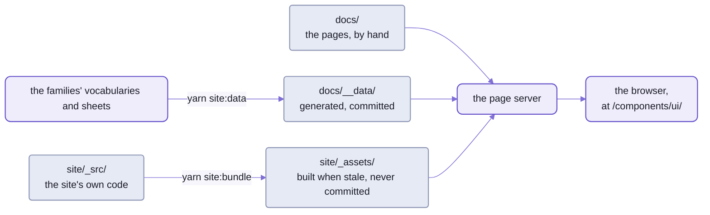
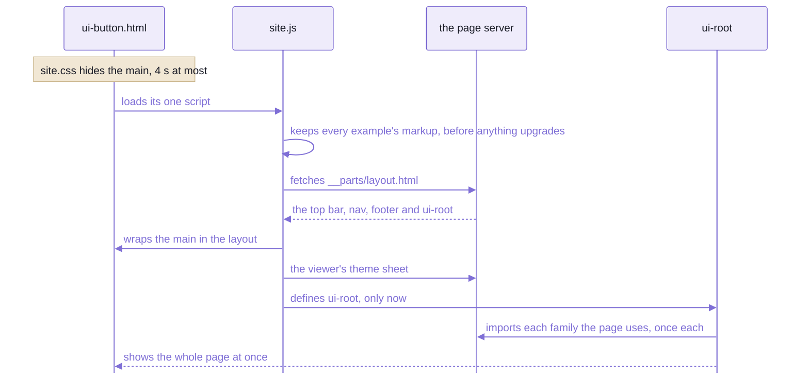

# Spell UI's docs site

```html
<ui-section id="examples-types-button" label="Button" sticky collapsible dividing>
  <ui-docs-example description="A standard button.">
    <ui-button>Follow</ui-button>
  </ui-docs-example>
</ui-section>
```

_The first example on [the Button page](docs/ui-button.html), as it's written on disk._

That's a whole example, and all of its source.
In the browser it's a live `<ui-button>` under its description, with a code button that shows these same lines.
Nobody typed them twice:  an example shows its own markup.

If you've written Storybook stories, here's what's different.
A story is a function, and Storybook builds every story into an app of its own.
Here an example is markup in a plain HTML page, and the page server sends that page exactly as it is on disk:
nothing is built between saving a page and reading it.
The one thing built is a bundle every page loads, and the page server builds that itself when its sources change.

There are 84 pages, with 1,740 live examples (counted 2026-10-21):
- a page per family, 62 of them, each named for its main tag and laid out as fomantic-ui.com's are
- a page of its own for 14 sub-tags:  `ui-radio`, `ui-textarea` and the content parts
- eight more:  the home page, getting started, the class grammar, theming, utilities, icons,
  the component index and the kitchen sink

Each family's page has four tabs, Examples, Usage, API and Theming, and an "On this page" rail beside them.
A left nav lists every component, A-Z or by topic, with a search.
And where an element can't do what a page needs, that's a gap in the library:
it gets fixed in the element, never patched in the page.



_Three things make the site:  pages written by hand, data a script writes from the elements, and one bundle._

## Viewing it:  one command, from anywhere in the kit

```sh
spell server start all
```

<details>
<summary>What it printed</summary>

```text
Spell servers of ~/www/spell.worktrees/readme:
  page server           56343  http://127.0.0.1:56343/                docs, epics, /api                 started
  editor                56344  http://localhost:56344/                the spell app (vite)              running
  Spell UI's docs site  56343  http://127.0.0.1:56343/components/ui/  static pages, by the page server  running
```

</details>

_A run in an epic's worktree of the kit:  the main checkout's server already held port 4747, so this one took free
ports._

The last row is the docs site:  open it, or one page in it, `ui-button.html`.
When the bundle is stale, the page server rebuilds it as it starts, and a page that asks for it first waits.

- The docs site is served by the kit's page server, because Spell UI's own part of its settings names the set and
  its bundle (`"pageServer"`, in [package.json](package.json):
  [the kit's README-server.md](https://github.com/spell-app/spell/blob/main/README-server.md#settings-and-route-modules--each-repo-brings-its-own)).
  - So it needs only the kit and `spell-ui`:  `yarn clone spell-ui`
    ([setup](https://github.com/spell-app/spell/blob/main/README.md#setup-from-zero)).
  - `start all` and `spell server start` both find the kit from any folder of it.
- `start all` brings up the editor too, where spell-app is cloned.
  For the page server alone, `spell server start`.
- An open page reloads when the page, its layout, its data or the bundle changes.
- `spell server stop all` stops them both.
- The epic server serves the same pages, at the same path.
- Just the elements, no server:  `yarn dev` in `spell-ui/` opens [the demo](src/tools/demo/index.html),
  every example in class grammar beside the elements, with hot reload.

Three catches, all found the hard way:
- **A page opened from disk shows bare markup.**
  At a `file://` address there's no `_assets/` beside the page, so no bundle.
- **`spell server url <file>` doesn't know the docs site yet.**
  For a page in `docs/` it prints a plain file's address, with no bundle laid over it.
  Use the docs site's address instead:  `/components/ui/<page>`.
- **The main checkout's server never builds a worktree's bundle.**
  It answers `/worktrees/<epic>/components/ui/` with the worktree's own pages and bundle,
  but builds only its own bundles as it starts.
  After a change to the bundle's sources in a worktree, run `spell bundle ui-site` there,
  or `spell server start all` in the worktree, as above.

## A page is its head and one `main`

Every page is a component set's page, laid out as every set is:
pages in one flat folder, tracked with the branch, so a page changes in the same commit as its element.
This is all of a page's file but its content:

```html
<!doctype html>
<html lang="en">
  <head>
    <meta charset="utf-8" />
    <meta name="viewport" content="width=device-width, initial-scale=1" />
    <meta name="color-scheme" content="light dark" />
    <title>Button | Spell UI</title>
    <meta name="description" content="A button indicates a possible user action." />
    <script>
      /* the viewer's colour scheme, before first paint */
    </script>
    <link rel="stylesheet" href="_assets/site.css" />
    <script type="module" src="_assets/site.js"></script>
    <script defer src="/_epic/assets/spell-comments.js"></script>
  </head>
  <body class="ui-typography">
    <main id="main" class="site-main" data-toc-header="Button">
      <!-- the masthead, then <ui-tabs id="site-tabs"> and its four panes -->
    </main>
  </body>
</html>
```

_From [ui-button.html](docs/ui-button.html), trimmed:  the scheme script's ten lines, and 1,064 lines of content._

There's no top bar, no nav and no `<ui-root>`.
They're in [the layout](docs/__parts/layout.html), written once for every page,
and the bundle puts each page's `main` inside it.

### The first load:  hidden until it's all there



_The page shows once its layout, its theme and every element on it are ready:  no flash of unstyled markup, no jump._

- The order is the trick.
  `<ui-root display="when-ready">` keeps the page hidden until every element in it is ready,
  and the bundle defines it only after the layout and the theme's sheet are in, so the chrome counts too.
  Until then [the site's CSS](site/_src/site.css) hides the bare `main`, for 4 seconds at most.
- The examples' markup is kept FIRST, by the bundle's first import, [snapshot.ts](site/_src/snapshot.ts).
  An element may change its light DOM as its family loads (a roving `tabindex`, an include's fetched content),
  so the code an example shows is read before anything upgrades.
  An example whose markup changes as it runs holds it in a `<template>` child instead.
- After the first page, a click on another page of the site doesn't load a page.
  The site's router fetches it, loads the families it uses, swaps only the `main`
  (through a `<ui-include selector="main#main">`) and pushes its real URL:
  inside a View Transition, where the browser has them.
  - The chrome stays;  back, forward, deep links and reloads work as with plain pages.
  - A swap that fails falls back to a full load.
- **The catch:**  inline scripts in `main` run again on every visit, and `<head>` styles DON'T follow a swap.
  Put a page's styles in its `main`, or in the site's layout glue.

What a page can count on:
- Links are written as from the page's served address:
  `_assets/` is beside it, `../../` is the page server's root, `../epics/epic-item.html` another set's page.
- `<ui-root>` loads every family on first use, the doc-only `<ui-docs-*>` elements included:
  `api`, `example`, `inspector`, `nav`, `search`, `themes`, `toc` and `tokens`, in [their folder](src/docs-components/).
  They read the site's data, [components.json5](docs/__data/components.json5), never the vocabularies.
- The layout's root is `<ui-root class="site" stack-with="page" ...>`,
  so an example that stacks on a narrow screen stacks by the SCREEN's width, as on fomantic-ui.com,
  not by the narrower docs column's.
- Everything visible is a `ui-*` element.
  The site's CSS is layout glue only (grid areas, widths, sticky offsets):  a rule there that changes a look is a gap.
- A page's source is one click away:  the site header's "open in VS Code" button.

### Comments come with every page

People comment on these pages as on every set's,
with the bullhorns, threads and Send of `spell-epic`'s review tools ([its README-pages.md](https://github.com/spell-app/spell-epic/blob/main/README-pages.md)).

- Every page loads them in its `<head>`, after the site's bundle:
  `<script defer src="/_epic/assets/spell-comments.js"></script>`.
  `yarn site:new` writes that line;  a page written by hand needs it.
- The layout loads the epics pack, `<ui-components source="/_epic/pack/epics.pack.js">`:
  its `<epic-thread>` and `<epic-comment-pane>` draw the threads and the pane.
- Both are `spell-epic`'s engine routes, `/_epic/...`, which the page server serves too.
- The site's bundle shares its Solid and Spell UI with the pack, by their npm names
  (`solid-js`, `@solidjs/web`, `spell-ui/core`, `spell/element` ...):  [SitePacks.ts](site/_src/SitePacks.ts).
- A comment waits in `<page>.inbox.json5` beside its page, git-ignored,
  until Send hands it to the standing `feedback` epic.
- **The cost:**  a pack may use any export of what it shares, so those modules stay whole in the bundle.
  A page loads 555 kB of script and CSS before its first family, 155 kB gzipped, on today's build;
  without them it was 305 kB, 79 kB gzipped, as SitePacks.ts's header records.

<details>
<summary>The pages folder and the build folder, file by file</summary>

| Path | What |
| --- | --- |
| [docs/](docs/) | the pages, served at `/components/ui/`:  `index.html`, `getting-started.html`, `grammar.html`, `theming.html`, `utilities.html`, `icons.html`, `kitchen-sink.html` |
| [docs/components.html](docs/components.html) | the component index:  its cards between markers, written by `yarn site:index` |
| `docs/ui-<name>.html` | one page per family, named for its main tag;  a page of its own for each sub-tag its family lists under `pages` in `pages.json5` (`ui-radio`, `ui-textarea`, the content parts but `ui-header`) |
| [docs/\_\_parts/](docs/__parts/) | `layout.html`:  EVERY page's chrome (top bar, nav, `<ui-root>`), written once;  `footer.html` |
| [docs/\_\_data/](docs/__data/) | `components.json5`, `icons.json5`, `search.json5`, `custom-elements.json`, `html-custom-data.json`, `css-custom-data.json`:  GENERATED by `yarn site:data`, and committed, since the pages fetch them as they are;  `pages.json5`, kept by hand |
| [docs/examples/](docs/examples/) | files the pages' examples load:  `<ui-include source>`, `<ui-markdown source>`, an icon pack |
| [docs/images/](docs/images/) | Fomantic's docs images, at fomantic-ui.com's `/images/...` paths;  `components/`, the catalogue's 40 thumbnails (`yarn readme:components`) |
| [site/\_src/](site/_src/) | the bundle's source:  [site.ts](site/_src/site.ts), the entry (what's in it and why);  [SitePacks.ts](site/_src/SitePacks.ts), the component packs' globals;  `SiteShell.ts`, which mounts the layout;  `SiteRouter.ts`, which swaps pages;  [SitePatch.ts](site/_src/SitePatch.ts), which patches an edited page in place (the kit's `PagePatch`);  [SiteSections.ts](site/_src/SiteSections.ts), sticky offsets, folds and landing on a hash (through `HashLanding`);  `snapshot.ts`, the examples' markup;  [site.types.ts](site/_src/site.types.ts), their shared constants, which the site check reads too;  [site.css](site/_src/site.css), layout glue only.  Its config:  [vite.site.config.ts](vite.site.config.ts) |
| `site/_assets/` | GENERATED, NOT committed:  the bundle (`site.js`, `site.css`, a lazy chunk per family);  `.bundle.json`, its sources' hash, so the page server doesn't build it again;  `icon-packs`, a link to `../../src/icons/icon-packs` (2,167 SVGs, 8.7 MB:  committed once, never copied).  NEVER edit |

- Git-ignored because its hashed chunk names churned every diff;
  how the page server builds bundles on demand:  [the kit's README-server.md](https://github.com/spell-app/spell/blob/main/README-server.md).
- EVERY component set's pages load this one bundle:
  Spell UI's, Epic UI's at `/components/epics/`, App UI's at `/components/app/`.
  Each takes the folder above its `_assets/` as the site's root, for its layout and its data.
- `site.ts`, `snapshot.ts` and `SitePacks.ts` are imported for what they do, not for exports:
  each is listed in `package.json`'s `sideEffects`, or the bundler drops it.

</details>

## Writing a page:  start from the model, write it flat

The model page is [ui-button.html](docs/ui-button.html):  open it beside yours, and copy its patterns.
A new page comes from `yarn site:new`, in `spell-ui/`:

```sh
yarn site:new ui-card                                                          # docs/ui-card.html
yarn site:new getting-started --title "Getting started" --summary "One line."  # docs/getting-started.html
```

- A tag (any tag of the family:  `ui-cards` works too) writes its family's page, `docs/<main tag>.html`:
  a masthead with the family's theme picker, and the four tabs.
- A sub-tag its family lists under `pages` writes a page of its own, `docs/<tag>.html`:
  ONE tag's API (`<ui-docs-api tag>`, where `#<tag>` lands), and a Theming tab only when a family token names it.
- Anything else is a guide page, one column, no tabs:  `--title` (default:  the name in Title Case) and `--summary`.
- Title, summary and status come from [the pages data](docs/__data/pages.json5):
  fix a summary THERE, then `yarn site:data`.
- It starts from `spell-epic`'s template, [spell-ui-docs.html](https://github.com/spell-app/spell-epic/blob/main/templates/spell-ui-docs.html),
  found through the kit's install, and refuses to overwrite a page:  `--force` does, and loses what you wrote.

```text
$ yarn site:new my-guide --title "My Guide"
wrote docs/my-guide.html  (page)
  view:  spell server url .../spell-ui/docs/my-guide.html   (from the repo root);  check:  yarn site:check my-guide.html
```

### The Examples pane:  write it flat, and let a script nest it

Write a level 2 header per topic, and an example with a `header` for each example.
Here is the hook's example, as you'd type it:

```html
<ui-header level="2" dividing>Types</ui-header>
<ui-docs-example header="Button" description="A standard button.">
  <ui-button>Follow</ui-button>
</ui-docs-example>
```

Then `yarn site:sections` turns it into the markup at the top of this page.
The header becomes `<ui-section id="examples-types" label="Types" sticky collapsible dividing>`,
and the example a section of its own inside it, `#examples-types-button`, holding the example without its `header`.

- Every section's title sticks below the tabs' bar, which sticks too.
- They fold, and the folds are remembered per page;  everything starts open.
- The ids follow the nesting, so a link lands anywhere:
  `#examples-types-emphasis` opens the Examples tab, unfolds what hides it,
  and puts its title just below the stuck ones ([SiteSections.ts](site/_src/SiteSections.ts)).
  Old hashes still land (`#types`, `#emphasis`).
  - The landing itself is the docs elements' own,
    [HashLanding](src/docs-components/ui-docs-toc/HashLanding.ts), by the site's rules:
    the page scrolls once, where the table of contents and the site used to scroll one after the other.
- Rerun `yarn site:sections` after renaming a header:  it fixes the ids, and running it twice changes nothing.
- An example is a `<ui-docs-example description>` around live markup.
  It shows that markup, re-indented, so you write it once;  a comment inside it shows too.

The other three panes:
- Usage:  what to write, the events with their `detail`, keyboard and accessibility, in sections like Examples'.
- API:  done already.
  `<ui-docs-api family="ui-button">` draws every table from the vocabularies,
  and `yarn site:sections` splits it into one section per kind the family has (Attributes, Events ...),
  each holding `<ui-docs-api family="ui-button" only="attributes">`.
  - A family of 2+ tags gets a Tags section first:  each tag with its one-line summary,
    its name a link to its first table below (`<ui-docs-api family="ui-button" only="tags">`).
  - So the API tab gets the same row of section buttons as Examples.
  - Its "On this page" list names every attribute, event, slot ... under its section;
    a click lands on the row (`#api-attributes-size`), which flashes.
  - Rerun `yarn site:sections` after `yarn site:data`:  a tag's first event adds an Events section.
- Theming:  keep `<ui-docs-tokens family="ui-button" playground>`, and explain the family's tokens around it.
  - `yarn site:kitchen` fills the playground with the family's main example, so a token edited there shows at once.
  - A playground with children of your own (and no markers) is yours:  the script leaves it alone.

<details>
<summary>The pages guide in five lines, and the sub-tag pages</summary>

The pages guide (below, "More in the docs site") says how a page is written.
In five lines:
1. Fomantic's page, section by section and in its order, with its headers and descriptions;  our own extras after.
2. The only attributes that exist are the family's vocabulary, `UI<Name>.en.ts`.
   Its `examples/elements/` files are Fomantic's examples already in element markup:  reuse them.
3. The markup IS the code shown:  clean `ui-*` markup, no `style=`, and no comments inside an example.
4. A Fomantic feature left out on purpose gets one line in its place,
   `<ui-message size="small" class="site-not-ported">Not ported:  ...</ui-message>`:  the pages have 81.
5. What an element can't render yet is a gap:  a comment before its example's section, naming its issue
   (147 in the pages today), and a fix in the element, never CSS in the page.

The gap that catches everybody once, from the Button page:

```html
<!-- GAP I23:  Fomantic's `right arrow` / `left chevron` draw nothing;  use the canonical `arrow right`, `chevron left`. -->
```

A sub-tag gets a page of its own once its family's entry in `pages.json5` lists it under `pages`
(title, summary, status).
- Then `yarn site:data`, and `yarn site:new <tag>` writes `<tag>.html`.
- Its family's page keeps the whole family's API, and a one-line link to it.
- The nav, the search, the component index and the kitchen sink follow.
- Today:  `ui-radio` (from `ui-checkbox`), `ui-textarea` (from `ui-input`),
  and twelve content parts (from `ui-parts`, whose own page is `ui-header.html`).

</details>

## The scripts:  four rebuild what the site reads

From `spell-ui/`.
After changing a vocabulary, a family's sheet, an example or any source the site shows, run `yarn site:build`:
it runs the first four below, in turn.
Then commit what it changed in `docs/`;  the bundle is never committed.

| Script | What it writes |
| --- | --- |
| `yarn site:data [--check]` | the site's data, from the vocabularies and the families' sheets:  `components.json5`;  `icons.json5`, the icon browser's search terms;  `search.json5`, every page's sections for the site search (rerun after renaming or moving a section);  the editors' manifests, `custom-elements.json`, `html-custom-data.json` and `css-custom-data.json`, and the JSX types, `src/jsx.ts`;  and a new family's entry in `pages.json5` |
| `yarn site:index [--check]` | the component index's cards, [components.html](docs/components.html):  every tag under each of its topics, A-Z |
| `yarn site:kitchen [--check]` | the kitchen sink's examples, [kitchen-sink.html](docs/kitchen-sink.html), from each family's main example file (`examples/elements/types.html`), three sections a family at most;  and each component page's Theming playground, its family's main example (the first of those sections), between `playground:start` / `playground:end` markers |
| `yarn site:bundle` | `site/_assets/`, from [the site's entry](site/_src/site.ts) and [its Vite config](vite.site.config.ts);  prints the sizes.  The page server runs it as `spell bundle ui-site` |
| `yarn site:build` | the four above, in turn |
| `yarn site:dev` | `site:bundle`, then live editing:  the page server (started if needed) serves `/components/ui/` while a Vite watch build rebuilds the bundle on every source edit, and the open pages reload |
| `yarn site:new <tag\|page>` | a page, from the template (above) |
| `yarn site:sections [--check] [page...]` | nests every page's flat headers into `<ui-section>`s and writes their ids, and splits each API tab into a section per kind of table;  no page named:  every page |
| `yarn site:check <page...> \| --all` | loads pages in a headless browser, and fails on what's broken (below) |
| `yarn readme:components [--check]` | the catalogue in [README-components.md](README-components.md), from the site's data;  `--shoot <url> [family ...]` retakes its thumbnails from the served site |
| `yarn design:build [--out <dir>]` | the claude.ai design system's files, from the site's data, the element examples and the Spell theme, into `<dir>/project/` (by default `build/design-system/`, git-ignored);  also `spell design build` |

- `--check` writes nothing, and exits 1 if a file would change.
- `site:index`, `site:kitchen` and `readme:components` write only between their pages' markers:
  the rest of each page is kept by hand.
- `site:index`, `site:kitchen` and `site:new` run `site:sections`' converter on what they write.
- A comment typed into one of the `.json5` data files stays when `site:data` rewrites it.
- `site:dev` doesn't watch the data, the index or the kitchen sink:  rerun `yarn site:build` for those.
  - A watch rebuild leaves old hashed chunks behind;  `yarn site:build` clears them.
  - `Ctrl-C` stops the watch, not the page server.
- A stale bundle, by hand:

  ```sh
  spell bundle check ui-site
  ```

  <details>
  <summary>What it printed</summary>

  ```text
  ui-site:  STALE (built from older sources)
  fix:  spell bundle ui-site
  ```

  </details>

### Checking:  a real browser, at desktop, phone width and dark

`yarn site:check <page...>`, or `yarn site:check --all`, loads pages from the kit's page server (started if needed),
in Playwright's Chromium, and fails on:
- console errors, page errors, failed requests and responses of 400 or more
- `ui-*` or `spell-*` elements still undefined once settled, or defined ones with no shadow root
- on a family's page, anything but the four tabs (Theming may be missing), or a tab that doesn't show from its `#hash`
- an "On this page" rail hidden or empty on desktop, or showing on a phone
- a section id that doesn't follow its nesting, a flat level 2 header left, a deep link that doesn't land
- horizontal scroll at phone width:  it names the elements past the edge, which is what a fix needs
- a nav button whose flyout won't open

It checks every page, whatever failed before it.
Problems go to stderr, a JSON summary is the last thing on stdout,
and it exits 0 when clean, 1 on any problem, 2 when it can't start (no such page, no page server serving the bundle).

**What it can't see:  overlap, clipping or ugly wrapping.**
The screenshots go to `results/site-check/` (or `--out <dir>`):  LOOK at them.
The command is [site-check.ts](scripts/site-check.ts), on [SiteCheck](src/tools/SiteCheck.ts).

### 🌱 Deploying

The site isn't deployed anywhere yet:  it runs locally, from the page server.
What a static host would take, from what's built today:
- one folder, `docs/`, with the site's `_assets/` copied in beside it, through the `icon-packs` link (`cp -RL`)
- every bundle URL is relative (`base: "./"`), so the site works under any path
- and one piece that won't travel:  the comments' two addresses, `/_epic/...`, answer only on Spell's own servers

## The tools:  the library's own checks, beside the site's

The scripts above share a home with the tools that measure the library, run it in every framework,
and screenshot every example.
They're node programs in [src/tools/](src/tools/), each a class, run through yarn scripts;
their results land in `results/`, git-ignored.

| Script | What it does |
| --- | --- |
| `yarn build` | the library, into `dist/` |
| `yarn vendor` | ONE copy of each peer (Solid) into `vendor/`, with an import map, for import-map pages |
| `yarn measure` | builds the library in memory and measures it:  each family's own code, the shared entries, the lazy chunks;  prints a `CHECK` line for a module it can't place, or shared code outside its own chunk, and still exits 0 |
| `yarn smoke` | builds, checks the declarations, then loads every framework page in headless Chromium ([README-frameworks.md](README-frameworks.md)) |
| `yarn report` | lines of code, then the tables of the generated status report |
| `yarn serve` | the smoke pages and their import map, for a person:  prints the URLs, runs until stopped.  Not the docs site:  that's the kit's page server, `spell server start` |
| `yarn test:hmr` | hot reload end to end:  a dev server, headless Chromium and real edits to source files, 8 scenarios, every file restored after |
| `yarn test:visual` | screenshot tests of every element example, light and dark, per browser (below) |
| `yarn screenshots [families]` | one PNG per example pair of the demo page, for a quick look;  no baselines |
| `yarn icons:pack <folder> --id <id>` | checks a folder of SVGs and writes its icon pack ([README-runtime.md](README-runtime.md)) |

The order to run the package tools in:

```sh
yarn build
yarn vendor
yarn measure
yarn test       # writes perf-results.json
yarn smoke
yarn report
```

### The visual tests:  1,242 screenshots, all from macOS

`yarn test:visual` screenshots every page in each family's `examples/elements/`, light and dark,
and compares each with [its baseline](src/test-helpers/visual/baselines/).

```sh
yarn test:visual [--os local|linux|both] [--browsers all|chrome|webkit|firefox] [--update] [--grep <family>] [--parity] [--static] [--workers <n|n%>]
```

- `--os linux`, the default, renders in Playwright's Docker image, so it needs Docker;
  `--os local` renders on this machine.
- **Not yet:  the baselines are macOS's only.**
  1,242 of them, 414 each for Chromium, Firefox and WebKit;  Linux's wait on a working Docker.
- `--update` (or `yarn test:visual:update`) writes new baselines:  only after looking at every diff in the HTML report.
- `--grep ui-button,ui-modal/types` runs only those families and examples;  the `ui-` may be left out.
- `--parity` also compares the class grammar with the elements;  `--static` compares only the static server render
  with the elements.
  Both are reports, in `results/visual/`, with no baselines.
- It isn't part of `yarn review`, being slow and needing Docker;
  but a change that alters rendering runs it, and updates its baselines in the same change.

<details>
<summary>Every file in src/tools/, one line each</summary>

| File | What |
| --- | --- |
| [cli.ts](src/tools/cli.ts) | the command line behind `yarn vendor`, `measure`, `smoke` (`declarations`, then `smoke`), `serve`, `report` (`loc`, then `report`), `icons:pack` |
| [index.ts](src/tools/index.ts) | the barrel:  the measure, vendor, LOC, report, smoke and icon-pack classes;  NOT the site and design tools, the static renderer, the pages or the scripts (its header says why) |
| [package.config.ts](src/tools/package.config.ts) | `PACKAGE`:  entries, shared entries (`core`, `forms`), externals, peer list, module → bucket;  `DIST_IMPORTS` for import maps |
| [tools.types.ts](src/tools/tools.types.ts) | `PackageConfig`, result shapes (`MeasureResults`, `SmokeResults`, `LocResults`) and `kB()`, `SolidIdentityHook`, the site's two halves (`SITE_PAGES`, `SITE_BUILD`), the static pages' and the design export's shapes, the error classes `IconPackError` and `SiteCheckError` |
| [BundleMeasure.ts](src/tools/BundleMeasure.ts) | an in-memory `vite build` with the repo's config, modules bucketed into library / shared entries / own per family / lazy;  the library as used and in full;  standalone per-family builds;  structural checks |
| [PeerVendor.ts](src/tools/PeerVendor.ts) | one ES module per peer specifier, plus `importmap.json`, in `vendor/`:  deduped (ONE Solid), tree-shaken to the bindings `dist/` and the pages import |
| [DeclarationCheck.ts](src/tools/DeclarationCheck.ts) | run by `yarn smoke` after the build:  every published `exports` `types` path exists, and every import in `dist/`'s declarations is a bare package name or a path inside `dist/`:  no `#` alias, no `spell-ui/...`, no `spell/util` or `spell/element` (theirs ship in `dist/_util/` and `dist/_spell-element/`) |
| [HostApp.ts](src/tools/HostApp.ts) | compiles the Solid 2 host app (`frameworks/solid/app.tsx`) with Solid external |
| [SmokeRunner.ts](src/tools/SmokeRunner.ts), [StaticServer.ts](src/tools/StaticServer.ts) | serve `dist/`, `vendor/` and `src/` from ONE static server (a thin wrapper over the kit's web server), inject the import map, drive each page in headless Chromium |
| [LocCount.ts](src/tools/LocCount.ts) | lines and code lines per file, by group |
| [ReportTables.ts](src/tools/ReportTables.ts) | rewrites the generated tables of the status report, in the content folder's Spell UI notes |
| [peers.ts](src/tools/peers.ts) | the peer specifiers `dist/` imports |
| [IconPackBuilder.ts](src/tools/IconPackBuilder.ts) | `yarn icons:pack`:  checks a folder of SVGs (no script, no external resources) and writes its `pack.js`, keeping hand edits;  `--sanitize`, `--skip-unsafe`, `--allow-unsafe`;  also run by `gen:icons` |
| [SiteDataBuilder.ts](src/tools/SiteDataBuilder.ts) | `yarn site:data`:  `components.json5` from every vocabulary and family sheet, `icons.json5`, and keeps `pages.json5` complete;  its test fails while they're stale.  Another component set's data too (`set`, `forSet()`):  the brand's, Epic UI's, App UI's |
| [SiteSearchBuilder.ts](src/tools/SiteSearchBuilder.ts) | `search.json5`:  every page's title and sections, read from the page files, for `<ui-docs-search>` |
| [ElementManifests.ts](src/tools/ElementManifests.ts) | what editors read about the elements, written by `yarn site:data`:  in `docs/__data/`, `custom-elements.json` (Custom Elements Manifest 2.1), `html-custom-data.json` (VS Code's HTML data) and `css-custom-data.json` (VS Code's CSS data:  custom properties, `::part()` and `:state()` names), which spell-app's VS Code extension copies when it's built, for every window;  and the JSX types, `src/jsx.ts` (`spell-ui/jsx`) |
| [FamilyFiles.ts](src/tools/FamilyFiles.ts) | where a family's own files are, by name:  `ui-button` => `UIButton.css`, `UIButton.types.ts` ...;  for the tools that look one up (`FamilyTokens`, `yarn gen:root`) |
| [FamilyTokens.ts](src/tools/FamilyTokens.ts) | one family's public CSS tokens, read from its sheets:  its page's token table |
| [FoundationTokens.ts](src/tools/FoundationTokens.ts) | the foundation tokens (`--ui-font-size`, palette, radii, motion ...), grouped for the theming page, read from the generated sheets |
| [ThemeFamilies.ts](src/tools/ThemeFamilies.ts) | which families each theme sheet touches, read from its CSS |
| [SiteCheck.ts](src/tools/SiteCheck.ts) | `yarn site:check`:  the docs pages in headless Chromium, from the kit's page server's `/components/ui/` (started with `spell server start`, run in spell-app's folder);  the checks above, screenshots in `results/site-check/`, a JSON summary on stdout |
| [pageServer.ts](src/tools/pageServer.ts) | the kit whose page server `site:dev` and `site:check` start, from its root, and the kit's own `spell`:  both found by package, never the `spell` on the `PATH` |
| [StaticRenderer.ts](src/tools/StaticRenderer.ts) | the server-only Vite server the static render runs on from node:  it compiles the components' JSX for the server, which `tsx` can't;  used by the visual tests' static pages, and by `spell ssr` in its child process (`src/cli/runner/renderStatic.ts`) |
| [StaticDocument.ts](src/tools/StaticDocument.ts) | loaded BY that server, never by node:  `render(html, options)` turns a whole page static, `stylesheet(tags)` builds and minifies (Lightning CSS) the sheet for those families;  `spell ssr`'s engine |
| [DesignExport.ts](src/tools/DesignExport.ts), `DesignTokens.ts`, `DesignColor.ts`, `DesignComponents.ts` | `yarn design:build`, also `spell design build`:  the claude.ai design system's files in `<dir>/project/`:  `tokens.json`, `components/index.d.ts`, a README and `preview.html` per family, the cover, `design-system.json`;  it leaves the design bundle's `components/bundle.js` and `bundle.css` alone |
| [environment.ts](src/tools/environment.ts) | the environment variables ([below](#environment-variables)), parsed once |
| [generatedFiles.ts](src/tools/generatedFiles.ts) | what Spell UI's scripts that write generated files share:  `vp fmt`, a page's status words;  write-or-`--check` and splicing between markers are the kit's (`spell/element-tools/generatedFiles`), escaping markup the kit's `escapeHTML()` |
| [hmr.e2e.ts](src/tools/hmr.e2e.ts) | `yarn test:hmr`:  8 scenarios, as a plain `node:test` script |
| [screenshots.ts](src/tools/screenshots.ts) | `yarn screenshots`:  one PNG per example pair of `demo/index.html`, into `.cache/screenshots/` |
| tests | in [tests/tools/](tests/tools/):  `DesignExport`, `IconPackBuilder`, `SiteDataBuilder` (fails while `docs/__data/` is stale), `SiteSearchBuilder` ...;  in the `ssr` project |
| `results/` | what the tools write (git-ignored):  `measure-results.json`, `perf-results.json`, `site-check/`, `visual/` |
| [frameworks/](src/tools/frameworks/) | the host pages:  `vanilla`, `react` (esm.sh), `vue` (unpkg), `solid` (a Solid 2 app and the `identity.js` probe), the shared round trip `check.js`, `perf.html` |
| [smoke/](src/tools/smoke/) | more import-map pages:  `compat-solid-1.9.html`, `translate.html`, `perf-adapter.js` |
| [visual/](src/tools/visual/) | `yarn test:visual`:  `cli.ts` (flags) → `VisualRunner` (dev server, one Playwright run per OS, pruning) and `DockerBrowserServer` (Docker checks, the browser server container);  `playwright.config.ts`, `visual.spec.ts` (tests generated by `VisualExamples`), `fixture.html` / `fixture.ts` (one example, settled), `ParityReport` (`--parity` / `--static`);  for `--static`, `StaticFamilies`, `StaticPages` and `StaticFixture`;  `VisualSettings` (viewport, time, tolerances, paths);  `visual.types.ts` |
| [demo/](src/tools/demo/) | the `yarn dev` pages:  every example side by side (`index.html`), `perf`, `translate`, `hmr`;  `fallback.html` is also a smoke page;  `FamilySheets` puts every family sheet on the page |

The generic tools are the kit's, `spell/element-tools/<Name>`, in [its src/element-tools/](https://github.com/spell-app/spell/tree/main/src/element-tools):
- `Terminal`, where every tool and script prints;  `NodePackage`, finding an installed dependency
- `ComponentPack` and `packModules`, a component pack's build (`spell-pack build | check`)
- `RootCatalog` and `VocabularyFiles`, which `yarn gen:root` and `yarn site:data` read the vocabularies with
- `DevServer`, the dev server `test:visual`, `test:hmr` and `screenshots` start
- `HotElements`, the hot-reload plugin
- `elementBaseConfig()`, `CSS_TARGETS`, `SOLID_DEDUPE`:  the Vite settings Spell UI's `baseConfig()` starts from

</details>

<details>
<summary>How the tools are written:  imports, pages, the identity probe, buckets</summary>

- The CLASSES live in `src/tools/`, in PascalCase files.
  - A yarn script that only runs one is a few lines in [scripts/](scripts/), named for the script:
    `yarn site:check` → [site-check.ts](scripts/site-check.ts) → `SiteCheck.main()`.
  - A folder with its own flags has a `cli.ts`:  [the tools'](src/tools/cli.ts), [the visual tests'](src/tools/visual/cli.ts).
- Output goes through `Terminal` (stdout and stderr), never `console.*`.
- Environment variables are read through `environment`.
- Imports:  these are node scripts, run by `tsx`.
  - By package name, as all of Spell UI's code is (`spell-ui/tools/SiteCheck`, `spell/server`;
    [AGENTS.md](AGENTS.md), "Imports");  a same-folder peer stays relative (`./tools.types.ts`).
  - Their TypeScript settings are the node ones, [tsconfig.node.json](tsconfig.node.json),
    with `src/cli/`, `scripts/` and the configs.
  - Browser-side helpers the static server serves are transpiled on the fly, and may import types only
    ([PerfRun](src/test-helpers/PerfRun.ts)).
- Pages:
  a smoke page imports `spell-ui...` and the peers by name, and publishes `window.smokeResult = { ok, label, checks }`.
  - `kind: "compat"` is reported as COMPATIBILITY.
  - A page module that imports a peer binding itself must be listed in `PeerVendor`'s `usedBy`,
    in [the tools' command line](src/tools/cli.ts):
    else the vendored file lacks it ("does not provide an export named ...").
- The identity probe ([identity.js](src/tools/frameworks/solid/identity.js)) is the ONLY place that proves
  the host app and the components share one Solid.
  It binds `createSignal` and `render`, and never `import * as` a package, so the vendored Solid stays tree-shaken.
- Buckets, which `yarn measure` checks and reports on stderr, without failing:
  - a module [the package config](src/tools/package.config.ts) can't place is `other`, flagged by the `unattributed` check
  - a `shared:<name>` module outside `<name>.js` is flagged by `coreOutsideCore`;
    today that's two of `src/property/`'s files, `PropertySchemas.ts` and `PropertyEditorPages.ts`

</details>

### Environment variables

The tools, the scripts and the configs read them in ONE place, [`environment`](src/tools/environment.ts),
parsed once.
Ours start `SPELL_UI_`;  `CI` and `INIT_CWD` are other tools' names, read as they are.

| Variable | Read as | What |
| --- | --- | --- |
| `SPELL_UI_TEST_ALL` | `environment.isAllBrowsers` | run the `browser` tests in Chromium, Firefox AND WebKit;  set by `yarn test:all` |
| `SPELL_UI_SOLID_PROD` | `environment.isSolidProduction` | Solid's production runtime under `vite dev`, for timing `src/tools/demo/perf.html`;  set by hand |
| `SPELL_UI_FA_PACKAGE_DIR` | `environment.fontAwesomeDir` | an extracted Font Awesome package for `yarn gen:icons`, instead of downloading one |
| `SPELL_UI_VISUAL_OS`, `_BASE_URL`, `_WS`, `_PARITY`, `_STATIC`, `_WORKERS` | `environment.visual` | `yarn test:visual`'s choices, set by `VisualRunner` for Playwright's workers (`VisualVariables`) |
| `CI` | `environment.isCI` | set by the CI service:  tests skip their timing budgets |
| `INIT_CWD` | `environment.invocationDir` | set by yarn:  the folder a relative path argument is resolved against |

## Spell UI's `spell` commands

Spell UI adds four commands to `spell`:  `spell icon`, `spell ssr`, `spell pack` and `spell design`.
What each one does, with every option and real output, is on [the kit's README-cli.md](https://github.com/spell-app/spell/blob/main/README-cli.md#spell-ui);
this is their code.

- The kit's `spell` finds them through Spell UI's `package.json`:  `"spell": { "commands": "./src/cli/commands.ts" }`.
- Each action imports its command's file only when it runs, so `spell help` stays fast.
- Adding one:  the kit's recipe, "How a command is built" in [README-cli.md](https://github.com/spell-app/spell/blob/main/README-cli.md#how-a-command-is-built);
  the rules for writing one here, [src/cli/AGENTS.md](src/cli/AGENTS.md).

<details>
<summary>The DRY rule (one of each)</summary>

If you find yourself writing a second copy of any of these, stop and reuse.

- the `spell` program, its errors and exit codes, running another tool:  the kit's `spell/cli`
- building and checking a pack:  the kit's `ComponentPack` (`spell/element-tools/ComponentPack`)
- the static render:  [StaticRenderer](src/tools/StaticRenderer.ts) and [StaticDocument](src/tools/StaticDocument.ts)
- the icon packs:  Spell UI's icons (`BuiltInPacks`, `IconName`)

</details>

<details>
<summary>Every file in src/cli/, one line each</summary>

| Path | What |
| --- | --- |
| [src/cli/commands.ts](src/cli/commands.ts) | the list the kit's `spell` loads:  each command's name, flags and help |
| [cli.types.ts](src/cli/cli.types.ts) | the commands' options and reports:  types only |
| [iconCommand.ts](src/cli/iconCommand.ts) | `spell icon`:  the list, or the gallery page;  `iconSearch.ts` finds them, `serve.ts` serves the gallery |
| [ssrCommand.ts](src/cli/ssrCommand.ts) | `spell ssr`:  which pages, where they go, the shared stylesheets;  renders in `runner/renderStatic.ts` |
| [packCommand.ts](src/cli/packCommand.ts) | `spell pack`'s four verbs, on `packCreate.ts` (create, add) and `packBuild.ts` (build, check) |
| [designCommand.ts](src/cli/designCommand.ts) | `spell design`:  each verb's tool, run with its arguments as typed |
| [templates/](src/cli/templates/) | the files `spell pack create` and `add` write from:  [their README](src/cli/templates/README.md) |
| tests | in [tests/cli/](tests/cli/) |

- Not yet shared:  `serve.ts` has a twin in spell-app, the browser page of `spell run`.
  One home in the kit's command line would do for both.

</details>

<details>
<summary>More in the docs site</summary>

These guides are served by the page server from the content folder,
so they need a checkout with the content folder and the page server running (above).

- The Spell UI docs site, how it was built:  `/guides/spell-ui-site.html`
- The commands guide, for adding a `spell` command:  `/guides/dev/commands/commands.md`
- The pages guide, how to write a docs page (sources, examples, usage, theming, gaps):  `/epics/spell-ui-pages/PAGES.md`
- Visual testing:  `/guides/ui/notes/visual-testing.md`
- The generated status report (bundle, speed, hosts, hot reload, fallbacks):  `/guides/ui/notes/report.md`
- Theming notes, "Stacking":  `/guides/ui/notes/theming.md`

</details>

## See also

- [README.md](README.md):  Spell UI's front page, for what the elements are before the pages about them
- [README-components.md](README-components.md):  every family with a picture, the catalogue `yarn readme:components` writes
- [The kit's README-server.md](https://github.com/spell-app/spell/blob/main/README-server.md):  the page server the site runs on, its addresses and its live reload
- [README-frameworks.md](README-frameworks.md):  the framework pages `yarn smoke` runs
- [AGENTS.md](AGENTS.md):  the rules for working here, "The docs site" and "Commands" among them
