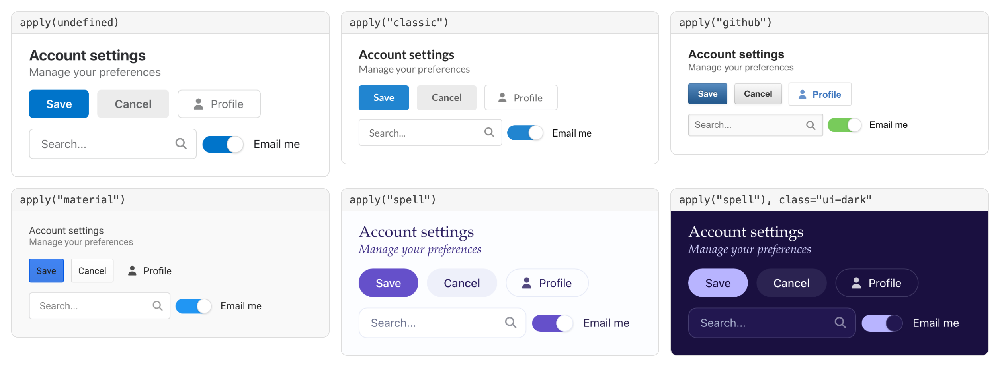
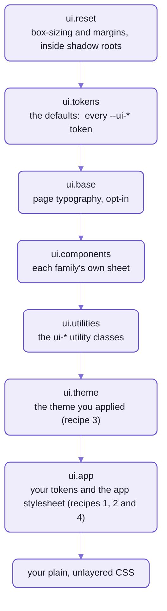

# Theming Spell UI



_One block of markup, six looks, each under the call that made it:  screenshots of a running page._

Nothing in the markup changed between those panels.
`UI.themes.apply("github")` swapped one stylesheet, on the page and inside every component's shadow root at once;
the last panel added one class, `ui-dark`.

That's the big switch, and you may never need it.
Spell UI draws everything from CSS custom properties, the TOKENS,
so theming is mostly setting a few of them:  say how your look differs from the default, and stop.

What you can't do yet is offer people a theme menu on your own page, or make a theme from your own colours and fonts:
both are 🌱 coming, at the end.

<details>
<summary>The markup in every panel, and how the pictures were taken</summary>

```html
<ui-header level="3">Account settings<ui-header>Manage your preferences</ui-header></ui-header>
<div class="row">
  <ui-button primary>Save</ui-button>
  <ui-button>Cancel</ui-button>
  <ui-button basic icon="user">Profile</ui-button>
</div>
<div class="row">
  <ui-input icon="magnifying glass" placeholder="Search..." aria-label="Search"></ui-input>
  <ui-checkbox type="toggle" selected>Email me</ui-checkbox>
</div>
```

- Taken in headless Chromium, on Spell UI's theming page from the page server,
  with `UI.themes.apply()` called between the shots.
- `classic` has Lato added from Google Fonts:  the theme names the font, but loads none.

</details>

## If you've themed MUI or Tailwind, two things move

### Your selectors stop at the shadow root;  custom properties don't

Each `<ui-button>` draws a real `<button>` inside its shadow root, where the page's selectors can't reach.
With MUI you'd hand a `ThemeProvider` a `styleOverrides` entry;  with Tailwind, you'd put classes on the button.
Here there's no provider, and the inner `<button>` you'd put classes on is out of reach:
custom properties inherit through the shadow boundary, as `color` does, and every component reads its look from them.

That gets your values in.
What decides who wins is order:  every sheet, the page's and each shadow root's, sits in one of seven cascade layers,
declared the same way everywhere:

```css
@layer ui.reset, ui.tokens, ui.base, ui.components, ui.utilities, ui.theme, ui.app;
```



_Later layers win, whatever the specificity:  each says only what it changes, and your plain CSS wins over all seven._

- So a theme's `.ui.button` beats a component's own `.ui.primary.button:hover`, and nobody writes `!important`.
- Inside a family's sheet, four sub-layers do the same:  types, content, variations, states.
  A `:hover` beats `basic`, again without `!important`.
- The layer order is the first sheet in the page and in every shadow root:
  each shadow root fixes its own order from the first `@layer` it sees.

### A colour is one value, and the browser works out the rest

MUI's `createTheme()` runs your palette through JavaScript once, to make its `light`, `dark` and `contrastText`.
Here every shade is a CSS expression, worked out by the browser where it's used.
This is red, six of its fourteen tokens, from the generated [colour sheet](src/styles/colors.css):

```css
--ui-red-on-light: oklch(0.57 0.21 27);
--ui-red-on-dark: oklch(0.7 0.19 25);
--ui-red: light-dark(var(--ui-red-on-light), var(--ui-red-on-dark));
--ui-red-hover: oklch(from var(--ui-red) calc(l - 0.05) calc(c * 1.1) h);
--ui-red-text: light-dark(oklch(from var(--ui-red) min(l, 0.5) c h), oklch(from var(--ui-red) max(l, 0.78) c h));
--ui-red-on: light-dark(oklch(1 0 0), var(--ui-ink-on-light));
```

- Set red's two bases, `--ui-red-on-light` and `--ui-red-on-dark`, and ten of the other twelve follow:
  `--ui-red` itself;  its hover, focus, pressed and active shades;  its text, header, border and background;
  and its inverted colour.
- Every colour works this way:  thirteen hues, `red` to `black`;  `primary` and `secondary`, which point at blue
  and black until you re-point them;  and `positive`, `negative`, `info` and `warning`.
- They're OKLCH, so `l - 0.05` darkens a yellow about as much as it darkens a blue.
- **The two that don't follow:**  `-on` and `-inverted-on`, the text drawn ON the colour.
  - Each is white or ink, picked when the sheets were generated:
    the first that reaches WCAG AA's 4.5:1 on the colour and on its four states, in each scheme.
  - A [test](tests/styles/colors.contrast.test.ts) measures every pair from the computed tokens,
    so a palette change that breaks contrast fails, naming the colour.
  - Unlike MUI's `contrastText`, nothing recomputes it for you:  move a base far, and set its `-on` too.

## What ships:  tokens, dark mode and the themes

### About 400 tokens, and 1,200 more that belong to one family each

| Family | Tokens | Worth knowing |
| --- | --- | --- |
| type | `--ui-font-size`, `--ui-font-family`, `--ui-font-family-heading`, `--ui-font-family-mono`, `--ui-line-height` | `--ui-font-size` is `16px`, and every size scales from it in `em`, never `rem` |
| spacing | `--ui-space-3xs` ... `--ui-space-3xl` | nine steps, `0.125em` to `4em` |
| radius | `--ui-radius`;  `--ui-radius-s`, `-m`, `-l`, `-pill`, `-circle` | `--ui-radius` is `-m`, `0.375em` |
| shadows | `--ui-shadow-raised`, `-floating`, `-overlay` | |
| motion | `--ui-duration-fast`, `-normal`, `-slow`;  the `--ui-ease-*` curves | |
| colour | `--ui-primary`, `--ui-secondary`, every hue, each with its roles:  `-hover`, `-focus`, `-text`, `-border`, `-background`, `-inverted`, `-on` ... | three quarters of the 400, each a `light-dark()` pair or worked out from one |
| a family's own | `--ui-<tag>-*`:  `--ui-button-background`, `--ui-checkbox-mark-color` | 42 on `<ui-button>` alone;  each family's docs page lists its own on a Theming tab, with their defaults |

Why `em`:  Tailwind's `rem` sizes all follow the page's root font size.
Here a wrapper's `--ui-font-size: 20px` makes every component inside it bigger, and nothing outside it;
only hairlines, focus rings, shadows and breakpoints stay in `px`.

### Dark mode follows the operating system, and any element can overrule it

Every colour token is a `light-dark()` pair, resolved where it's USED, not where it's declared.
So the scheme can change at any element, and everything below it follows, through shadow roots:
- `class="ui-dark"` or `class="ui-light"` forces a scheme on a subtree;  `ui-invert` flips it back from its parent's
- `<ui-root theme="dark">` does the same for everything inside a root
- on `<html>`, `class="ui-dark"` turns the whole page dark, as the [dark sheet](src/styles/themes/dark.css) does
- `:root { color-scheme: light }` keeps a page light:  the library sets `light dark` in its tokens layer,
  so a page's own `color-scheme` wins

One name trips people up:  `theme` on `<ui-root>` is the colour SCHEME, `light` or `dark`.
A look like `github` is applied with `UI.themes.apply()` (recipe 3).

### The themes:  `classic`, 23 of Fomantic's, and Spell's own

Each theme is one sheet in [the themes folder](src/styles/themes/), and there's no list of them anywhere else:
the runtime globs the folder, so dropping a `<name>.css` in makes a theme.
- `classic`:  Fomantic UI's original look (Lato, 14px, its palette, 4px radii), and the base every Fomantic theme
  sits on.
  It names Lato but loads no font:  add it yourself, or the system font stands in.
- 23 of Fomantic's own themes, ported, `amazon` to `twitter`:  every one, in a line, below.
  - Each is a DELTA on `classic`, as Fomantic's were on its default look.
  - The one left out, Lead By Example, is a GitHub look-alike with its own `theme.config`:  `github` stands in.
  - Mind the names:  `classic` is Fomantic's DEFAULT look, while `fomantic-classic` is the Fomantic theme that
    happens to be called "classic", Semantic UI 1.x's glossy gradients.
- `spell`:  Spell's own look, and the docs site's default:  serif headings with italic ledes, Spell Purple,
  pill buttons, an aubergine dark mode.
  It ships no font either:  the serif is whichever Palatino the system has.
- Not a theme:  the dark sheet, a colour scheme you put on top of any of them (above).
  `classic` has no dark of its own, since Fomantic had none:  its dark colours are Fomantic's light hues.

The cost:  each theme is its own lazy chunk, fetched the first time it's applied.
Most are 0.2 to 2.3 kB gzipped (`classic` 1.6, `github` 2.3), and `spell` is 3.4, as `yarn measure` weighs them.
The four that bring a font are 21.5 to 39.4 kB, because the font travels inside the chunk:
`bookish` (Karma), `chubby` (Source Sans 3), `instagram` (Montserrat) and `material` (Roboto).

<details>
<summary>Every theme, in a line</summary>

"Page-wide" themes change the site's globals too (font, size, palette), so every component shifts a little;
the last column is what a theme restyles on purpose.

| Theme | Look | Restyles |
| --- | --- | --- |
| `spell` | Spell's own:  Palatino-family serif headings with italic ledes, a system sans body, Spell Purple, pill buttons, 16px cards, soft layered shadows, an aubergine dark mode.  Page-wide;  the docs site's default. | everything, through the global tokens |
| `classic` | Fomantic's original look, and the base of every theme below:  Lato, 14px, Fomantic's palette and size ratios, 4px radii.  Page-wide. | everything, through the global tokens |
| `amazon` | amazon.com circa 2015:  13px Arial, gradient buttons, an orange primary.  Page-wide. | button, header |
| `basic` | Stripped back:  flat grey buttons, borderless cards, pill steps, no progress track. | button, card, progress, step, table |
| `bookish` | Serif "book" headers in Karma. | header |
| `bootstrap3` | Bootstrap 3's `.btn`:  white, a grey hairline, a small radius, Bootstrap's palette. | button |
| `chubby` | Big, soft, padded controls. | accordion, button, comment, dropdown, form, input, menu, header |
| `colored` | Checkboxes, radios and sliders chosen in the primary colour. | checkbox |
| `duo` | A two-colour loader ring:  primary and secondary halves. | loader |
| `fixed-width` | Narrower, fixed modal widths. | modal |
| `flat` | A flatter, brighter site with underlined form fields.  Page-wide. | dropdown, form, input, header |
| `fomantic-classic` | Fomantic's own theme named classic, Semantic UI 1.x's glossy look:  gradients and embossed edges.  Page-wide. | button, card, header, progress, table |
| `github` | GitHub's look, circa 2015.  Page-wide. | breadcrumb, button, dropdown, form, grid, image, input, label, menu, message, header, popup, segment, step, table |
| `gmail` | Compact grey notice bars, like Gmail's. | message |
| `instagram` | Flat bordered cards in Montserrat, like Instagram's posts. | card |
| `material` | Google's Material Design, circa 2016.  Page-wide. | button, dropdown, menu, modal, header |
| `pulsar` | A primary-coloured loader that fades in, whirls and fades out. | loader |
| `raised` | Buttons with a 3D bottom edge. | button |
| `resetcss` | Eric Meyer's Reset CSS on the page, in place of normalize.  Page-wide;  the one theme in `ui.reset`, since a reset belongs under everything. | native page markup |
| `round` | White, pill-shaped, uppercase outlined buttons. | button |
| `rtl` | An Arabic-script font stack and a right-to-left page.  Page-wide. | everything, through the direction |
| `striped` | Diagonal stripes on progress bars, marching while active. | progress |
| `systemfont` | The platform's own UI font instead of Lato.  Page-wide. | everything, through the font |
| `timeline` | A feed drawn as a timeline:  a line down the labels, round badges on it. | feed |
| `twitter` | twitter.com circa 2015:  pale gradient buttons, a sky-blue primary. | button |

</details>

## Four recipes

### 1. Sitewide defaults:  tokens on `:root`

Set the global tokens in your app's layer, and every component follows:

```css
@layer ui.app {
  :root {
    --ui-primary: var(--ui-pink);
    --ui-primary-inverted: var(--ui-pink-inverted);
    --ui-secondary: var(--ui-grey);
    --ui-red-on-light: oklch(0.58 0.22 20);
    --ui-red-on-dark: oklch(0.72 0.17 20);
  }
}
```

- On a live page, the primary button went from blue, `oklch(0.55 0.16 250)`, to pink, `oklch(0.58 0.22 355)`;
  its hover and its dark-scheme colour came along with no other line.
- The red pair re-colours red in each scheme separately:  set only `-on-light`, and dark mode keeps the default red.
- `-inverted` is re-pointed by hand because three of primary's tokens point at blue's rather than derive:
  `-inverted`, `-on` and `-inverted-on`.
  Pink and blue both take white text in light and ink in dark, so `-on` can stay;
  re-point primary at yellow, which takes ink, and add `--ui-primary-on: var(--ui-yellow-on)`.
- In `ui.app`, it beats any theme you apply, and your plain CSS can still beat it.

### 2. One component's defaults:  its own tokens

Each family also reads tokens of its own, `--ui-<tag>-*`,
and you set them as widely or as narrowly as a selector reaches:

```css
/* every button */
:root { --ui-button-radius: 0; }

/* the buttons in a toolbar */
.toolbar { --ui-button-padding-inline: 0.75em; }

/* one kind of button, on its inner box */
ui-button.cta::part(button) { --ui-button-background: gold; }

/* the headers inside every card */
ui-card { --ui-card-header-color: var(--ui-violet-text); }
```

- All four ran on a live page:  the radius went from `6px` to `0`, the toolbar's padding from `24px` to `12px`,
  the `.cta` gold and the card's header violet.
- Tokens inherit into the shadow root, so they work anywhere above the box:
  `:root`, any ancestor, the element itself, or its `::part()`.
- **The exception:**  a variation that SWAPS a value wins over the token.
  `circular` stayed a pill under `--ui-button-radius: 0`;  restyle it with a plain property on its part:
  `ui-button[circular]::part(button) { border-radius: 0.5em }`.
- Never set the `--_ui-*` names you'll meet in the sheets:  they're each component's private plumbing,
  read from the public token.

### 3. Applying a theme:  one call, every shadow root

For a whole look rather than a few values, one call.
The runtime fetches the theme's sheet the first time it's asked for,
and adopts it into the page and every component's shadow root, the ones there now and the ones to come:

```js
import { UI } from "spell-ui/core"

const { themes } = await UI.load()
themes.names // the 23 Fomantic themes, A-Z:  ["amazon", "basic", "bookish" ...]
await themes.apply("github") // classic, then github
await themes.apply("classic") // classic alone
await themes.apply("spell") // classic, then Spell's own look
await themes.apply(undefined) // no theme:  the plain default look
```

- Both sheets sit in `ui.theme`, `classic` first, so the theme wins every tie by coming second.
- One theme at a time:  each call replaces the last in place, and `apply(undefined)` takes both sheets away.
- Two calls racing:  the last one called wins, even when the first one's chunk arrives later.
- `themes.own` lists Spell UI's own themes, `spell` among them:  a picker shows them apart from `names`.
- A name it doesn't know throws a `TypeError` that lists the ones it does.
  So does `apply("dark")`, since dark is a scheme (above):

  ```text
  Themes.apply():  `dark` isn't a theme;  pick `classic`, one of `own` or one of:  amazon, basic, bookish, ...
  ```

- A page with no runtime can link the sheets itself:  `ui.css`, then `classic.css` and the theme's own from `themes/`.
  Only the token half reaches inside components then:  the class-grammar half needs the runtime to adopt it.

### 4. Restyling the base styles:  the app stylesheet

For a change no token covers, write CSS against the markup INSIDE the components.
Give one `<style>` or `<link>` on the page the id `ui-app-stylesheet`,
and the runtime mirrors it into every component's shadow root, adopted last:

```html
<style id="ui-app-stylesheet">
  @layer ui.app {
    .ui.button {
      border-radius: 0; /* squares every button on the page */
    }
    .ui.card {
      box-shadow: none; /* flattens every card */
    }
  }
</style>
```

- The selectors are Fomantic's class grammar, the classes the components draw inside their shadow roots,
  so this is where Fomantic's `.overrides` files go.
- Both rules ran on a live page, from a `<style>` inserted after it loaded, and an edit to its text was picked up:
  the runtime watches for edits, a late insertion and a `<link>` that loads later.
- `@import`s are inlined:  every level from a same-origin `<link>`;  one level from a `<style>` or another site's sheet.
- Keep it in `@layer ui.app`, or leave it unlayered to beat every layer in the shadow root.
- **One page, one app stylesheet,** and an element that gains the id later, through `setAttribute()`, isn't noticed:
  insert it with the id already on.
- **A selector stops at its own shadow root:**  `.ui.card > .content > .header` never reaches a `<ui-card>`'s header,
  which draws in a shadow root of its own, `<ui-header>`'s.
  The family's token does it instead:  `--ui-card-header-color`, recipe 2.

<details>
<summary>Porting a Fomantic theme, in short</summary>

All 24 of Fomantic's looks here, `classic` and the 23 themes, were ported the same way;
the theming page on the docs site has the recipe step by step.

1. Read the theme in Fomantic's source:  its `globals/site.variables` first, then each component's `.variables`
   and `.overrides`.
   Only what's there is the theme.
2. Write ONE sheet in [the themes folder](src/styles/themes/), all inside `@layer ui.theme`, in two halves:
   - TOKENS on `:root`:  Fomantic's variables, as `--ui-*` globals and `--ui-<tag>-*` component tokens
   - OVERRIDES:  Fomantic's `.overrides`, as class-grammar rules (`.ui.button`) for the markup inside shadow roots
3. Scope the overrides:  `ui.theme` beats every component layer, states included,
   so write `.ui.button:not(.basic, .inverted, .tertiary)` where Fomantic meant that, not `.ui.button`.
4. Put what the theme really needs, a font or an image, in `themes/<name>/`, referenced relatively.
5. Test it:  a `describe("<name>.css")` in [the themes test](tests/styles/themes/themes.test.ts),
   with at least one computed style per component it touches, read inside the shadow root.

- The models:
  - `github.css`:  the site's globals and 15 components, tokens and overrides
  - `material.css`:  fonts, palette, the `-on` colours re-checked
  - `fomantic-classic.css`:  small, mostly overrides
- Not ported:  Fomantic's per-component `theme.config`;  its icon fonts (icons here are SVG packs);
  web fonts by `@import` (a runtime sheet drops `@import`, so the page loads its fonts).

</details>

## 🌱 Coming:  picking and making themes

- a theme picker for any page:  the docs site has one today, but as a docs-only element, `<ui-docs-themes>`
  (a theme, then light, dark or system, remembered for each viewer)
- a way to make a theme from your own colours and fonts
- theme files per component, so one page can mix looks family by family

Today a page applies one theme at a time,
and mixes looks through component tokens, or by copying a theme's rules for one family into its app stylesheet.

<details>
<summary>More in the docs site</summary>

These pages are served by the page server, so they need a checkout and the page server running
([README-site.md](README-site.md)).
The second lives in the content folder, which a new checkout doesn't have.

- Theming, with a live theme gallery and every foundation token:  `/components/ui/theming.html`
- Spell UI's theming notes (the sheet table, component tokens, utilities, stacking):  `/guides/ui/notes/theming.md`

</details>

## See also

- [README.md](README.md):  Spell UI's front page, with `<ui-root>` and every way page CSS reaches inside a component
- [README-components.md](README-components.md):  every family, each with its own tokens on its docs page's Theming tab
- [README-runtime.md](README-runtime.md):  the sheets under every theme, and the `UI` runtime that applies them
- [README-migrating.md](README-migrating.md):  coming from Fomantic UI, whose themes and `.overrides` carry over
- [The kit's element framework](https://github.com/spell-app/spell-kit/blob/main/README-element.md):  how each component's shadow root adopts these sheets
