# Theming Spell UI

A theme is CSS in the theme layer, applied to the page AND every component's shadow root at once;
tokens do the rest.
Spell UI is styled from CSS custom properties, the TOKENS, which inherit into every shadow root:
so theming is mostly setting a few of them, saying how your look differs from the default.

This page is short on purpose:  what ships, and four recipes.
Picking and making themes is coming (below).

```mermaid
%%{init: {"theme":"base","themeVariables":{"fontFamily":"-apple-system, BlinkMacSystemFont, Segoe UI, Helvetica, Arial, sans-serif","fontSize":"15px","primaryColor":"#EFECFB","primaryBorderColor":"#6550CA","primaryTextColor":"#1A1C27","secondaryColor":"#F4F1E9","tertiaryColor":"#F7F6FC","lineColor":"#7F6FD6","textColor":"#7F6FD6","clusterBkg":"#F7F6FC","clusterBorder":"#B9B0E8","titleColor":"#1A1C27","edgeLabelBackground":"#F7F6FC","actorBkg":"#EFECFB","actorBorder":"#6550CA","actorTextColor":"#1A1C27","actorLineColor":"#9C90DE","signalColor":"#7F6FD6","signalTextColor":"#7F6FD6","labelBoxBkgColor":"#EFECFB","labelBoxBorderColor":"#6550CA","labelTextColor":"#1A1C27","loopTextColor":"#7F6FD6","noteBkgColor":"#F1E7D4","noteBorderColor":"#C9B48A","noteTextColor":"#1A1C27","activationBkgColor":"#DCD6F7","activationBorderColor":"#6550CA","sequenceNumberColor":"#FFFFFF"},"flowchart":{"curve":"basis","padding":12,"nodeSpacing":40,"rankSpacing":44}}}%%
flowchart LR
  tokens["ui.tokens:  the defaults"] --> components["ui.components:  each family's sheet"]
  components --> theme["ui.theme:  a theme"]
  theme --> app["ui.app:  your overrides"]
  app --> page["your unlayered CSS"]
  %% the Spell look:  yarn mermaid:pretty
  classDef default fill:#EFECFB,stroke:#6550CA,stroke-width:1.5px,color:#1A1C27,rx:8px,ry:8px
```



_Each layer says only what it changes;  later layers win, and your plain page CSS wins over all of them._

## What ships

- The layer order, first in the page and in every shadow root:
  `@layer ui.reset, ui.tokens, ui.base, ui.components, ui.utilities, ui.theme, ui.app;`
- The token families:
  - type:  `--ui-font-size` (px, `16px` by default:  the ONE absolute length;  everything else is `em`, never `rem`),
    `--ui-font-family`, `--ui-font-family-heading`, `--ui-font-family-mono`, `--ui-line-height`
  - spacing `--ui-space-3xs` ... `--ui-space-3xl`;  radius `--ui-radius`, `--ui-radius-s|m|l|pill|circle`;
    shadows `--ui-shadow-raised|floating|overlay`;  motion `--ui-duration-fast|normal|slow`
  - colours:  `--ui-primary`, `--ui-secondary`, and every hue (`--ui-red`, `--ui-blue` ...), each with its roles
    (`-hover`, `-focus`, `-text`, `-border`, `-background`, `-inverted`, `-on` ...), in OKLCH
  - each component's own, `--ui-<tag>-*` (`--ui-button-background`, `--ui-checkbox-mark-color`):
    its docs page's Theming tab lists them, with their defaults
- Dark mode follows the operating system.
  Every colour token is a `light-dark()` pair, resolved where it's used, so:
  - `class="ui-dark"` or `class="ui-light"` forces a scheme on a subtree;  `ui-invert` flips it
  - `<ui-root theme="dark">` does the same for everything in a root
  - [`dark.css`](src/styles/themes/dark.css) forces dark page-wide;  `:root { color-scheme: light }` keeps a page light
- The themes, one sheet each in [the themes folder](src/styles/themes/):
  - `classic`:  Fomantic UI's original look (Lato, 14px, its palette), and the base of every Fomantic theme
  - Fomantic UI's themes, ported:  amazon, basic, bookish, bootstrap3, chubby, colored, duo, fixed-width, flat,
    fomantic-classic, github, gmail, instagram, material, pulsar, raised, resetcss, round, rtl, striped, systemfont,
    timeline, twitter
  - Spell UI's own:  `spell` (the Spell look:  serif headings, Spell Purple, pill buttons, an aubergine dark mode;
    the docs site's default) and `spell-brand` (the same, plus the brand's own roles)
- `UI.themes.apply()` switches theme at run time, on the page and in every shadow root, existing and future.

## Four recipes

### 1. Sitewide defaults

Set global tokens on `:root`, in your app's layer:  every component follows.

```css
@layer ui.app {
  :root {
    --ui-primary: var(--ui-pink);
    --ui-primary-inverted: var(--ui-pink-inverted);
    --ui-secondary: var(--ui-grey);
    --ui-red-on-light: oklch(0.58 0.22 20);
    --ui-red-on-dark: oklch(0.72 0.17 20);
  }
}
```

- Re-pointing a base colour re-colours it everywhere, its hover, text and border roles included.
- `--ui-red-on-light` and `--ui-red-on-dark` set a hue for each scheme.

### 2. One component's defaults

Set the component's own tokens, as widely or narrowly as you like.

```css
/* every button */
:root { --ui-button-radius: 0; }

/* the buttons in a toolbar */
.toolbar { --ui-button-padding-inline: 0.75em; }

/* one kind of button, on its inner box */
ui-button.cta::part(button) { --ui-button-background: gold; }

/* the headers inside every card */
ui-card { --ui-card-header-color: var(--ui-violet-text); }
```

- Tokens inherit into the shadow root, so nothing inside blocks them.
- A variation that SWAPS a value (`circular`) wins over the token;  restyle it with plain properties on its part:
  `ui-button[circular]::part(button) { border-radius: 0.5em }`.
- Never set the `--_ui-*` names:  they're the components' private plumbing.

### 3. Applying a theme

The runtime loads a theme's sheet on demand and applies it everywhere.

```js
import { UI } from "spell-ui/core"

const { themes } = await UI.load()
themes.names // the Fomantic themes, A-Z:  ["amazon", "basic", "bookish" ...]
themes.own // ["spell", "spell-brand"]
await themes.apply("github") // classic + github, on the page and in every shadow root
await themes.apply("classic") // classic alone
await themes.apply(undefined) // Spell UI's own look
```

- A Fomantic theme is a DELTA on `classic`, so applying one applies `classic` first.
- `dark` is a colour scheme, not a theme:  `apply("dark")` throws.
- Each sheet is its own lazy chunk;  if two calls race, the last one wins.
- Without the runtime, a page can link the sheets itself:  `ui.css`, then `classic.css` and `<name>.css` from `themes/`.
  But then only the token half reaches inside components.

### 4. Restyling the base styles, sitewide

For a change no token covers, write CSS against the markup INSIDE the components, in Fomantic's class grammar:
give one `<style>` (or `<link>`) on the page the id `ui-app-stylesheet`.
The runtime mirrors it into every component's shadow root, last, in the `ui.app` layer.

```html
<style id="ui-app-stylesheet">
  @layer ui.app {
    .ui.button {
      border-radius: 0; /* squares every button on the page */
    }
    .ui.card > .content > .header {
      letter-spacing: 0.01em;
    }
  }
</style>
```

- One app stylesheet per page;
  later edits, a late insertion and `@import`s (one level, for inline sheets) are picked up.
- It's where Fomantic's `.overrides` files go.

## 🌱 Coming:  picking and making themes

What it will add:

- a theme picker for any page (the docs site has one today, as its own element)
- a way to make a theme from a brand's colours and fonts
- theme files per component, so one page can mix looks family by family

Today a page applies one theme with `UI.themes.apply()`, and mixes looks through component tokens.

<details>
<summary>Porting a Fomantic theme, in short</summary>

Each of the 24 Fomantic themes in Spell UI was ported the same way;
the theming page on the docs site has the recipe step by step.

- Read the theme in Fomantic's source:
  its `globals/site.variables`, then each component's `.variables` and `.overrides`.
- Write ONE sheet in [the themes folder](src/styles/themes/), in `@layer ui.theme`, in two halves:
  1. TOKENS on `:root`:  Fomantic's variables as `--ui-*` globals and `--ui-<tag>-*` component tokens
  2. OVERRIDES:  Fomantic's `.overrides` as class-grammar rules (`.ui.button`) for the markup inside shadow roots
- The models:
  - `github.css`:  16 components, tokens and overrides
  - `material.css`:  fonts, palette
  - `fomantic-classic.css`:  small, mostly overrides
- Not ported:  Fomantic's per-component `theme.config`.

</details>

<details>
<summary>More in the docs site</summary>

These pages are served by the page server,
so they need a checkout and the page server running ([README-site.md](README-site.md)).
The first is Spell UI's own docs page;  the second is in the content folder.

- Theming, with a live theme gallery and every foundation token:  `/components/ui/theming.html`
- Spell UI's theming notes (the sheet table, component tokens, utilities, stacking):  `/guides/ui/notes/theming.md`

</details>

## See also

- [README.md](README.md):  Spell UI's front page, and its page-level CSS
- [README-runtime.md](README-runtime.md):  the styles, and `UI.themes` among the runtime's services
- [README-migrating.md](README-migrating.md):  Fomantic's themes, coming from Fomantic UI
- [README-components.md](README-components.md):  every family, each with its Theming tab
- [The kit's front page](../README.md)
- Also beside it:  [README-frameworks.md](README-frameworks.md) · [README-site.md](README-site.md)
