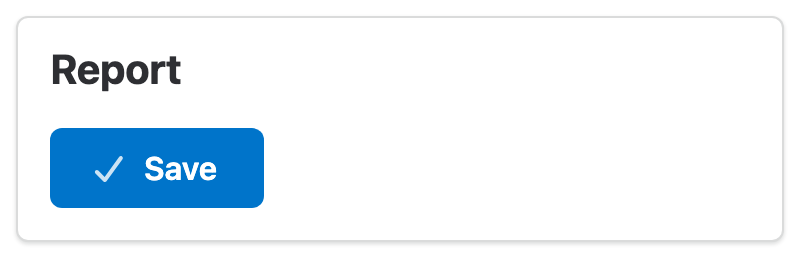
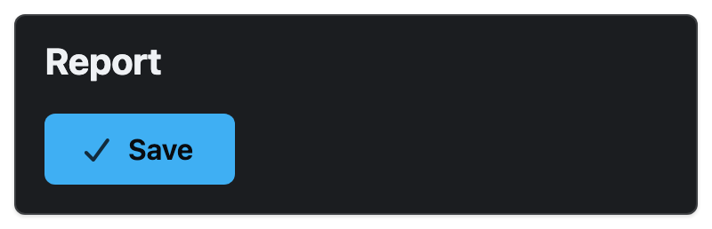
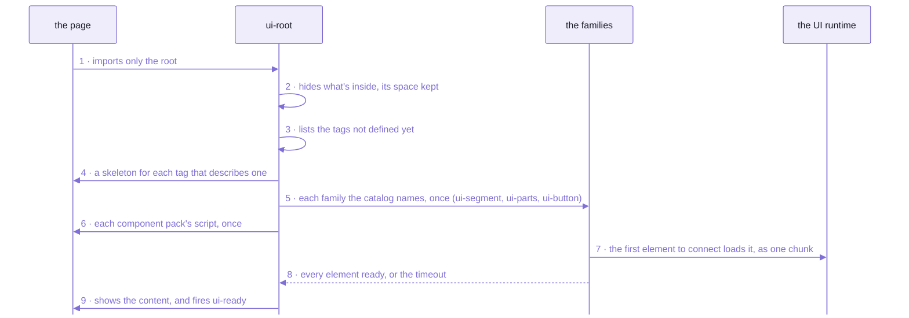

# Spell UI

**Accessible, themeable web components that load themselves on demand, from plain HTML or any framework.**

```html
<!doctype html>
<html lang="en">
  <head>
    <meta charset="utf-8" />
    <script type="importmap">
      {
        "imports": {
          "spell-ui/": "/dist/",
          "solid-js": "/vendor/solid-js.js",
          "@solidjs/web": "/vendor/@solidjs/web.js"
        }
      }
    </script>
    <script type="module">
      import "spell-ui/ui-root.js"
    </script>
  </head>
  <body>
    <ui-root>
      <ui-segment>
        <ui-header>Report</ui-header>
        <ui-button color="primary" icon="check">Save</ui-button>
      </ui-segment>
    </ui-root>
  </body>
</html>
```

| That page | The same page, with `<ui-root theme="dark">` |
| --- | --- |
|  |  |

_Both in headless Chromium, from a plain static server:  no build step of yours, and not a line of your CSS._

The page imports one module, `<ui-root>`'s, and never names a family.
The root found three tags it didn't know yet, looked each one up in its catalog,
and imported the three families that define them, once each:
`ui-segment.js`, `ui-parts.js` (a header is one of the content parts) and `ui-button.js`.
The other 55 families never left the server.

The dark one took one attribute.
Its blue is lighter, and the button's label turned from white to ink, Spell UI's near-black:
white on that blue measures 2.43:1, under the 4.5:1 that WCAG AA asks of text, and the ink measures 8.10:1.
Every colour carries the text colour that reads on it, in light and in dark, so your page never has to know.

Spell UI is 62 families of these `<ui-*>` custom elements, 104 tags in all:
buttons, forms, dropdowns, cards, menus, modals, tables, a calendar, a tree diagram ...
It's Spell's component library ([the kit's front page](https://github.com/spell-app/spell/blob/main/README.md) says what Spell is),
and a page needs nothing else of Spell's to use it.

- **Accessible:**  each element draws real, semantic markup into its shadow root,
  a `<button>`, a `<dialog>`, an `<input>`, never a `<div>` pretending to be one.
  The tests run axe, the accessibility checker, in a real browser,
  on every example of every family that has examples:  59 of the 62.
- **Themeable:**  everything draws from CSS tokens, in OKLCH colours that work in light and dark.
  Set a few, or switch the whole look to one of 28 themes with one call, `UI.themes.apply("github")`.
- **Loaded on demand:**  a page pays for the families it uses, 5.7 kB each on average, gzipped.
- **From plain HTML or any framework:**  written on Solid 2 inside, but a plain custom element to your page,
  so React, Vue, Svelte, Solid or no framework at all use it the same way.
- **On today's platform, with no polyfills:**  cascade layers, anchor positioning, `<dialog>` and popover,
  and form controls that are real form controls, joining a `<form>` and validating and resetting like native ones.
  The cost is a current browser ([below](#what-it-costs-and-what-it-assumes)).

**Real today:**  all of that, from a checkout of the kit, the folder every Spell repo is cloned into.
**Not yet:  `npm install spell-ui`.**
The page above maps `spell-ui/` onto the kit's own build of the library, and Solid onto one vendored copy:
[the thirty seconds below](#thirty-seconds-two-ways) make both, and show the map 🌱 npm will need instead.

<details>
<summary>What the button drew inside its shadow root</summary>

```html
<ui-button color="primary" icon="check">
  #shadow-root (open)
    <button type="button" class="ui primary button" part="button">
      <span class="icon" part="icon">
        <slot name="icon"><svg viewBox="0 0 448 512" fill="currentColor" aria-hidden="true">…</svg></slot>
      </span>
      <slot></slot>
    </button>
  Save
</ui-button>
```

- Read back from that page in headless Chromium, the icon's path and its licence comment left out.
- A real `<button>`, so focus, Enter, Space and screen readers work the way they do on any button.
- `Save` never moved into the shadow root:  it's the page's own text, shown through the `<slot>`,
  so find-in-page still finds it.
- `class="ui primary button"` is Fomantic UI's class grammar, written for you from the attributes
  ([below](#the-families--62-in-fomantic-uis-groups), where the words come from).

</details>

## If you've used a component library, three things move

Picking a component, passing it data and styling it all still happen here.
Each moves to something the browser already has:
custom elements, the DOM's own attributes and events, and cascade layers.

### You write tags, and the root does the importing

In MUI you write an import for every component you use, and your bundler ships what you imported.
Here the page imports nothing but the root, and you just write the tag:
`<ui-root>` imports its family the first time the page uses it, from plain HTML, with no bundler at all.



_A page loads its elements:  one import up front, then each family the first time the page uses it._

<details>
<summary>The same nine steps, in words</summary>

1. The page imports only the root, as the page above does (`spell-ui/ui-root.js`), or a bundle that defines it.
2. `<ui-root>` connects.
   Unless `display="immediately"`, it hides what's inside with an inline style, before any stylesheet arrives.
   - It keeps its space (`when-ready`), or draws a loader (`loading`) or skeletons instead.
   - It hides only when scripts run (`@media (scripting: enabled)`):
     crawlers and readers without JavaScript see everything.
3. It lists the tags inside that aren't defined yet:  every `ui-*` tag, and every tag of a component pack.
4. With skeletons on (the default), it draws a grey placeholder for each tag whose vocabulary describes one
   (a button is `"inline 6 x 2.5"`), in its own shadow root:  the page's DOM is untouched.
5. For each tag it looks up the family in its catalog, which is generated from the vocabularies and never guessed
   from the name (`<ui-header>` is in `ui-parts`), and imports that family's module ONCE per page.
6. Each `<ui-components source="x.pack.js">` inside loads that pack's script once;
   the pack registers its prefix and catalog, so its tags load like the root's own.
7. The first element that connects loads the shared `UI` runtime, as ONE lazy chunk:
   keyboard, overlays, focus, styles, themes, icons ...
8. Ready means every family settled and every element inside resolved its `ready` promise, or the `timeout` passed.
   A tag that failed fires a cancelable `ui-error` and shows its plain fallback.
9. Then the root gets `:state(ready)`, fires `ui-ready { failed }`, and shows the content, never hiding it again.
   Content added later loads the same way, but is never hidden.

</details>

The cost:  the root shows the page's content whole,
so none of it appears until every family and the runtime are in, or `timeout` runs out (5 s by default).
The skeletons fill that wait;  `display="immediately"` draws each element as it arrives instead.

### The page holds the element;  your framework only drives it

In a React library, a component is a function React calls, so only React can use it.
`<ui-button>` is a node the page itself holds, like `<video>`:
attributes, properties and events outside, and a component behind it drawing into its shadow root.
So any framework drives it as it drives a built-in element, by three rules every element keeps:
- primitives are ATTRIBUTES:  `<ui-dropdown placeholder="Fruit" open>`
- rich data is a PROPERTY:  `dropdown.options = [...]`
- events are `ui-*` `CustomEvent`s, with their state in `detail`:  `ui-changed` → `event.detail.value`

`yarn smoke` holds Spell UI to that on four pages, in plain JavaScript, React 19, Vue 3 and Solid 2:
one `<ui-dropdown>` each, no wrapper component, the same round trip in headless Chromium.
Each framework's recipe, and a fourth rule (`ready`, and custom states):
[README-frameworks.md](README-frameworks.md#the-contract--four-rules-every-element-keeps).

No page checks Svelte, Angular or Preact yet, though the same rules should hold;
and only Solid's JSX knows the tags (`spell-ui/jsx`):  other frameworks' JSX has no typings yet.

### Your CSS stops at the shadow root;  four doors let it in

With a component library you'd pass a `className`, or give its theme provider some overrides.
Here each element draws in a shadow root, where your page's selectors can't reach.
Four doors are open on purpose, and together they restyle anything:

| Door | Reaches | Example |
| --- | --- | --- |
| tokens (`--ui-*`) | every component:  custom properties inherit into shadow roots | `:root { --ui-primary: oklch(55% 0.2 290); }` |
| utility classes | your markup, and inside components | `ui-stack`, `ui-bold`, `ui-text-truncate`, `ui-gap-m` |
| `::part()` | a component's named inner boxes | `ui-button::part(button) { border-radius: 0; }` |
| the app stylesheet | component internals, in Fomantic's class grammar | `<style id="ui-app-stylesheet">.ui.button { ... }</style>` |

Order decides who wins, not specificity.
Every sheet sits in one of seven cascade layers, and a later layer wins whatever its selectors;
your own stylesheet, left unlayered, beats all seven, so plain CSS overrides the library with no `!important`.

Each component also has public tokens of its own, `--ui-<tag>-*`, listed on its docs page's Theming tab:
`ui-button.wide { --ui-button-padding-inline: 3em; }`.
The layers in order, dark mode and five recipes (sitewide defaults, one component's, a whole theme,
the app stylesheet, making a theme) are on [README-themes.md](README-themes.md#five-recipes).

## Thirty seconds, two ways

Both start from the kit, with Spell UI cloned inside it.
Setting the kit up from zero (Node 24, yarn, the clone) is [the kit's front page](https://github.com/spell-app/spell/blob/main/README.md#setup-from-zero);
then bring Spell UI in:

```sh
cd ~/www/spell             # the kit
yarn clone spell-ui        # clones spell-ui and what it needs, then the one install
```

Spell UI needs only the kit;  `spell-epic` and `spell-app` need Spell UI.
`yarn install` runs in the kit, never in `spell-ui/`, because the kit holds the one install for every repo.
Run `yarn clone spell-ui` again and it says the repo is there, then installs anyway (`--no-install` skips that):

```text
every repo asked for is cloned:  spell-ui
== yarn install:  one install over every repo
```

**In a plain HTML page:**  build the library once, and copy it beside your page.

```sh
cd ~/www/spell/spell-ui
yarn build                         # the library, into dist/
yarn vendor                        # ONE copy of Solid, for import-map pages, into vendor/
mkdir ~/hello && cp -R dist vendor ~/hello/
```

Save the page at the top as `~/hello/hello.html`, then serve that folder with any static server:

```sh
cd ~/hello
python3 -m http.server 8000        # then open http://localhost:8000/hello.html
```

- Serve it, rather than opening the file:  `/dist/` and `/vendor/` in its import map are paths on a server.
- That's how the pictures above were taken, and the page was ready with no failures.
  It fetched the root, Spell UI's core, Solid, the three families its markup names, the runtime,
  the CSS foundation and one icon:  nothing else.
  What that weighs:  [below](#what-it-costs-and-what-it-assumes).

<details>
<summary>Every request that page made, in order</summary>

```text
/hello.html
/dist/ui-root.js                            the one import, then the root's own three
/dist/ui-loader.js
/dist/ui-placeholder.js
/dist/ui-components.js
/vendor/solid-js.js                         Solid, the one copy
/vendor/@solidjs/web.js
/dist/core.js                               Spell UI's core
/vendor/chunks/solid-47ihJRgg.js
/dist/UIRuntime-JolihiMM.js                 the runtime, as the first element connected
/dist/ui-segment.js                         the three families the markup names
/dist/ui-parts.js
/dist/ui-button.js
/dist/UISegment-9pF9jT62.js                 and two chunks they share with other families
/dist/UIButton-DbtbK2pV.js
/dist/styles.js                             the CSS foundation
/dist/icon-packs/fa7-free/pack.js           the default icon pack's index, for icon="check"
/dist/icon-packs/fa7-free/solid/check.svg
```

- Recorded by Playwright, each answered with a 200;  a rebuild changes the hashed names.

</details>

🌱 **From a CDN, once Spell UI is on npm,** there's nothing to build:  the map points at an npm CDN instead.

```json
{
  "imports": {
    "spell-ui/": "https://cdn.jsdelivr.net/npm/spell-ui/dist/",
    "solid-js": "https://esm.sh/solid-js@2.0.0-rc.17",
    "@solidjs/web": "https://esm.sh/@solidjs/web@2.0.0-rc.17?external=solid-js"
  }
}
```

Spell UI isn't published, so that map answers nothing yet.

**In a program with a bundler,** 🌱 once Spell UI is on npm:

```sh
npm install spell-ui solid-js@2.0.0-rc.17 @solidjs/web@2.0.0-rc.17
```

```js
// main.js
import "spell-ui/ui-root"
```

Then the same `<ui-root>` markup, in your page or in your components' templates.

Today that works inside the kit, under the name every Spell repo uses, `spell-ui/components/ui-root`:
Vite reads Spell UI's source, as it does for the Spell app's own `<spell-viewer>` element and for Spell UI's docs site.
A program outside the kit can't do that yet:
inside it, Spell UI's entries are its TypeScript source, which only the kit's one install resolves.

## `<ui-root>`, the top of every page

A page usually has one `<ui-root>`, around everything, and an app's shell can be one:
it loads what's inside on demand, gives it a theme and a size, and decides what shows until it's ready.

```html
<ui-root theme="dark" size="small" icons="fa7-brands" loading="Loading reports…">
  <ui-segment>
    <ui-header>Report</ui-header>
    <ui-button color="primary">Save</ui-button>
  </ui-segment>
</ui-root>
```

| Attribute | Values | What it does |
| --- | --- | --- |
| `display` | `skeleton` (the default), `when-ready`, `immediately` | what shows while it loads:  `skeleton`, a placeholder for each component that describes one, then the content;  `when-ready`, nothing, its space kept, until everything is ready;  `immediately`, each element as it arrives |
| `loading` | a message, or bare | a `<ui-loader>` with this message while components load (bare:  "Loading…");  not with `immediately` |
| `timeout` | `5s` (the default), `500ms`, or milliseconds | the longest wait before showing the content anyway:  a component that didn't load fires `ui-error` and shows its native fallback |
| `theme` | `light`, `dark` | the colour scheme of everything inside |
| `size` | `mini`, `tiny`, `small`, `medium`, `large`, `big`, `huge`, `massive` | the size of everything inside |
| `icons` | comma-separated ids or URLs | icon packs for everything inside:  `fa7-free` (the default), `fa7-brands`, `fomantic`, or `pack.js` URLs, the later winning;  added over the outer root's |
| `emoji` | `cldr` (the default), `fomantic` | the emoji names everything inside uses |
| `width`, `height` | a CSS length, or `window` | a root with either is a box that scrolls its own content, in a region named by its `aria-label`;  `window` follows a phone's address bar |
| `fixed` | present or not | fills the viewport and stays there:  the page never scrolls, the root does;  on iOS the keyboard can cover fields near the bottom |
| `stack-with` | `container`, `page` | what stacking layouts inside measure (`stackable`, `doubling` ...):  each element's own width, or the screen's, as in Fomantic;  sets `--ui-stack-with`, and an element's own `stack-with` wins |
| `assets` | a folder | where the built-in icon packs load from, relative to the page;  by default, beside the library |
| `disabled`, `visible`, `animation` | | the states every element shares ([the kit's README-element.md](https://github.com/spell-app/spell/blob/main/README-element.md#what-every-element-gets-without-asking)) |

- Two events:
  - `ui-ready`, once everything's in:  its `detail.failed` lists what didn't load, `[{ tag, reason, error?, source? }]`,
    where `reason` is `unknown` (no such tag), `failed` (its family didn't load) or `timeout`
  - `ui-error`, cancelable, for each tag or pack that didn't load;  cancel it to skip the console warning
    - a pack that didn't load:  `tag: "ui-components"`, with its `source`
- A promise:  `root.component.settled` resolves with the same failures, once it's ready.
  An outer root waits on an inner one.
- Roots nest:  an inner root inherits the outer one's settings, and changes only what it names.
- A subclass is a root too:  the Spell app's own `<spell-viewer>` element is one, loading its own tags the same way.
- Solid's context can't cross into a custom element, so a root carries your app's data instead:
  `root.appContext = value` (`<ui-root appContext={value}>` in Solid), read by every component inside.
  Each reads it once, when it's built, so set it before the elements inside first connect.

<details>
<summary>Its parts, states and swappable looks</summary>

- Parts:  `loading` (the loader), `skeleton` (the placeholders' box), `scroller` (the scrolling region of a box root).
- States:  `:state(loading)`, `:state(ready)`, `:state(light)`, `:state(dark)`, `:state(box)`, `:state(fixed)`.
- Swappable looks:  `UIRoot.Loading = MyLoading`, `UIRoot.Skeleton = MySkeleton`.
- The live page, with every example:  [`<ui-root>`'s docs page](docs/ui-root.html), served by the page server
  ([README-site.md](README-site.md#viewing-it--one-command-from-anywhere-in-the-kit)).

</details>

## Component packs:  another package's elements, loaded the same way

Spell UI's families aren't the only elements a root can load.
A component pack is another package's elements, under a prefix of its own (`epic-`, `x-` ..., never `ui-`):
name the pack once inside the root, and its tags load the first time the page uses them, exactly like Spell UI's.
There's one today, `spell-epic`'s `epics` pack:  the `<epic-*>` elements every epic page is built from.

```html
<ui-root>
  <ui-components source="/_epic/pack/epics.pack.js"></ui-components>
  <epic-page>...</epic-page>
</ui-root>
```

A pack is ONE classic script, so it works even from a page opened as a file.
It carries its elements and nothing they stand on:  no Solid, no Spell UI.
It borrows the page's, so the page still has one Solid, and the pack's elements share Spell UI's base.

- The price of borrowing:  the page first loads a Spell UI bundle that sets `window.SpellUI`,
  today the docs site's bundle or the epic pages' single-file bundle.
  The library's own entries don't set it.
- A pack that fails or times out logs an error naming its `source`, and the root still gets ready.
- A pack's elements are written exactly like a Spell UI family.
  How one is built (`spell pack build`), and what it costs:
  [the kit's README-element.md](https://github.com/spell-app/spell/blob/main/README-element.md#packs-and-ui-root);
  the `spell pack` commands that make one:  [the kit's README-cli.md](https://github.com/spell-app/spell/blob/main/README-cli.md#spell-ui).

## The families:  62, in Fomantic UI's groups

Looking for a datepicker?  It's `<ui-calendar>`, and a snackbar is `<ui-toast>`.
[The catalogue](README-components.md#the-catalogue) finds a family by the name your last library gave it:
every family with a picture, its tags, and what other libraries call it.
Every example runs live in [the docs site's component index](docs/components.html), served by the page server.

The names, and the groups they sort into, are Semantic UI's and Fomantic UI's:
- Elements, the basic pieces of a page:  `<ui-button>`, `<ui-input>`, `<ui-label>`, `<ui-segment>` ...
- Collections, made of several kinds of part:  `<ui-form>`, `<ui-menu>`, `<ui-table>` ...
- Views, ways to present a kind of content:  `<ui-card>`, `<ui-feed>`, `<ui-statistic>` ...
- Modules, elements with behaviour, that open, pick or move:  `<ui-dropdown>`, `<ui-modal>`, `<ui-calendar>` ...
- then one set of content parts every family shares, each styled by what it's in:  `<ui-header>`, `<ui-meta>` ...
- and five of Spell UI's own, with no Fomantic counterpart:
  `<ui-root>`, `<ui-section>`, `<ui-code>`, `<ui-markdown>`, `<ui-panel>`

The class grammar is theirs too:  `ui small primary basic button`, written for you from the attributes,
over each family's CSS, ported from Fomantic UI 2.9.4 into its shadow root.
Fomantic has, we think, the best vocabulary of any widget set, on LESS and jQuery with thin accessibility,
from before cascade layers, anchor positioning, `<dialog>` and popover.
Spell UI kept the words and replaced the rest ([README-migrating.md](README-migrating.md)).

Two families aren't finished:  Property Editor and Section, marked *(In progress)* in the catalogue.

## Other ways to load

The root is one of five ways in.
Each is a real entry of the package, by the name every Spell repo uses today, and 🌱 the shorter one it'll have on npm.

| How | Inside the kit, today | 🌱 On npm | What it does |
| --- | --- | --- | --- |
| everything | `import "spell-ui"` | the same | defines every family at once |
| one family | `import "spell-ui/components/ui-button"` | `spell-ui/ui-button` | each family is its own entry, so a page carries only what it imports |
| on demand | `import "spell-ui/components/ui-root"` | `spell-ui/ui-root` | the root loads the rest:  this page's way, and the docs site's |
| no JavaScript at all | `import "spell-ui/styles/ui.css"`, through your bundler | not among its published entries yet | tokens, utilities, typography and plain-HTML styling as one stylesheet;  `class="ui-typography"` on `<body>` for Fomantic's page typography |
| the static render | `spell ssr <pages>` | -- | `ui-*` pages turned into plain HTML in node, for search engines and readers without JavaScript ([README-runtime.md](README-runtime.md#the-static-render)) |

- On the kit's build, an import map's `spell-ui/` reaches the same entries as files:
  `spell-ui/index.js`, `spell-ui/ui-button.js`, `spell-ui/ui-root.js`.
- `ui.css` is a build entry:  your bundler inlines its `@import`s and resolves its custom media queries,
  which no browser reads by itself.

## What it costs, and what it assumes

The page at the top paid for five things once, and then a few kB for each family it used:

| Paid once per page | What it is | Gzipped |
| --- | --- | --- |
| Solid 2 | the parts of it Spell UI uses | 24.9 kB |
| Spell UI's core | the element framework, and the foundation every family needs, in ONE chunk | 40.6 kB |
| `<ui-root>` | the root, with its own loader, placeholders and packs element;  `ui-root.js` alone is 8.3 kB | 16.0 kB |
| the runtime | ONE lazy chunk, when the first element connects ([README-runtime.md](README-runtime.md)) | 16.9 kB |
| the CSS foundation | every sheet the page and the shadow roots adopt, as text | 17.3 kB |

That's 115.7 kB, and none of it is paid twice, however many elements follow.
After that, each family costs its own code, once:  5.7 kB on average, from Text's 1.2 kB to Form's 16.9 kB.
The first form control on a page adds the shared `forms` chunk, 6.8 kB.
The page at the top used three families, with the two chunks they share with others:
21.6 kB, so 137.3 kB in all, before its icon.
Import every family at once (`import "spell-ui"`) and it's 421 kB, Solid included.

- The changelog's budget, 8 kB a family, holds for 49 of the 62;  nothing checks it.
- Measured by `yarn measure`, which gzips each chunk of the library build on its own, as a browser fetches them.
  The page at the top fetched Solid as the vendored copy, both modules whole:  28.1 kB gzipped, as served.

Spell UI assumes a current browser, with no polyfills:
- anchor positioning (popups, dropdowns)
- the popover attribute and `<dialog>`
- container style queries
- form-associated custom elements (`ElementInternals`), and custom states (`:state()`)
- cascade layers, OKLCH and `light-dark()` colours
- Where Safari still has gaps, the runtime's `UI.browser.supports` flags them,
  and the element takes another way (invoker commands, for one).

And one more edge to plan around:  Solid 2 is a release candidate.
Spell UI pins `solid-js` and `@solidjs/web` at 2.0.0-rc.17 exactly, as peers,
so your app and Spell UI share the one copy, and your app runs that release candidate too.

## Working on it

From `spell-ui/`, inside the kit:

```sh
yarn dev           # every example, class grammar beside elements, with hot reload
yarn review        # the finishing pass:  types, lint, format, every test
yarn test          # the tests, in a real browser (and node, for the static render)
yarn test:visual   # screenshot tests of every example, light and dark
yarn site:build    # the docs site's data, index, kitchen sink and bundle
```

`yarn dev` opens [the demo page](src/tools/demo/index.html):
each example's plain class markup on the left, the same example as elements on the right.
`yarn review` MUST pass before work is handed back.

- Adding a family, step by step:  [README-components.md](README-components.md#adding-a-family-step-by-step).
- The rules for working here (how a component is written, imports, the lint guard):  [AGENTS.md](AGENTS.md).
- The docs site, the tools, their environment variables, and Spell UI's `spell` commands:
  [README-site.md](README-site.md).
- The framework every family is written on, the kit's:  [README-element.md](https://github.com/spell-app/spell/blob/main/README-element.md).

<details>
<summary>Every yarn script, one line each</summary>

| Script | What it does |
| --- | --- |
| `yarn dev` | the demo ([src/tools/demo/](src/tools/demo/)):  every example, class grammar beside elements, hot reload |
| `yarn build` | type check, then the library into `dist/` |
| `yarn preview` | serves the built library |
| `yarn clean` | deletes the caches and built folders |
| `yarn review` | `ts`, `lint:fix`, `format`, `test`:  MUST pass before work is handed back |
| `yarn ts` | the declarations below and here, then every type check |
| `yarn lint` / `lint:fix` | oxlint, warnings fail;  `:fix` fixes what it can |
| `yarn format` / `format:check` | oxfmt;  `:check` only checks |
| `yarn test` | the `ssr` project (node), then `browser` (Chromium) |
| `yarn test:watch` / `test:ui` | Vitest watching, or its UI |
| `yarn test:all` | the browser tests in Chromium, Firefox and WebKit (`yarn test:browsers` once first) |
| `yarn test:browsers` | installs Playwright's Chromium, Firefox and WebKit |
| `yarn gen:styles`, `gen:icons`, `gen:emoji`, `gen:root` | the generated files:  token sheets, icon packs, emoji data, the root's catalog |
| `yarn tokens:alias <family> [--write]` | the codemod that gives a family's sheet private aliases for its public tokens |
| `yarn manifest` | the custom-elements manifest, from the source |
| `yarn test:visual` / `test:visual:update`, `test:hmr`, `vendor`, `measure`, `smoke`, `serve`, `report`, `screenshots`, `icons:pack <folder> --id <id>` | the tools:  the visual tests, hot reload end to end, vendored peers, bundle sizes, the framework pages, the report tables ([README-site.md](README-site.md#the-tools--the-librarys-own-checks-beside-the-sites)) |
| `yarn site:dev`, `site:data`, `site:index`, `site:kitchen`, `site:bundle`, `site:build`, `site:new`, `site:sections`, `site:check`, `readme:components`, `design:build` | the docs site, the catalogue in [README-components.md](README-components.md), and the claude.ai design system's files ([README-site.md](README-site.md#the-scripts--four-rebuild-what-the-site-reads)) |

</details>

<details>
<summary>The files</summary>

| Path | What |
| --- | --- |
| [src/index.ts](src/index.ts) | `spell-ui`:  defines every family (a side effect) and re-exports them, plus the shared constants, the runtime, styles and icons |
| [src/core.ts](src/core.ts) | `spell-ui/core`, the `E` namespace:  the element core and the foundation every family needs, in ONE chunk |
| [src/forms.ts](src/forms.ts) | `spell-ui/forms`, the `F` namespace:  what only form controls need (`FormComponent`, `Validator`, `MenuOptions` ...) |
| [src/api.ts](src/api.ts) | `spell-ui/api`:  `E`, `F`, and the vocabulary layer as `V` |
| [src/components/](src/components/) | one folder per component FAMILY (`ui-button/`):  components, vocabularies, sheet, fallback, examples;  `components.types.ts` (`UIT`), `ComponentDefinitions.ts` (every tag's vocabulary, rolled up) |
| [src/elements/](src/elements/) | Spell UI's half of the element core:  `ClassBuilder`, `NativeFallback`, `LoadableComponent`, `PartComponent`, `SpellUISettings` ... |
| *(none:  the kit's [src/element/](https://github.com/spell-app/spell/tree/main/src/element))* | the element bases every set shares:  `UIComponent`, `DOMElement`, the reactive decorators, `Cell`, `PartContext` ... |
| [src/runtime/](src/runtime/) | the `UI` runtime:  one instance per page, its services as classes (`Keyboard`, `Overlays`, `Focus` ...) |
| [src/vocabulary/](src/vocabulary/) | the naming layer:  value sets, `Vocabulary` (translated names), `Converters` |
| [src/styles/](src/styles/) | layers, tokens, colours, sizes, reset, typography, utilities, themes;  `tokens.css`, `colors.css`, `sizes.css` are GENERATED (`yarn gen:styles`) |
| [src/icons/](src/icons/) | the icon pack format, and the built-in packs (`icon-packs/`, GENERATED by `yarn gen:icons`) |
| [src/property/](src/property/) | what `<ui-property-editor>` reads a thing's properties from (a vocabulary, a JSON Schema or a JSON block's values), and an editor's saved page;  no Solid, so node tools use it too |
| [src/static/](src/static/) | the static render (`SSR`, node only):  `ui-*` markup to plain HTML |
| [src/util/](src/util/) | the kit's generic helpers and its element's timing helpers, re-exported, plus `Warnings` |
| [src/docs-components/](src/docs-components/) | the docs site's own `<ui-docs-*>` families:  laid out like components, never in the library's entries |
| [src/test-helpers/](src/test-helpers/) | Spell UI's own test helpers (`Sheets`, `ThemeHarness`, `MemberClashes` ...);  the generic ones (`Fixture`, `ElementFixture`, `A11y`, `Viewport`) are the kit's, `spell/test-helpers/...` |
| [src/tools/](src/tools/) | node tooling, as classes:  measure, vendor, smoke, report, site data and checks, the design export, the visual tests ([README-site.md](README-site.md)) |
| [src/cli/](src/cli/) | Spell UI's `spell` commands (`spell icon`, `ssr`, `pack`, `design`):  their list, `commands.ts`, and their code ([README-site.md](README-site.md#spell-uis-spell-commands)) |
| [tests/](tests/) | every test, at the same path as the code it tests |
| [scripts/](scripts/) | one file per yarn script, named for it (`site:data` → `site-data.ts`);  what they share is in `src/tools/` |
| [docs/](docs/) | the docs site's PAGES, a component set served at `/components/ui/`:  `*.html`, `__parts/`, `__data/` |
| [site/](site/) | the docs site's BUILD:  the bundle's entry (`_src/`) and the bundle (`_assets/`, git-ignored) |
| [tsconfig.json](tsconfig.json), [tsconfig.node.json](tsconfig.node.json) | the browser code's TypeScript settings (the generated JSX types, `src/jsx.ts`, too) and the node code's (`src/tools/`, `src/cli/`, `scripts/`, the configs):  no aliases, every file by its package name |
| [vite.config.ts](vite.config.ts), [vitest.config.ts](vitest.config.ts), [vite.site.config.ts](vite.site.config.ts) | the library build (its families in `COMPONENTS`), the tests (two projects, `ssr` and `browser`), the docs site's bundle |
| `results/` | what the tools write (git-ignored) |
| *(none:  `spell-app`'s [`<spell-code>`](https://github.com/spell-app/spell-app/tree/main/src/app/components/spell-code))* | code in Spell, coloured by Spell's own parser:  a subclass of `<ui-code>`, in the Spell app |

</details>

<details>
<summary>The DRY rule (one of each)</summary>

If you find yourself writing a second copy of any of these, stop and reuse.

- One element base, the kit's `E.UIComponent`:  a component per element, its `render()` returning JSX.
  - `F.FormComponent`, for a control with a value.
- One vocabulary per tag (`UI<Name>.en.ts`):  every attribute, value, event, slot, part and text string the tag uses.
  - NEVER a string literal for one in a template.
- One class grammar builder:  `E.ClassBuilder` (`ui small primary button`).
- One home for constants several families share:  `UIT` ([the shared types](src/components/components.types.ts)).
  - Key names are `UIT.Key`.
- One way to warn:  `E.Warnings.warn()` / `devWarn()`.
  Each prints `[spell-ui] <source>:  ...`.
- One runtime per page:  `UI` (`UI.keyboard`, `UI.overlays`, `UI.focus`, `UI.transitions`, `UI.ids`, `UI.toasts`,
  `UI.modals`, `UI.icons`, `UI.sources`, `UI.themes` ...).
- One generic CSS rule set per hue and size, switched by token remap (`--ui-color`, `--ui-scale`).
  - Breakpoints from [the media sheet](src/styles/media.css).
- One DOM climb across shadow roots, the kit's util's `flatParentFor()` and `closestAcrossShadow()`.
- Tooling:
  - ONE reader of environment variables:  [`environment`](src/tools/environment.ts)
    ([every variable it reads](README-site.md#environment-variables))
  - ONE printer:  the kit's [`Terminal`](https://github.com/spell-app/spell/blob/main/src/element-tools/Terminal.ts) (`spell/element-tools/Terminal`)
  - ONE dependency finder:  the kit's [`NodePackage`](https://github.com/spell-app/spell/blob/main/src/element-tools/NodePackage.ts)
  - ONE write-or-`--check` for generated files:  [`generatedFiles`](src/tools/generatedFiles.ts)

</details>

<details>
<summary>Deferred</summary>

- [The `site:sections` script](scripts/site-sections.ts) is two things:
  the command of that name, and the `SiteSections` converter three other scripts import.
  - Its class should move to a file of its own,
    but the name `SiteSections` is taken by the browser side, [the site's own](site/_src/SiteSections.ts).
- A fresh checkout can't run `gen:icons` and `gen:emoji`.
  - Both need the git-ignored clone of Fomantic UI, `reference/Fomantic-UI/`.
  - `gen:icons` needs the network too.
  - `gen:icons --search-only` needs no clone:  it rewrites the icons' search words alone, not the packs.

</details>

<details>
<summary>More in the docs site</summary>

These guides are served by the page server from the content folder,
so they need a checkout with the content folder and the page server running:
[README-site.md](README-site.md#viewing-it--one-command-from-anywhere-in-the-kit), "Viewing it".

- UI Component Creation:  `/guides/ui-component-creation.html`
- Spell UI's design notes (plan, grammar, theming, translation, icons, fallback, runtime, status, report):
  `/guides/ui/notes/`

</details>

## 🌱 Coming

The one that would change this page most:  `npm install spell-ui`, with Solid 2 as a peer,
so any project can use Spell UI without the kit,
and an import map can point at a CDN ([above](#thirty-seconds-two-ways)).
Where it stands:  the package is already shaped for it, its published entries pointing at the built `dist/`,
whose declarations `yarn smoke` checks an app could resolve;  it isn't published.

The rest is on the page that owns each one:
- a tool that moves a Semantic UI page over:  [README-migrating.md](README-migrating.md#-coming--the-migration-tool)
- a theme picker for any page, and themes per component:
  [README-themes.md](README-themes.md#-coming--picking-themes-and-themes-per-component)
- icon sets installed by name, Lucide and Material Symbols among them:
  [README-runtime.md](README-runtime.md#-coming--named-icon-sets)
- rendering `ui-*` pages from a Python app as it answers:
  [README-runtime.md](README-runtime.md#-coming--rendering-from-a-python-app)
- the docs site, deployed where anyone can read it:  [README-site.md](README-site.md#-deploying)

## Every page of Spell UI

| Page | What's on it |
| --- | --- |
| [README.md](README.md) | <ul><li>this page:  a page in thirty seconds, every request it made, and two screenshots</li><li>three things that move, by contrast with a component library:  tags, the page holding the element, four doors for your CSS</li><li>`<ui-root>`, component packs, the 62 families, other ways to load</li><li>what a page costs and assumes;  working on it;  🌱 npm</li></ul> |
| [README-components.md](README-components.md) | <ul><li>a family is a folder, and a row</li><li>when two families look alike:  Select or Dropdown, Modal or Flyout, Toast or Nag ...</li><li>the catalogue:  every family by group, with a picture and what other libraries call it</li><li>how a family is laid out, and adding one step by step;  written from the data</li></ul> |
| [README-runtime.md](README-runtime.md) | <ul><li>one runtime per page, not one per tree:  eighteen services, one field each</li><li>vocabularies and localization;  icons, and using another icon set</li><li>styles;  the static render, served from Python too</li><li>Spell UI's half of the element core;  🌱 named icon sets, rendering from a Python app</li></ul> |
| [README-themes.md](README-themes.md) | <ul><li>two things that move from MUI or Tailwind:  custom properties, one colour value</li><li>what ships:  about 400 tokens, dark mode, and 28 themes</li><li>five recipes, from tokens on `:root` to the app stylesheet and the theme editor</li><li>🌱 a theme picker for any page</li></ul> |
| [README-frameworks.md](README-frameworks.md) | <ul><li>the contract:  four rules every element keeps, and who decides the value</li><li>plain JavaScript, React 19, Vue 3 and Solid 2, each checked by a page that runs;  Svelte, Angular, Preact</li><li>types:  your editor knows every tag, and Solid's JSX does too</li><li>using it today with an import map;  what the smoke pages prove, and what they don't</li></ul> |
| [README-migrating.md](README-migrating.md) | <ul><li>from Semantic UI, Fomantic UI or Semantic UI React:  your classes moved inside</li><li>a whole card, three ways;  every class word becomes an attribute</li><li>what changes under the words:  your CSS, jQuery calls, a few words</li><li>from Semantic UI React, no wrappers;  moving a page by hand;  🌱 the migration tool</li></ul> |
| [README-site.md](README-site.md) | <ul><li>the docs site, 84 pages and 1,740 live examples, viewed with one command</li><li>a page is its head and one `main`;  writing one, flat</li><li>the scripts, and checking in a real browser;  🌱 deploying</li><li>the tools, the visual tests and their environment variables;  Spell UI's `spell` commands</li></ul> |

Every other repo's pages:  [the kit's index](https://github.com/spell-app/spell/blob/main/README.md#every-readme).

## See also

- [README-frameworks.md](README-frameworks.md):  next, if your page is a React, Vue or Solid app
- [README-components.md](README-components.md):  next, to find the family you need by any name you know
- [README-themes.md](README-themes.md):  next, if the default look isn't yours
- [The kit's README-element.md](https://github.com/spell-app/spell/blob/main/README-element.md):  the framework under every element, before you write one
- [AGENTS.md](AGENTS.md):  the rules for working here, before you change a line
