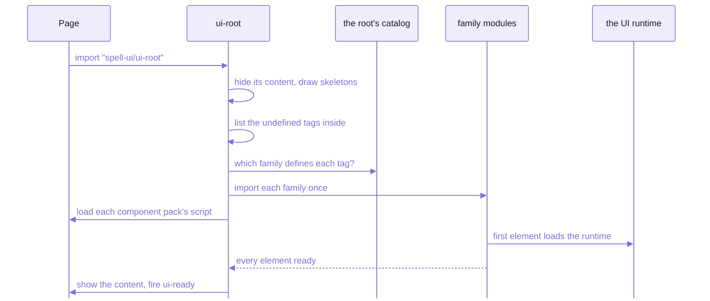

# Spell UI

**Beautiful, themeable, accessible components that load themselves on demand,
for use in plain HTML or any framework.**

Spell UI is a library of `<ui-*>` custom elements, about sixty families in all:
buttons, forms, dropdowns, cards, menus, modals, tables ...
You write the tags in your markup;  each one loads its own code the first time it appears on the page.

- Each element draws into a shadow root, with real, semantic markup inside:
  a `<button>`, a `<dialog>`, an `<input>`, never a `<div>` pretending to be one.
- Styled with today's CSS:
  cascade layers, OKLCH colour tokens that work in light and dark, anchor positioning, `<dialog>` and popover;
  no jQuery, no polyfills.
- Form controls are real form controls:  they join a `<form>`, validate and reset like native ones.
- Written on Solid 2 inside, but a plain custom element to your page:
  React, Vue, Svelte, Solid or no framework at all use it the same way.
- Themeable from CSS:  set a few tokens, or switch the whole look to one of 26 themes.

If you've used a component library like Material UI, Shoelace or Semantic UI, the difference is in the loading:
you don't import a component per tag, or a bundle of all of them.
You import ONE element, the root, and it does the rest.



_A page loads its elements:  one import up front;  everything else arrives the first time the page uses it._

<details>
<summary>The same nine steps, in words</summary>

1. The page imports only the root:  `import "spell-ui/ui-root"`, or a bundle that defines it.
2. `<ui-root>` connects.
   Unless `display="immediately"`, it hides what's inside with an inline style, before any stylesheet arrives.
   - It keeps its space (`when-ready`), or draws a loader (`loading`) or skeletons instead.
   - It hides only when scripts run (`@media (scripting: enabled)`):
     crawlers and readers without JavaScript see everything.
3. It lists the tags inside that aren't defined yet:  every `ui-*` tag, and every tag of a component pack.
4. With skeletons on (the default), it draws a grey placeholder for each tag whose vocabulary describes one
   (a button is `"inline 6 x 2.5"`), in its own shadow root:  the page's DOM is untouched.
5. For each tag it looks up the family in its catalog (generated from the vocabularies, never guessed from the name),
   and imports that family's module ONCE per page.
6. Each `<ui-components source="x.pack.js">` inside loads that pack's script once;
   the pack registers its prefix and catalog, so its tags load like the root's own.
7. The first element that connects loads the shared `UI` runtime, as ONE lazy chunk:
   keyboard, overlays, focus, styles, themes, icons ...
8. Ready means every family settled and every element inside resolved its `ready` promise, or the `timeout` passed.
   - Then the root gets `:state(ready)`, fires `ui-ready { failed }`, and shows the content, never hiding it again.
   - A tag that failed fires a cancelable `ui-error` and shows its plain fallback.
9. Content added later loads the same way, but is never hidden.

</details>

## Thirty seconds

Two ways in:  a plain HTML page with nothing to install, or a program you build.
In both, the root sees three tags and loads those three families (beside its own loader and skeletons), nothing else.

**In a plain HTML page**, the browser loads Spell UI from an npm CDN.
The import map gives it Solid, which Spell UI shares with your page.

```html
<!doctype html>
<html lang="en">
  <head>
    <meta charset="utf-8" />
    <script type="importmap">
      {
        "imports": {
          "spell-ui/": "https://cdn.jsdelivr.net/npm/spell-ui/dist/",
          "solid-js": "https://esm.sh/solid-js@2.0.0-rc.13",
          "@solidjs/web": "https://esm.sh/@solidjs/web@2.0.0-rc.13?external=solid-js"
        }
      }
    </script>
    <script type="module">
      import "spell-ui/ui-root.js"
    </script>
  </head>
  <body>
    <ui-root>
      <ui-segment>
        <ui-header>Report</ui-header>
        <ui-button primary icon="check">Save</ui-button>
      </ui-segment>
    </ui-root>
  </body>
</html>
```

**In a program** built with Vite (or any bundler):

```sh
npm install spell-ui solid-js@2.0.0-rc.13 @solidjs/web@2.0.0-rc.13
```

```js
// main.js
import "spell-ui/ui-root"
```

Then the same `<ui-root>` markup in your page or your components' templates.

<details>
<summary>Until Spell UI is on npm:  the kit checkout stands in</summary>

Spell UI isn't published yet, so the two recipes above don't run today.
Until it is, build it in the kit:

```sh
cd ~/www/spell             # the kit, with spell-ui cloned inside it ("Install", below)
cd spell-ui
yarn build                 # the library into dist/:  one module per family, plus core, forms, styles
yarn vendor                # ONE copy of Solid, for import-map pages, into vendor/
```

- Point the import map's `"spell-ui/"` at that `dist/` folder, served by any static server.
  Point Solid at the copy `yarn vendor` writes:

  ```json
  { "imports": { "spell-ui/": "/dist/", "solid-js": "/vendor/solid-js.js", "@solidjs/web": "/vendor/@solidjs/web.js" } }
  ```

  The page above, so changed, gets ready with no errors.
  Beside the root's own, it loads `ui-segment.js`, `ui-parts.js` and `ui-button.js`.
- The framework smoke pages do exactly that, with ONE vendored copy of Solid:
  [README-frameworks.md](README-frameworks.md).
- Or skip the build:  `yarn dev` serves every example from source, with hot reload ("Working on it", below).

</details>

## `<ui-root>`

The root is the top of a page or an app:
everything inside it loads on demand, takes its theme and size, and shows once it's ready.
A page usually has one, around everything;  an app's shell can be one.

```html
<ui-root theme="dark" size="small" icons="fa7-brands" loading="Loading reports…">
  <ui-segment>
    <ui-header>Report</ui-header>
    <ui-button primary>Save</ui-button>
  </ui-segment>
</ui-root>
```

| Attribute | What it does |
| --- | --- |
| `display` | what shows while loading:  `skeleton` (the default), `when-ready` (nothing, space kept), `immediately` |
| `loading` | a loader with this message while loading |
| `timeout` | the longest wait before showing anyway:  `5s` by default |
| `theme` | `light` or `dark`, for everything inside |
| `size` | `mini` ... `massive`, for everything inside |
| `icons` | icon packs for everything inside:  `fa7-free` (the default), `fa7-brands`, `fomantic`, or a pack's URL |
| `emoji` | emoji names:  `cldr` (the default) or `fomantic` |
| `width`, `height`, `fixed` | make the root a box that scrolls its own content, or a full-page app shell |
| `stack-with` | what stacking layouts measure:  each element's own width, or the page's |

- Events:
  - `ui-ready`, once everything's in:  its `detail.failed` lists what didn't load
  - `ui-error`, cancelable, per tag or pack that didn't
- A promise:  `root.settled` resolves once it's ready, with the failures.
  An outer root waits on an inner one.
- Roots nest:  an inner root inherits the outer one's settings, and changes only what it names.
- A subclass is a root too:  the Spell app's own `<spell-app>` element is one, loading its own tags the same way.
- Solid's context can't cross into a custom element, so a root carries your app's data instead:
  `root.appContext = value`, read by every component inside.

<details>
<summary>Every attribute, its values, events, parts and states</summary>

| Attribute | Values | What it does |
| --- | --- | --- |
| `display` | `skeleton` (default), `when-ready`, `immediately` | `skeleton`:  a placeholder per component that describes one, then the content;  `when-ready`:  nothing, space kept, until everything is ready;  `immediately`:  draw as things arrive |
| `loading` | a message, or bare | a `<ui-loader>` with this message while components load (bare:  the default text);  not with `immediately` |
| `timeout` | `5s` (default), `500ms`, or milliseconds | the longest wait before showing the content anyway;  a component that didn't load fires `ui-error` and shows its native fallback |
| `theme` | `light`, `dark` | colour scheme of everything inside |
| `size` | `mini`, `tiny`, `small`, `medium`, `large`, `big`, `huge`, `massive` | size of everything inside |
| `stack-with` | `container`, `page` | what stacking layouts inside measure (`stackable`, `doubling` ...):  each element's own width, or the screen's as in Fomantic;  sets `--ui-stack-with`;  an element's own `stack-with` wins |
| `width` | a CSS length, or `window` | with a width or height the root is a box that scrolls its own content, in a region named by its `aria-label` |
| `height` | a CSS length, or `window` | `window` follows a phone's address bar |
| `fixed` | boolean | fills the viewport and stays there:  the page never scrolls, the root does;  on iOS the keyboard can cover fields near the bottom |
| `icons` | comma-separated ids or URLs | icon packs for everything inside:  `fa7-free`, `fa7-brands`, `fomantic`, or `pack.js` URLs, later wins;  added over the outer root's |
| `emoji` | `cldr` (default), `fomantic` | emoji names for everything inside |
| `assets` | a folder | where the built-in icon packs load from, relative to the page;  default beside the library |
| `disabled`, `visible`, `animation` | | the states every element shares ([README-runtime.md](README-runtime.md)) |

- Events:
  - `ui-ready`:  `{ failed: [{ tag, reason: "unknown" | "failed" | "timeout", error?, source? }] }`
  - `ui-error`:  one of those, per tag;  cancel it to skip the console warning
    - a pack that didn't load:  `tag: "ui-components"`, with its `source`
- Parts:  `loading` (the loader), `skeleton` (the placeholders' box), `scroller` (the scrolling region of a box root).
- States:  `:state(loading)`, `:state(ready)`, `:state(light)`, `:state(dark)`, `:state(box)`, `:state(fixed)`.
- Swappable looks:  `UIRoot.Loading = MyLoading`, `UIRoot.Skeleton = MySkeleton`.
- The live page, with every example:  [`<ui-root>`'s docs page](docs/ui-root.html).

</details>

## Component packs

A component pack is ANOTHER package's custom elements, loaded by the root exactly like Spell UI's own.
Name the pack once inside the root;  its tags then load on first use.

```html
<ui-root>
  <ui-components source="/_epic/pack/epics.pack.js"></ui-components>
  <epic-page>...</epic-page>
</ui-root>
```

- A pack has its own tag prefix (`epic-`, `brand-`, `x-`), never `ui-`.
- It's ONE classic script, so it even works from a page opened as a file.
- It doesn't carry its own Solid or Spell UI:  it takes the page's.
  So there is ONE Solid per page, and the pack's elements are built on the same base as Spell UI's.
  - That's why a page that loads packs first loads a Spell UI bundle that offers them (`window.SpellUI`):
    the docs site's bundle, or the epic pages' single-file bundle.
- A pack that fails or times out logs an error naming its `source`, and the root still gets ready.
- The packs today:
  - spell-epic's `epics` pack (`<epic-*>`):  the elements of every epic page
  - spell-brand's `brand` pack (`<brand-*>`)
- A pack's elements are written exactly like a Spell UI family;  how one is built (`spell pack build`):
  the kit's [README-element.md](../README-element.md#packs-and-ui-root), "Packs and `<ui-root>`".

## Page-level CSS

Each element draws in a shadow root, so your page's selectors can't reach inside it.
Four doors are open on purpose, and together they restyle anything.

| Door | Reaches | Example |
| --- | --- | --- |
| tokens (`--ui-*`) | every component:  custom properties inherit into shadow roots | `:root { --ui-primary: oklch(55% 0.2 290); }` |
| utility classes | your markup, and inside components | `ui-stack`, `ui-bold`, `ui-text-truncate`, `ui-gap-m` |
| `::part()` | a component's named inner boxes | `ui-button::part(button) { border-radius: 0; }` |
| the app stylesheet | component internals, in Fomantic's class grammar | `<style id="ui-app-stylesheet">.ui.button { ... }</style>` |

- The layers, in order:  `ui.reset, ui.tokens, ui.base, ui.components, ui.utilities, ui.theme, ui.app`.
  Later layers win whatever the specificity.
- An unlayered page stylesheet always wins:  your plain CSS beats the library, with no `!important`.
- Each component has public tokens of its own, `--ui-<tag>-*`:  `ui-button.wide { --ui-button-padding-inline: 3em; }`.
  Its docs page's Theming tab lists them.

Two real examples, from the theming page:

```css
/* sitewide defaults:  a pink primary, a grey secondary, a red of your own in each scheme */
@layer ui.app {
  :root {
    --ui-primary: var(--ui-pink);
    --ui-primary-inverted: var(--ui-pink-inverted);
    --ui-secondary: var(--ui-grey);
    --ui-red-on-light: oklch(0.58 0.22 20);
    --ui-red-on-dark: oklch(0.72 0.17 20);
  }
}
```

```css
/* the app stylesheet, <style id="ui-app-stylesheet">:  pill-shaped primary buttons, everywhere */
@layer ui.app {
  .ui.primary.button {
    border-radius: var(--ui-radius-pill);
  }
}
```

Themes, dark mode and the four recipes:  [README-themes.md](README-themes.md).

## The families

About sixty families, in Fomantic UI's four groups, plus a few of Spell UI's own.

- Every family, with a picture and a line each:  [README-components.md](README-components.md)
- Every example, live:  [the docs site's component index](docs/components.html)

| Group | The tags |
| --- | --- |
| Elements | `<ui-button>`, `<ui-container>`, `<ui-divider>`, `<ui-emoji>`, `<ui-flag>`, `<ui-icon>`, `<ui-image>`, `<ui-input>`, `<ui-textarea>`, `<ui-label>`, `<ui-list>`, `<ui-loader>`, `<ui-placeholder>`, `<ui-rail>`, `<ui-reveal>`, `<ui-segment>`, `<ui-step>`, `<ui-text>` |
| Collections | `<ui-breadcrumb>`, `<ui-form>` and `<ui-field>`, `<ui-grid>`, `<ui-menu>`, `<ui-message>`, `<ui-table>`, `<ui-property-editor>` |
| Views | `<ui-ad>`, `<ui-card>`, `<ui-comment>`, `<ui-feed>`, `<ui-item>` and `<ui-items>`, `<ui-statistic>`, `<ui-tree-diagram>` |
| Modules | `<ui-accordion>`, `<ui-calendar>`, `<ui-checkbox>` and `<ui-radio>`, `<ui-dimmer>`, `<ui-dropdown>`, `<ui-embed>`, `<ui-flyout>`, `<ui-modal>`, `<ui-nag>`, `<ui-popup>`, `<ui-progress>`, `<ui-rating>`, `<ui-search>`, `<ui-select>`, `<ui-shape>`, `<ui-sidebar>`, `<ui-slider>`, `<ui-sticky>`, `<ui-tab>`, `<ui-toast>`, `<ui-transition>`, `<ui-visibility>`, `<ui-components>`, `<ui-include>` |
| Content parts | `<ui-header>`, `<ui-content>`, `<ui-meta>`, `<ui-description>`, `<ui-extra>`, `<ui-actions>` ...:  one set for every owner, each styled by what it's in |
| Spell UI's own | `<ui-root>`, `<ui-section>`, `<ui-code>`, `<ui-markdown>`, `<ui-panel>` |

## From a framework

Every element keeps the same three rules, which is what makes it work everywhere:

- primitives are ATTRIBUTES:  `<ui-dropdown placeholder="Fruit" open>`
- rich data is a PROPERTY:  `dropdown.options = [...]`
- events are `ui-*` `CustomEvent`s with their state in `detail`:  `ui-change` → `event.detail.value`

The recipe for each framework, matched to pages that run in a headless browser:
[README-frameworks.md](README-frameworks.md).

## Other ways to load

The root is the usual way;  these are the others, each a real entry of the package.

| How | What |
| --- | --- |
| `import "spell-ui"` | everything:  defines every family at once |
| `import "spell-ui/ui-button"` | one family:  each is its own entry, so a page carries only what it imports;  `spell-ui/components/ui-button` too, the name the Spell repos import it by |
| `import "spell-ui/ui-root"` | on demand:  the root loads the rest (this page's way, and the docs site's) |
| `spell-ui/styles/ui.css` | no JavaScript at all:  tokens, utilities, typography and plain-HTML styling as one stylesheet;  `class="ui-typography"` on `<body>` for Fomantic's page typography |
| the static render | `ui-*` pages turned into plain HTML in node, for search engines and readers without JavaScript:  `spell ssr <pages>`, [README-runtime.md](README-runtime.md) |

## Install

Spell UI lives in the kit, the one checkout every Spell repo works in.
Setting the kit up from zero (Node 24, yarn, the clone) is on [the kit's front page](../README.md).

```sh
cd ~/www/spell             # the kit
yarn clone spell-ui        # clones spell-ui and what it needs, then the one install
```

When it's already there, `yarn clone` says so:

```text
every repo asked for is cloned:  spell-ui
```

- `yarn install` runs in the kit, never here:  the kit holds the one install for every repo.
- Spell UI needs only the kit;  the repos above it (the brand, the epics, the app) need Spell UI.

## 🌱 Coming:  `npm install spell-ui`

Spell UI will be on npm:  `npm install spell-ui`, with Solid 2 as a peer, so any project can use it without the kit.
The package is already shaped for it (its published entries point at the built `dist/`);  it isn't published yet.

## Working on it

From `spell-ui/`, inside the kit:

```sh
yarn dev           # every example, class grammar beside elements, with hot reload
yarn review        # the finishing pass:  types, lint, format, every test
yarn test          # the tests, in a real browser (and node, for the static render)
yarn test:visual   # screenshot tests of every example, light and dark
yarn site:build    # the docs site's data, index, kitchen sink and bundle
```

- The docs site, its scripts, the tools (measure, smoke, visual tests) and Spell UI's `spell` commands:
  [README-site.md](README-site.md).
- The rules for working here (house style, how a component is written, imports, the lint guard):
  [AGENTS.md](AGENTS.md).
- The element framework every family is written on, the kit's:  [README-element.md](../README-element.md).

<details>
<summary>Every yarn script, one line each</summary>

| Script | What it does |
| --- | --- |
| `yarn dev` | the demo (`src/tools/demo/`):  every example, class grammar beside elements, hot reload |
| `yarn build` | type check, then the library into `dist/` |
| `yarn preview` | serves the built library |
| `yarn clean` | deletes the caches and built folders |
| `yarn review` | `ts`, `lint:fix`, `format`, `test`:  MUST pass before work is handed back |
| `yarn ts` | the declarations below and here, then every type check |
| `yarn lint` / `lint:fix` | oxlint, warnings fail;  `:fix` fixes what it can |
| `yarn format` / `format:check` | oxfmt;  `:check` only checks |
| `yarn test` | the `ssr` project (node), then `browser` (chromium) |
| `yarn test:watch` / `test:ui` | Vitest watching, or its UI |
| `yarn test:all` | the browser tests in chromium, firefox and webkit (`yarn test:browsers` once first) |
| `yarn test:visual` / `test:visual:update` | screenshot tests of every element example, light and dark;  `:update` writes new baselines |
| `yarn test:hmr` | hot reload, end to end:  a dev server, a browser and real file edits |
| `yarn test:browsers` | installs Playwright's chromium, firefox and webkit |
| `yarn vendor`, `measure`, `smoke`, `report` | the package tools:  vendored peers, bundle sizes, the framework pages, the report tables ([README-site.md](README-site.md)) |
| `yarn serve` | serves `dist/`, `vendor/` and `src/` for the import-map pages |
| `yarn icons:pack <folder> --id <id>` | checks a folder of SVGs and writes its icon pack |
| `yarn screenshots [families]` | one PNG per example pair of the demo, for a quick look |
| `yarn site:dev`, `site:data`, `site:index`, `site:kitchen`, `site:bundle`, `site:build`, `site:new`, `site:sections`, `site:check` | the docs site ([README-site.md](README-site.md)) |
| `yarn readme:components` | the catalogue in [README-components.md](README-components.md) |
| `yarn gen:styles`, `gen:icons`, `gen:emoji`, `gen:root` | the generated files:  token sheets, icon packs, emoji data, the root's catalog |
| `yarn tokens:alias <family> [--write]` | the codemod that gives a family's sheet private aliases for its public tokens |
| `yarn design:build` | the claude.ai design system's files, from the vocabularies and the theme |
| `yarn manifest` | the custom-elements manifest, from the source |

</details>

<details>
<summary>The files</summary>

| Path | What |
| --- | --- |
| [`src/index.ts`](src/index.ts) | `spell-ui`:  defines every family (a side effect) and re-exports them, plus the shared constants, the runtime, styles and icons |
| [`src/core.ts`](src/core.ts) | `spell-ui/core`, the `E` namespace:  the element core and the foundation every family needs, in ONE chunk |
| [`src/forms.ts`](src/forms.ts) | `spell-ui/forms`, the `F` namespace:  what only form controls need (`FormComponent`, `Validator`, `MenuOptions` ...) |
| [`src/api.ts`](src/api.ts) | `spell-ui/api`:  `E`, `F`, and the vocabulary layer as `V` |
| [`src/elements/`](src/elements/) | Spell UI's half of the element core:  `ClassBuilder`, `NativeFallback`, `LoadableComponent`, `PartComponent`, `SpellUISettings` ... |
| *(none:  the kit's [`element/`](../src/element/))* | the element bases every set shares:  `UIComponent`, `DOMElement`, the reactive decorators, `Cell`, `PartContext` ... |
| [`src/components/`](src/components/) | one folder per component FAMILY (`ui-button/`):  components, vocabularies, sheet, fallback, examples;  `components.types.ts` (`UIT`), `ComponentDefinitions.ts` (every tag's vocabulary, rolled up) |
| [`src/docs-components/`](src/docs-components/) | the docs site's own `<ui-docs-*>` families:  laid out like components, never in the library's entries |
| [`src/runtime/`](src/runtime/) | the `UI` runtime:  one instance per page, its services as classes (`Keyboard`, `Overlays`, `Focus` ...) |
| [`src/vocabulary/`](src/vocabulary/) | the naming layer:  value sets, `Vocabulary` (translated names), `Converters` |
| [`src/styles/`](src/styles/) | layers, tokens, colours, sizes, reset, typography, utilities, themes;  `tokens.css`, `colors.css`, `sizes.css` are GENERATED (`yarn gen:styles`) |
| [`src/icons/`](src/icons/) | the icon pack format, and the built-in packs (`icon-packs/`, GENERATED by `yarn gen:icons`) |
| [`src/util/`](src/util/) | the kit's generic helpers and its element's timing helpers, re-exported, plus `Warnings` |
| [`src/static/`](src/static/) | the static render (`SSR`, node only):  `ui-*` markup to plain HTML |
| *(none:  spell-app's [`<spell-code>`](../spell-app/src/app/components/spell-code/))* | spell's own highlighter, which Spell UI no longer ships |
| [`src/test-helpers/`](src/test-helpers/) | Spell UI's own test helpers (`Sheets`, `ThemeHarness`, `MemberClashes` ...);  the generic ones (`Fixture`, `ElementFixture`, `A11y`, `Viewport`) are the kit's, `spell-kit/test-helpers/...` |
| [`tests/`](tests/) | every test, at the same path as the code it tests |
| [`src/tools/`](src/tools/) | node tooling, as classes:  measure, vendor, smoke, report, site data and checks, the design export, the visual tests ([README-site.md](README-site.md)) |
| [`src/cli/`](src/cli/) | Spell UI's `spell` commands (`spell icon`, `ssr`, `pack`, `design`):  their list, `commands.ts`, and their code ([README-site.md](README-site.md#spell-uis-spell-commands)) |
| [`scripts/`](scripts/) | one file per yarn script, named for it (`site:data` → `site-data.ts`);  what they share is in `src/tools/` |
| [`tsconfig.json`](tsconfig.json), [`tsconfig.node.json`](tsconfig.node.json) | the browser code's TypeScript settings, and the node code's (`src/tools/`, `src/cli/`, `scripts/`, the configs):  no aliases, every file by its package name |
| `results/` | what the tools write (git-ignored) |
| [`docs/`](docs/) | the docs site's PAGES, a component set served at `/components/ui/`:  `*.html`, `__parts/`, `__data/` |
| [`site/`](site/) | the docs site's BUILD:  the bundle's entry (`_src/`) and the bundle (`_assets/`, git-ignored) |

</details>

<details>
<summary>The DRY rule (one of each)</summary>

If you find yourself writing a second copy of any of these, stop and reuse.

- One element base, the kit's `E.UIComponent`:  a component per element, its `render()` returning JSX.
  - `F.FormComponent`, for a control with a value.
- One vocabulary per tag (`UI<Name>.en.ts`):  every attribute, value, event, slot, part and text string the tag uses.
  - NEVER a string literal for one in a template.
- One class grammar builder:  `E.ClassBuilder` (`ui small primary button`).
- One home for constants several families share:  `UIT` ([the shared types](src/components/components.types.ts)).
  - Key names are `UIT.Key`.
- One way to warn:  `E.Warnings.warn()` / `devWarn()`.
  Each prints `[spell-ui] <source>:  ...`.
- One runtime per page:  `UI` (`UI.keyboard`, `UI.overlays`, `UI.focus`, `UI.transitions`, `UI.ids`, `UI.toasts`,
  `UI.modals`, `UI.icons`, `UI.sources`, `UI.themes` ...).
- One generic CSS rule set per hue and size, switched by token remap (`--ui-color`, `--ui-scale`).
  - Breakpoints from [the media sheet](src/styles/media.css).
- One DOM climb across shadow roots, the kit's util's `flatParentFor()` and `closestAcrossShadow()`.
- Tooling:
  - ONE reader of environment variables:  [`environment`](src/tools/environment.ts)
  - ONE printer:  the kit's [`Terminal`](../src/element-tools/Terminal.ts) (`spell-kit/element-tools/Terminal`)
  - ONE dependency finder:  the kit's [`NodePackage`](../src/element-tools/NodePackage.ts)
  - ONE write-or-`--check` for generated files:  [`generatedFiles`](src/tools/generatedFiles.ts)

</details>

<details>
<summary>Environment variables</summary>

Read ONLY in [`environment`](src/tools/environment.ts):  by the tools, the scripts and the configs.

| Variable | Read as | What |
| --- | --- | --- |
| `SPELL_UI_TEST_ALL` | `environment.isAllBrowsers` | run the `browser` tests in chromium, firefox AND webkit;  set by `yarn test:all` |
| `SPELL_UI_SOLID_PROD` | `environment.isSolidProduction` | Solid's production runtime under `vite dev`, for timing `src/tools/demo/perf.html`;  set by hand |
| `SPELL_UI_FA_PACKAGE_DIR` | `environment.fontAwesomeDir` | an extracted Font Awesome package for `yarn gen:icons`, instead of downloading one |
| `SPELL_UI_VISUAL_OS`, `_BASE_URL`, `_WS`, `_PARITY`, `_STATIC`, `_WORKERS` | `environment.visual` | `yarn test:visual`'s choices, set by `VisualRunner` for Playwright's workers (`VisualVariables`) |
| `CI` | `environment.isCI` | set by the CI service:  tests skip their timing budgets |
| `INIT_CWD` | `environment.invocationDir` | set by yarn:  the folder a relative path argument is resolved against |

</details>

<details>
<summary>Adding a new family, step by step</summary>

1. Make the folder, `ui-<name>/` in [the components folder](src/components/), laid out like `ui-button/`
   ([README-components.md](README-components.md), "How a family is laid out").
2. Write one vocabulary per tag, `UI<Name>.en.ts`, its topics and other names included:
   - `topics`:  2+ ids from `ValueSets.topics`
   - `aka`:  other libraries' names
   - [The component definitions test](tests/components/ComponentDefinitions.test.ts) fails on a tag without them.
3. Make it a library entry:
   - `COMPONENTS` in [vite.config.ts](vite.config.ts)
   - in [package.json](package.json):  its barrel's own key in `exports` (`"./components/ui-<name>"`;
     [the package exports test](tests/tools/PackageExports.test.ts) fails without it), its short published name in
     `publishConfig.exports` (`"./ui-<name>"`), and its `dist/` file in `sideEffects`
   - re-export it from [the package's entry](src/index.ts)
4. `yarn gen:root`:  the root's catalog of tag → family.
   [Its test](tests/components/ui-root/UIRoot.catalog.test.ts) fails while it's stale.
5. `yarn site:data`:  the docs site's data.
   [Its test](tests/tools/SiteDataBuilder.test.ts) fails while it's stale.
   - Add the family's facts to [the pages data](docs/__data/pages.json5).
6. `yarn site:new <tag>`:  its docs page, from the template.
   Then `yarn site:build`, and `yarn site:check <tag>`.
7. `yarn readme:components`:  its row in the catalogue.

</details>

<details>
<summary>Deferred</summary>

- [The `site:sections` script](scripts/site-sections.ts) is two things:
  the command of that name, and the `SiteSections` converter three other scripts import.
  - Its class should move to a file of its own,
    but the name `SiteSections` is taken by the browser side, [the site's own](site/_src/SiteSections.ts).
- A fresh checkout can't run `gen:icons` and `gen:emoji`.
  - Both need the git-ignored clone of Fomantic UI, `reference/Fomantic-UI/`.
  - `gen:icons` needs the network too.

</details>

<details>
<summary>Sizes and budgets</summary>

- An average family is 7.3 kB of its own code, gzipped;  the budget is 8 kB.
- The shared runtime, loaded once per page on first use:  31 kB.
- `<ui-root>` alone, the one import a page makes:  8.1 kB minified and gzipped.
- `yarn measure` checks them, and fails a family that leaks into another's chunk ([README-site.md](README-site.md)).

</details>

<details>
<summary>The browser features it assumes</summary>

Spell UI assumes a current browser, with no polyfills:

- anchor positioning (popups, dropdowns)
- the popover attribute and `<dialog>`
- container style queries
- form-associated custom elements (`ElementInternals`), and custom states (`:state()`)
- cascade layers, OKLCH and `light-dark()` colours
- Where Safari still has gaps, the runtime's `UI.browser.supports` flags them,
  and the element takes another way (invoker commands, for one).

</details>

## Where it comes from

Spell UI keeps Semantic UI's and Fomantic UI's vocabulary, written as attributes on `ui-*` tags:

- the descriptive class grammar (`ui small primary basic button`)
- the Types / Content / States / Variations taxonomy
- the component names

Each family's CSS is a port of Fomantic UI 2.9.4's, kept inside the shadow root.

- Why:  Fomantic has the best vocabulary of any widget set,
  but it's LESS and jQuery with thin accessibility,
  and it predates cascade layers, anchor positioning, `<dialog>` and popover, and form-associated elements.
- Coming from Semantic UI, Fomantic UI or Semantic UI React:  [README-migrating.md](README-migrating.md).

<details>
<summary>More in the docs site</summary>

These guides are served by the page server from the content folder,
so they need a checkout with the content folder and the page server running:
[README-site.md](README-site.md), "Viewing it".

- Custom Elements in Spell:  `/guides/custom-elements/custom-elements.html`
- UI Component Creation:  `/guides/ui-component-creation.html`
- The Spell UI docs site:  `/guides/spell-ui-site.html`
- Spell UI's design notes (plan, grammar, theming, translation, icons, fallback, runtime, status, report):
  `/guides/ui/notes/`

</details>

## See also

- [README-components.md](README-components.md):  every family, with pictures
- [README-runtime.md](README-runtime.md):  what's under the elements:
  the runtime, vocabularies, icons, styles, the static render
- [README-themes.md](README-themes.md):  theming
- [README-frameworks.md](README-frameworks.md):  from plain JavaScript, React, Svelte, Solid and Vue
- [README-migrating.md](README-migrating.md):  from Semantic UI, Fomantic UI or Semantic UI React
- [README-site.md](README-site.md):  the docs site and the tools
- [AGENTS.md](AGENTS.md):  the rules for working here
- [The kit's front page](../README.md), and its [element framework](../README-element.md)
